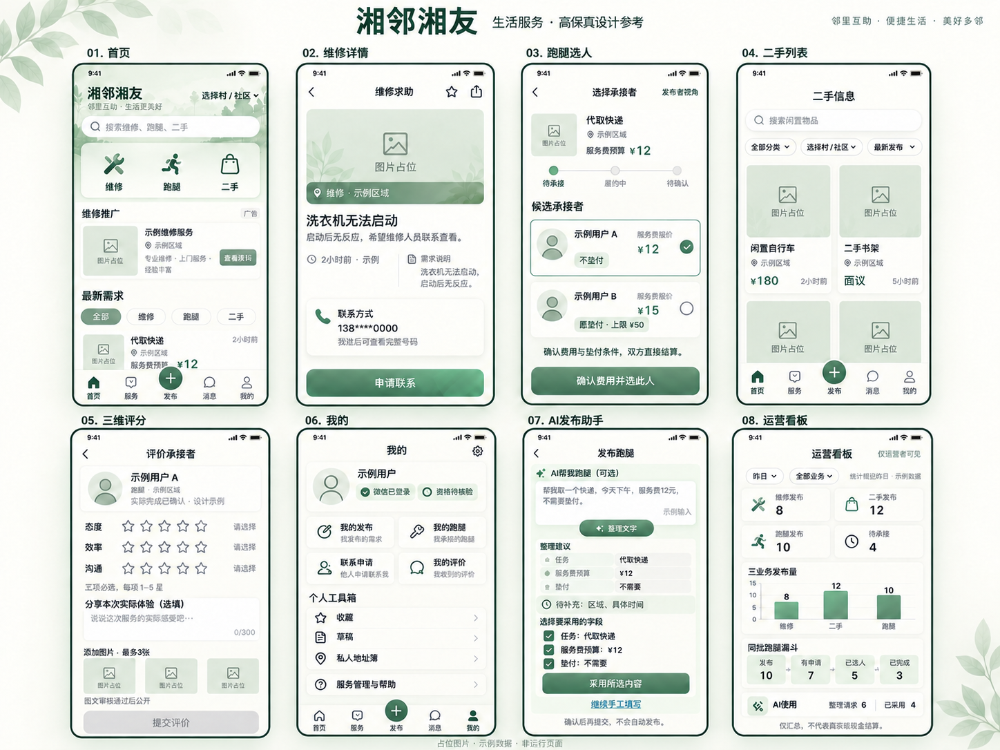

# 湘邻湘友 · 八页高保真原型参考

日期：2026-10-09。依据：[design.md](../../../design.md)、[PRD](../../../docs/prd.md)及当前已采用的[视觉基准](../v2/overview-before-spacing.png)。

## 最终图片

八个页面按四列、两行排列：首页、维修详情、跑腿选人、二手列表、三维评分、我的、AI发布助手、运营看板。最终PNG尺寸为1448×1086，供整体风格与页面关系评审；尺寸由生成结果读取，不等于单个页面的实现尺寸。

本次按用户要求将照片改为带“图片占位”标记的占位面板，头像使用通用人物图标。保留柔和绿、浅米白、深炭绿的视觉方向、清晰分区、小圆角、绿色渐变和轻玻璃层次。价格、人物与统计为示例；原型不包含真实用户资料。

未替换已采用的UI v2图片、采用记录、设计变量、SVG或其他旧文档。这个文件夹独立保存本轮新图，当前状态为设计参考，未被写成新的正式采用决定。

## 检查记录

- 八页及底部操作区域全部可见；照片和头像使用占位内容。
- 联系电话打码，跑腿页保留费用与垫付分组及“双方直接结算”说明。
- 三维评分每行五颗空心星，提交处于未填写状态；微信登录与待核验资格分别表达。
- AI页面为发布表单中的文字整理建议，采用后仍须确认提交；运营看板仅运营者可见，数字与图表使用一致示例值。
- 修正初稿中的额外红色、橙色和紫色强调，以及未提供的候选人历史完成单量；保留修正前图片便于追溯。
- PNG格式、尺寸、内容指纹、八页范围、占位要求及旧采用图指纹由新增测试验证；自动测试不代替文字和视觉检查。

生成图片内个别中文小字仍需要在真实开发时按PRD精确排版。色彩包含透明混合和抗锯齿，不能将位图理解为只有三种RGB值；这是一张静态高保真图片，不代表页面已实现、业务状态已运行或完成上线验收。

## 文件与生成方式

使用内置imagegen生成并作两次针对性修正，原始输出复制到本项目内保存。

- [最终总览图](overview.png)
- [初稿](overview-initial.png)
- [配色与内容修正版](overview-colour-corrected.png)
- [完整生成提示词](generation-prompt.txt)
- [配色与内容修正提示词](refinement-prompt.txt)
- [最终文字与状态修正提示词](final-correction-prompt.txt)
- [文件清单与验证记录](manifest.json)
- [相关测试](../../../tests/design-reference-prototype.test.cjs)
