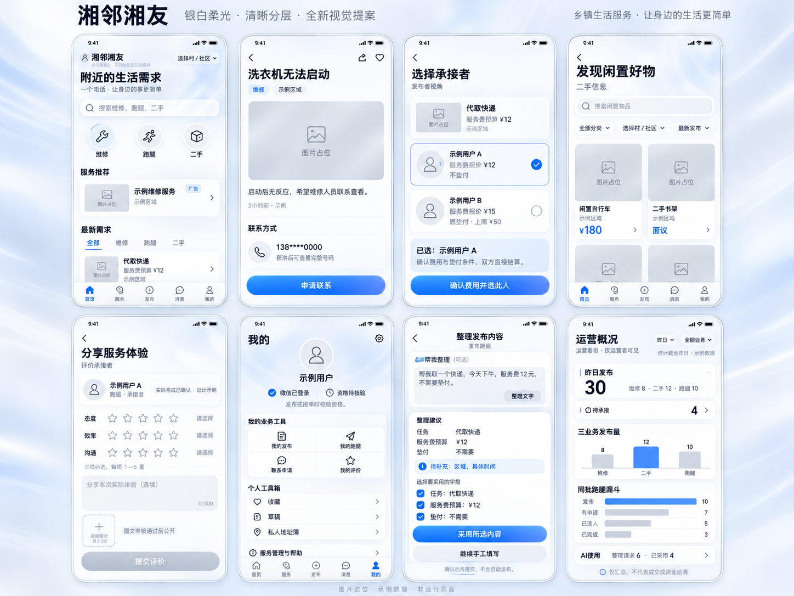

# 湘邻湘友 · Redbook 全新视觉提案

日期：2026-10-09。

## 本轮依据

用户最新要求：不参考之前的UI设计，根据redbook提炼的设计思路重新绘制，不与旧版相同。

本轮沿用[design.md](../../../design.md)中从参考材料提炼的信息分组、留白、重点表达和轻材质层次；其中对旧绿色UI基准的继承规则，不用于本轮新图。依据最新指示重新设计色彩、形状与构图，原文档保留原样。

视觉依据来自本地已核实的14张图片、3份文字：[机票组](../../../redbook/post01/)、[银灰财务组](../../../redbook/post02/)、[B端看板组](../../../redbook/post03/)。项目页面与业务表达仍按[PRD](../../../docs/prd.md)组织，不将参考图中的金融交易、自由聊天或桌面导航变成项目功能。

## 重新提炼的方向

- 航空参考：信息按任务分组，局部蓝色突出当前操作；详情先讲清对象，再展示补充信息。
- 财务参考：银白柔光、通透表面、统一圆角和轻悬浮层次，阅读前景保持清晰。
- 看板参考：中性基底承载数据，指标与筛选靠近，图表简洁且数值关系一致。

最终采用银白与浅灰为基底、深色文字、局部蓝色强调。色彩与组件形状属于本轮视觉提案，不声称从原图精确测得。去掉旧版绿色、叶片与乡村装饰，重新组织首页、详情、个人资料和运营看板。

## 新版与上版的可见差异

| 部分 | 本轮重绘 |
| --- | --- |
| 首页 | 编辑式标题、独立圆形分类入口、下划线分类与轻推荐卡 |
| 详情 | 大标题先于占位图，联系信息作为独立阅读区 |
| 跑腿选人 | 任务摘要、候选报价与已选摘要，无旧版三步进度图 |
| 导航 | 五项等权入口，活动项蓝色强调，发布入口融入导航 |
| 我的 | 居中头像与状态、统一工具分区、开放列表 |
| 运营看板 | 发布总量、横向指标、三业务柱形图与条形漏斗 |

## 交付与核对

最终图片为1448×1086，包含首页、维修详情、跑腿选人、二手列表、三维评分、我的、AI发布助手和运营看板。图片及头像为占位内容，统计、价格和人物为示例；保留广告标识、联系方式打码、双方直接结算、未预选评分、AI确认后提交和运营者专用提示。

已目视核对八页范围、占位内容及新旧构图差异。新增测试检查来源指纹、图片格式与尺寸、独立路径及错误状态反例。它是静态高保真图片，未实现页面或验证真实业务；生成的小字在实际开发时需按PRD精确排版。

使用内置imagegen从完整文字提示生成新图，没有传入旧原型作为参考或编辑目标。旧文档、旧原型、原采用记录和redbook素材均未修改。本提案尚未被记录为正式采用版。

- [最终图片](overview.png)
- [完整生成提示词](generation-prompt.txt)
- [来源与图片清单](manifest.json)
- [相关验证](../../../tests/redbook-redesign.test.cjs)
