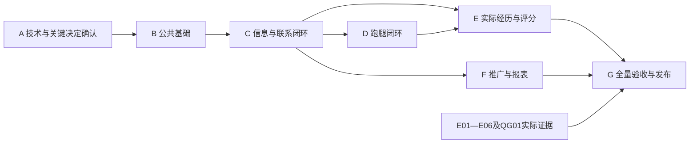

# 永兴乡镇生活服务小程序开发计划

版本：1.0

日期：2026-10-06（Asia/Shanghai）

需求基线：[PRD v1.3](prd.md)。设计基线：[结构化设计说明 v1.0](structured-design.md)、[已确认视觉设计 v2](ui-design-v2.md)及[采用记录](../assets/ui/approved-selection.json)。

当前状态：仓库只有需求、设计、资源和验证代码，没有产品代码。计划创建时用户确认“尚未选定，先列技术方案确认任务”。后续用户回复“采用”，已确认原生微信小程序＋TypeScript＋Node.js云函数＋CloudBase、云端计时补偿、小程序内两位独立同权运营账号，以及先本地/受控测试、采购前确认费用。已有AppID，当前个人主体；用户确认安装后，官方开发者工具已安装并通过本机验证，登录/AppID权限待查，云环境尚未开通。实际进度、未完成前置和外部证据见[技术执行记录](technical-decision.md)及[证据台账](external-evidence.md)；预算、经营资料和上线日期仍未确定。

本轮交付为开发计划及其文档验证。后续代码实现、安装、实际开户、采购、咨询发送、真实证件/支付和上线须有对应任务授权；E01—E06、QG01仍尚未核实通过。受控测试通过与真实服务接入通过分别记录。

## 1. 先确定验证方案

### 1.1 本计划如何验证

1. 对照 PRD 逐项检查 M01—M10、R01—R08、F01—F16、V01—V20、N01—N09、S01—S04及全部 T/RT 用例，确认没有遗漏已批准功能、恢复已撤销规则或增设业务。
2. 检查40项任务：编号唯一、依赖存在且无环，每项有执行内容、交付物和验收条件；关键决定与外部启用条件没有被写成已经通过。
3. 检查权限、金额、独立状态、计时、并发和失败场景；与 PRD 有差异时修改计划，不擅改 PRD。
4. 检查严格 UTF-8、Markdown 链接/表格/围栏及 Git 差异；运行新增[计划验证脚本](../tests/validate-development-plan.ps1)并回归现有结构化设计及视觉资源检查。
5. 通过后只提交本轮新增文件，保留原需求、资源与历史文件。文档检查不代表小程序功能或生产服务验证通过。

### 1.2 产品开发如何验证

| 验证层 | 方法 | 必须提供的证据 |
| --- | --- | --- |
| 规则与计算 | 控制服务端测试时钟；校验字段、金额、退款、评分均值、期限 | 输入、预期、实际结果及版本；不依赖等待7天或30天 |
| 服务端集成 | 多账号直接请求、真实存储读写、事件/任务处理；测试环境受控供应商替身 | 请求/响应、授权后的字段、状态版本、去重结果及审计记录 |
| 并发与故障 | 同时选两人/抢最后推广位；重复/迟到事件；请求成功后断网；任务中断重跑 | 最终唯一记录、容量、通知数、权益起点、修改次数和异常记录 |
| 小程序端到端 | 已选页面路径、权限视角、表单、错误恢复、分享和私密文件读取 | 操作步骤、截图/录屏、实际响应及附件访问结果 |
| 外部真实接入 | 根据实际官方文档和已获权限验证身份、手机号、检测、通知和支付 | 项目适用证据、环境、授权、供应商结果及失败处理；受控替身不能代替 |
| 发布与恢复 | 分环境配置、备份恢复、升级失败/回退、计时任务补偿 | 版本、备份点、恢复演练、数据一致性、启用条件和批准记录 |

每项开发任务先把对应 T/RT 场景拆成可观察的测试输入和预期，再实现并运行。普通规则用单元测试，跨用户权限、并发和版本用集成测试，用户路径用端到端及人工设备验收。测试框架、执行命令和支持设备清单在 DP01/DP05确定，当前不编造工具命令。

## 2. 执行规则与完成定义

### 2.1 如何领取和完成任务

1. 选取前置任务均完成的 DP 任务；确认本任务执行授权及需要的真实启用条件。依赖未完成时只准备资料，不提前实现依赖能力。
2. 阅读该任务列出的 PRD 字段/页面/规则和原始验收；若出现未定义的关键行为，提出具体问题，得到回复后继续相关工作。
3. 写明本次范围、测试输入、预期和回滚方式。不得借“实现细节”修改费用、身份、权限、人数、期限、审核或交易范围。
4. 实现一个可验收的结果；服务端规则、界面状态、相关通知和运营记录一起交付。页面按钮隐藏不能代替服务端拒绝。
5. 运行本任务测试与受影响回归，保存实际结果；尚无真实权限的用例标为“未启用/待真实接入”，不能写“生产通过”。
6. 审阅差异、通过检查，为本次改动创建对应 Git commit。一次改动跨多个关联文件可以同一提交；不得留下交付后无提交的修改。

任务状态统一为“未开始 / 资料准备中 / 待用户确认 / 待外部依据 / 执行中 / 待验收 / 已完成”。创建计划时40项均为未开始；后续实际状态见[技术执行记录](technical-decision.md)和[结构化决定](development-decisions.json)。DP01执行中，DP02/DP04资料准备中；其余未开始。技术方案获确认不代表 DP01所有交付已经完成。实际执行时记录负责人、提交、结果及阻塞原因。

### 2.2 每项任务的完成定义

- 交付物存在，符合 PRD，关联字段/页面/状态/权限齐全，没有靠静态假页面冒充可用功能。
- 对应自动测试、相关回归及必要人工验收通过；需要真实权限的功能必须另有实际验证，不以模拟成功代替。
- 重复请求不重复状态转换、通知、占位、计分、扣减修改机会或退款；失败可查、能恢复，不靠客户端自行判成功。
- 日志、响应、附件、分享和通知遵守最小必要信息规则；核验输入不进入普通日志或自有原证件存储。
- 业务与技术文档同步；有可追踪提交，工作区差异与交付范围相符；涉及迁移/发布有经过验证的回退方案。

## 3. 阶段、依赖与阶段验收

| 阶段 | 任务 | 可交付结果 | 进入下一阶段的条件 |
| --- | --- | --- | --- |
| A 开工前确认 | DP01—DP06 | 技术决策、真实启用清单、数据处理方案、剩余页面方案、团队与排期 | DP01技术方案明确确认；相关关键决策留痕；有后续开发任务授权 |
| B 公共基础 | DP07—DP12 | 工程/测试环境、字段与权限、账号资格、文件安全、消息计时、运营基础 | 身份失败不放行、未授权响应/附件不泄露、任务重跑幂等；受控环境与生产隔离 |
| C 信息与联系闭环 | DP13—DP19 | 维修/二手/目录、联系授权、搜索、历史、私人工具、分享 | 发布→发现→申请→批准→撤销/结束全路径通过；无多收住址或额外资格审批 |
| D 跑腿闭环 | DP20—DP24 | 多人报价、唯一选人、变更、支出、完成/取消/争议 | T06—T10通过；完成申请计时和异议竞态通过；平台不代收居民费用 |
| E 经历与双向评分 | DP25—DP29 | 实际经历、资格、数值、受控图文/回应、六角色汇总 | RT01—RT16通过；QG01未通过时真实启用保持关闭 |
| F 推广与报表 | DP30—DP35 | 先审后付、容量、真实权益、修改/退款、效果统计 | T11—T14及T17通过；真实付款须E04通过，受控验证单独记录 |
| G 全量验收与发布 | DP36—DP40 | 真正接入、全量回归、恢复与设备验收、运营交接、批准后试运营 | 全部适用条件有证据、无阻断缺陷、恢复通过、预算和指标确认、有上线授权 |

阶段表达业务验收顺序，不表示必须等E阶段全部结束才研究F阶段。C完成后，评分和推广可以分别按各自依赖推进；是否多人同时开发在 DP06确认。本轮不预设人员数量或实际并行分工。



## 4. 可领取的40项执行任务

“检查”为文档/决策验收；T/RT为原始产品行为验收。引用若列多个编号，全部执行，不能只挑正常场景。表内依赖为最低技术前置；生产启用另须对应E/QG条件和操作授权。

| 编号 | 阶段 | 任务与执行内容 | 前置任务 | 交付物 | 验收/检查 | 启用条件 |
| --- | --- | --- | --- | --- | --- | --- |
| DP01 | A | 技术方案确认：比较能满足事务、私密文件授权、可靠计时、幂等及真实微信接入的候选架构；查官方资料并列能力、成本、约束、维护和恢复方式；明确小程序前端、后端、数据库、存储、任务调度、测试与部署 | 无 | 经用户明确确认的技术决策；具体项目目录、依赖版本依据、环境准备及测试命令 | 检查：关键选择有依据与实际回复；未获权限和费用不写已开通；能支撑PRD并发及隐私约束 | E06；采购或安装另需对应授权 |
| DP02 | A | 外部证据清单：按E01/E02/E04/QG01整理主体、类目、材料、二要素/16—17岁、手机号/通知、安全检测、虚拟支付/iOS能力；明确证据来源、负责事项和受阻功能 | 无 | 项目适用证据台账；已有/缺失/待确认清单；可审阅咨询草稿 | 检查：文档存在不当成项目获权限；咨询草稿不当已发送；每项有解除条件 | E01、E02、E04、QG01；发送/注册另需授权 |
| DP03 | A | 数据方案确认：按字段列目的、来源、接收者、访问者、保存期限、删除触发、必要保留依据、供应商留存；覆盖去重标识、评价元数据、申诉证据和注销 | DP02 | 经确认的数据处理/隐私授权清单与删除规则；不保存原始完整姓名/身份证的方案 | 检查：具体期限有实际依据；未定项目明确受阻；原输入不进入日志/草稿/报表 | E03；真实个人信息处理前必须通过 |
| DP04 | A | 运营端与经营配置确认：明确后台承载形式、两运营者可追踪账号、设备/登录入口；取得真实乡镇/村社区、细分分类、模板和初始服务资料；明确白天/晚间交接 | DP02 | 用户确认的后台方案与真实配置清单；交接规则 | 检查：两人同权但操作归人；不编造地区/人员、不宣称24小时值守；无独立公众网站业务 | E05；后台形式须用户确认 |
| DP05 | A | 剩余页面与适配确认：依据已采用v2补齐未出图V页面、错误/空态/权限态；确认设备适配、单位、无图素材与服务图标映射；说明毛玻璃可用性及必要降级供确认 | DP01、DP04 | 页面状态清单、关键流程稿、适配和可访问性验收清单 | 检查：不采用overview.png候选替代已选图；保留既定布局；关键差异用户确认；字段/权限不删减 | 未批准视觉/布局变化先确认 |
| DP06 | A | 人员、预算和排期确认：收集开发/测试投入、每周可投入时间、实际账号/服务/设备条件；按任务依赖与已确认技术估算工时范围、审核等待和风险缓冲，确认阶段日期 | DP01、DP02、DP03、DP04、DP05 | 负责人表、工时依据、资源预算、阶段日期和风险清单 | 检查：未经资料不能承诺总天数/费用；外部等待与开发工时分开；用户明确确认 | E05；关键预算及日期须确认 |
| DP07 | B | 工程与测试环境：按DP01建立项目、版本锁定、质量检查及测试运行入口；隔离本地/测试/生产配置；配置敏感凭据读取和受控测试替身 | DP01、DP03、DP04 | 可启动工程、环境说明、自动检查、测试夹具；测试数据明确为合成示例 | 检查：干净环境能复现；无密钥入库；受控替身不能用于生产且无生产默认放行 | 开始代码前须开发任务授权 |
| DP08 | B | 字段、数据与权限合同：映射PRD逻辑对象/F01—F16，明确服务端读写权限、唯一约束、状态版本、金额精度、时间来源；查现有平台能力后制定实际接口合同 | DP07 | 数据模型、索引/约束、迁移方案、接口请求/响应与错误合同 | T01、RT01、RT10；直接请求跨用户/伪角色/改金额被拒，禁止响应携私密原值后前端遮挡 | E03；接口名称和参数据实际实现/文档确定 |
| DP09 | B | 登录、资料与资格：微信登录、昵称、验证手机号、二要素、证件年龄和状态复用；覆盖失败/未知、身份变更人工入口、资格失效及限定标识 | DP08 | V05；资格状态与服务端门禁；官方服务适配及受控失败场景 | T04、RT01；15/16/17岁边界，供应商失败不成功，不刷脸、不存原始完整姓名/身份证、不转旧身份资产 | 真实使用E02/E03通过；未通过只受控测试 |
| DP10 | B | 图片与内容安全：验证JPEG/PNG实际类型、5MB与数量；区分公开图、私密凭据、执照和未审图；处理元数据、授权访问、检测失败及上传恢复 | DP08 | 安全上传/读取流程、检测适配、隐私处理、表单恢复 | T01、T15、RT05、RT06、RT10、RT15；未审/私密图不能通过直链绕过，未知检测不放行 | E01/E03/E06及实际检测权限；真实启用据证据 |
| DP11 | B | 消息、可靠计时与审计：事件和N01—N09幂等通知；可控测试时钟、到期任务重跑、事务与消息一致性；微信通知失败保留站内；审计不写原核验输入 | DP08 | V14消息基础、任务处理与失败补偿、审计事件；独立计时合同 | T08、T12、T18、RT06、RT07；重跑不重复通知，客户端改时钟无效，通知失败不改变业务状态 | 微信通道须E02；调度/监控据E06 |
| DP12 | B | 运营基础：两人同权独立账号；举报/申诉原因、证据、首次回应/结论、限制期限和操作记录；必要信息权限与敏感访问依据 | DP09、DP10、DP11 | V14/V15基础队列与限制/申诉；可复用审核/争议处理记录 | T18、RT11；1/3/7/30天或永久有理由；不暴露举报者；限制不阻旧履约；自动受理不冒充回应 | E03、DP04已确认后台形式 |
| DP13 | C | 维修与二手发布：实现分业务F02/F03表单、检测后自动公开、编辑/撤回/结束/已售；首次发布时间及本人历史；普通帖不做30天自动过期 | DP09、DP10、DP11、DP12 | V02/V04/V06维修二手基础；本人当前与历史记录 | T03、T05；无完整住址仍能发维修/二手，编辑不置顶，已售退出在售，未通过安全检测不公开 | 新真实发布须E01/E02/E03及实际检测权限 |
| DP14 | C | 免费服务目录：F07/F11资料、真实区域、时段重叠合并、忙碌、执照选填、限定核验说明；免费与推广文案分离、联系共用 | DP13 | V10及公开服务资料；具备资格直接开通目录 | T16、T14；无逐人资格人工审批，忙碌不限并发/取消/停推广；执照上传仅标已提交 | 真实区域DP04；资格/信息处理条件同DP13 |
| DP15 | C | 普通联系授权：维修/二手/目录/推广共用规则；逐人申请批准、拒绝、撤回、24小时冷却、对象失效；联系修改批量失效、历史关系保留 | DP14 | V08；具体信息与用户授权；历史获准关系；联系变更通知 | T01、T02、T03；重复待处理只1条，登录不解码，恢复信息不复活旧授权；正文改动不撤授权 | 真实启用按账户/个人信息条件；推广入口后续接入 |
| DP16 | C | 公开发现与视觉组件：V01列表/搜索/筛选、V02详情、服务入口、公共组件C01—C15；20条加载、公开包含匹配、普通倒序和广告独立区域 | DP05、DP15 | 首页/服务/详情；已采用v2对应的组件和状态显示 | T01、T03、T05、T16；分类与村筛选共同生效，搜索不含草稿/私密字段；图文小字按精确文案实现 | 真实数据条件未通过时只能明确受控环境 |
| DP17 | C | 收藏、草稿与地址簿：本人读写、失效收藏、半填草稿、最多1默认地址、删除确认；任务地址选入后保存独立快照 | DP15 | V09/F09/F10；私人工具及地址快照能力 | T15、T04；跨用户不可读，草稿不公开、不绕过资格，删改地址不改旧任务 | E03；地址不是首次发布资格 |
| DP18 | C | 模板、再次发布与分享：复制生成新对象；重确认地址/费用/未来时间；分享仅公开标题/首图，无图统一分类图，接收者按当前状态读取 | DP16、DP17 | V04/V06再发布与合法分享卡；不继承申请/授权/推广周期 | T15、T03、T05；旧卡不持续公开失效资料，分享/收藏不能解码，无PDF/Word通用上传或分享奖励 | 使用DP05确认素材；无新增业务 |
| DP19 | C | 信息与联系阶段验收：维修/二手/目录各跑发布→搜索→申请→批准→撤销/改号→结束历史；访客与其他账号直接检查响应/文件 | DP16、DP17、DP18 | 阶段验收记录及修复提交；本人/公众/获准对象权限矩阵 | T01、T02、T03、T04、T05、T15、T16、T18；受控和真实结果分栏 | 条件未通过的真实用例明确待接入，不能据此经营 |
| DP20 | D | 跑腿发布与候选：F04/F05任务模板、未来期望时间、私密取送字段、预算/费用分开；多人申请报价、改价/撤回、禁止自接、承接前重大修改使报价失效 | DP19 | V03/V04候选路径；需求和申请版本，私密快照 | T06、T07、T05；每人1份有效申请，候选只读本人报价，申请总数不设产品上限 | 新真实业务依身份/业务准入条件 |
| DP21 | D | 唯一正式承接：发布者确认最终费/愿垫付/上限；原子选择有效候选；结束其他申请、通知双方；正式双方相互联系、候选仍无私密地址 | DP20 | V03费用确认与V07正式任务；唯一承接记录 | T06、T10；并发选两人只1成功，重试返回已生效事实；同时多单承接不限量 | 私密联系权限与审计遵守E03 |
| DP22 | D | 履约变更与支出：原/新字段、费用差、原因、发起者/确认时间；仅1份待确认变更；替代/超预算/额外费先确认；支出和退货凭据独立 | DP21 | V07变更/支出/费用异议，版本和双方同意记录 | T07、T09；未同意不增支出/改原版本，不回复不默认同意，平台无居民支付/代收/转账 | 不接居民交易收款通道 |
| DP23 | D | 完成、取消和争议：承接者完成说明，发布者确认/异议；23小时提醒、24小时条件自动完成；超期只提醒；取消双方确认与费用协商分开；结束恢复打码 | DP22 | V07全履约流程及V15争议；原结束时间与完成依据 | T08、T09、T10、T18；异议与自动完成竞态按当前状态只生效一次，既有履约入口保留；不推定结清 | 人工处理基于实际记录，不做司法/代扣结果 |
| DP24 | D | 跑腿阶段验收：多候选、并发选人、变更拒绝、缺货、23/24小时边界、取消费用、骚扰屏蔽、限制后履约，分别回归服务端和页面 | DP23 | T06—T10逐项证据、失败复验及阶段提交 | T06、T07、T08、T09、T10、T18；只选1人与不限同时承接同时成立 | 真实/受控验证区别同DP19 |
| DP25 | E | 维修/二手实际经历：从历史获准关系选双方；发起/确认/拒绝/撤回/7日到期/24小时重试；无向同自然人发起；不同真实经历可分别确认，同次跨来源不能重复 | DP19 | V17/F13经历、历史关系选择和资格时间；维修目录/推广共用来源 | RT02、RT04、RT07、RT12、RT13；双方反向同时发起最多1待确认；结束帖子不恢复联系；不承诺自动证明线下唯一性 | QG01/E01/E03未通过不真实启用 |
| DP26 | E | 资格与核查：跑腿人工实际完成开双方资格；自动完成后补确认不改原结束/付款事实；维修二手运营必要证据核实例外；争议、失效和理由通知 | DP24、DP25 | 统一资格事实及V20核查；首次资格起点不重复赠送 | RT01、RT03、RT07、RT11、RT13；关闭争议不开资格，无法认定不开；同自然人换号不自评 | 实际证据、QG01/E03；不假称核实线下付款 |
| DP27 | E | 双向三维数值与一次修改：态度/效率/沟通1—5整数必填；经历/自然人/方向唯一；资格起7日首次评分，作者首次提交起7日一次修改；数值独立于图文 | DP26 | V18/F14；有效数值、版本、窗口及一次机会原子处理 | RT01、RT04、RT07、RT09、RT14、RT15；成功修改才消耗，重复请求不多耗；不预选五星，不造未评分数据 | 数值也需合法启用依据，不视为自动免准入 |
| DP28 | E | 评价图文与一次回应：F15整份安全+人工先审，未知/逾期不公开；修改待审/拒绝保留旧合法内容，明确清空停止旧公开；F16拒绝可重提、公开最多1条且不能自行改 | DP27、DP10、DP12 | V18/V20图文、回应及审核版本；私密原稿与公开版隔离 | RT05、RT06、RT08、RT10、RT15、RT16；0—3图/5MB/JPEG/PNG、1—300字符；旧审核不能覆盖新版本；不删合法低分 | QG01、E01/E03/E06及实际检测权限 |
| DP29 | E | 六角色汇总与评分全量验收：自然人/业务/被评角色分组，最新三维最后舍入，各维1—5星分布；公开两方向、打码昵称、首次提交倒序20条，修改不置顶 | DP28 | V19/RS01—RS05；评分阶段报告与算法/隐私/竞态证据 | RT01、RT02、RT03、RT04、RT05、RT06、RT07、RT08、RT09、RT10、RT11、RT12、RT13、RT14、RT15、RT16；无全站总分，无记录暂无评价 | QG01实际启用与受控功能验收分别记录 |
| DP30 | F | 推广版本与先审后付：本人关联免费资料、维修/跑腿分类、3图限制；7天9.9元/30天29.9元；24小时结果、驳回/重提/撤回；支付前真实条款及广告标识 | DP19 | V11/V15内容版本与购买前说明；免费文案独立 | T11、T13、T14；审核通过不等于占位/已付款；二手无推广，无免费体验/自动续购/未来预订 | 付款关闭至E04和条款核实通过 |
| DP31 | F | 容量与15分钟保留：每类3位、同自然人同类1位；容量含展示/保留/仍占位核对/已付待启动；重复点击和并发最后位；到期先核支付再释放 | DP30 | 原子占位、保留时间及到期核对；满额不能购买 | T11、T12；支付未知暂不转售，确认未付且实际通道能关闭才释放；客户端不能改套餐金额 | 通道查询/关闭文档与实际权限E04 |
| DP32 | F | 支付核对与真实权益：服务端验证实际通道结果及订单/金额/归属，幂等；迟到有位且合格自动恢复，否则支付异常；实际展示成功起算，读接口按时间即时排除到期 | DP31 | V12/V16付款/占位/权益独立记录、异常与补偿 | T12、T11；仅启动1周期，等待不倒扣，无位不静默排未来；任务延迟不继续返回过期广告 | 真实支付须E04通过且有对应操作授权 |
| DP33 | F | 推广修改、终止和共用联系：复审保留旧广告、通过替换不重置期限、驳回/撤回/到期处理；联系立即更新并撤授权；撤目录联动结束推广、记录实际停止 | DP32 | V10/V11/V12生命周期、停展事实与原因 | T13、T14、T16；到期后审核不能复活旧周期，忙碌不停止计时；改免费文案不改广告 | 不将联系方式例外扩展到文案图片 |
| DP34 | F | 普通渠道退款与iOS协助：按付款和实际未交付秒数计算向下取整到分，累计不超付款；平台原因完全未展示申请全额；渠道中/成功/失败独立，iOS App Store申请 | DP33 | V12/V16退款记录、计算与渠道结果；故障停展依据 | T14、T12；重复提交不超额，提交不等于到账；iOS不创建开发者主动退款，不承诺比例/获准 | E04实际渠道与条款；退款操作另需授权 |
| DP35 | F | 推广报表及阶段验收：实现S01可视至少1秒、S02广告来源详情、S03新联系申请、S04排除本人/运营；按Asia/Shanghai日和周期去重，临时标识按限定期限删除 | DP34、DP15 | V13汇总报表、事件去重/删除及T11—T14/T17阶段记录 | T11、T12、T13、T14、T17；非广告入口不计详情、重复待处理不计申请，无访客明细/成交栏目；实际启用期才计数 | E03/E04；临时标识最长至当日结束后24小时 |
| DP36 | G | 真实接入与启用核对：逐通道对照实际官方文档、资质、权限、配置和服务结果；验证失败/撤权；检查服务端启用条件及生产不能调用受控替身 | DP02、DP03、DP29、DP35 | E01—E06/QG01证据与各通道实测记录；仍受阻能力明确关闭 | T04、T12、T18、RT05、RT06；真实结果逐项记录，不用模拟覆盖未开通项目 | 真实证件/支付、注册/对外操作须相应授权 |
| DP37 | G | 全量集成与故障验收：按第7节全部34条T/RT执行，重点权限/附件/并发/重放/迟到/客户端篡改/版本竞态；修复后复验相关回归 | DP36 | 可追踪验收矩阵、测试报告、缺陷和修复提交 | T01—T18与RT01—RT16全部适用用例通过；未通过外部条件不可标生产完成 | 阻断缺陷与启用条件受阻不得进入正式上线 |
| DP38 | G | 设备、安全与恢复：按DP05设备检查显示/触控/滚动/毛玻璃；按实际部署测负载与权限、备份恢复、升级/任务中断补偿、旧/新版本兼容 | DP37 | 设备证据、实际容量数据、恢复/回退演练与上线检查记录 | 检查：恢复后订单/授权/占位/评分/通知不重复；旧客户端不绕过门禁；性能目标据确认数据，不捏造百分比 | E03/E06；设备/性能阈值在DP01/DP05/DP06确认 |
| DP39 | G | 运营交接与试运营配置：真实地区/服务资料、核验/广告/评价队列、白天晚间交接、异常付款/争议/申诉演练；确认预算、观测指标及有问题停止新增业务的流程 | DP38、DP04、DP06 | 运营手册、配置核对、交接记录、试运营指标与经营者确认 | T18、RT11；24小时首次回应与审核结果分开，无虚构成交/收入/用户量或24小时值守 | E05；具体预算/目标/规模须用户确认 |
| DP40 | G | 批准后发布及观察：提供具体版本、功能范围、证据、剩余风险和回退点供最终批准；获授权后提交审核/发布；观察异常，复核定时/到期/通知和资金记录 | DP39 | 审核/发布与启用记录、试运营观测、问题修复提交及后续决策 | 检查：未获上线授权不发布；未过条件不启用；问题停止新增业务时保留既有履约/退款/申诉处理 | E01—E06、QG01实际通过；上线/启用须明确授权 |

## 5. 开工前须明确确认的关键决定

这组决定在对应任务中提交具体方案后确认，不用空泛的“全部同意”代替真实资料或项目适用证据。已确认的PRD业务决定无需重新问。

| 决定 | 当前事实 | 确认内容与任务 |
| --- | --- | --- |
| 技术架构 | 用户确认尚未选定 | DP01提供候选方案与依据，明确采用组合、版本、环境、测试和恢复方案 |
| 运营后台 | 承载形式未确定；两人同权已确定 | DP04确认后台形式、入口和设备，不改变同权规则 |
| 数据处理期限与注销 | 具体依据未齐 | DP03逐类确认期限、删除/保留、供应商说明及最终授权文本；不得默填永久 |
| 剩余页面与适配 | 六页视觉已采用，其他页只有结构合同 | DP05补齐页面和状态；单位、设备、素材映射及影响视觉的降级确认 |
| 真实地区与经营资源 | 具体乡镇/村社区/初始服务/费用未齐 | DP04/DP06核实真实配置、人员时间、预算；不让开发者凭空补村名 |
| 工时与目标日期 | 没有开发人数、投入或截止日期依据 | DP06在技术和人员资料明确后估算、确认；当前不承诺若干周上线 |
| 真实能力启用及上线 | 外部条件尚未通过，未有上线授权 | DP36提供实测和条件证据；DP40给出可审阅版本后取得最终发布授权 |

范围与基线的变更必须写清原规则、新规则、原因、影响任务/测试、费用/主体/权限变化和用户实际回复；更新PRD后再改计划。不能为了赶日期省掉M10或R01—R08；若需要分批公开启用，须用户另行确认，不在本计划擅自缩小首期。

## 6. 真实启用门槛与受阻时的工作

| 条件 | 必须取得的实际证据 | 受阻时可以准备的工作 | 不得启用的能力 |
| --- | --- | --- | --- |
| E01 | 真实主体、类目、许可材料及多提供者/UGC/推广模式适用依据 | 整理证据和咨询草稿；授权后的封闭受控开发/测试 | 全功能商业上线，不能套其他主体或业务类目 |
| E02 | 本主体二要素/16—17岁条件、手机号与通知权限及真实服务结果 | 合成场景核验失败/年龄/门禁；授权后的通道适配 | 新真实核验及相应资格入口；未验证手机号不能用手填或自报替代 |
| E03 | 每类目的/字段/对象/期限/删除/保留依据、供应商留存及最终授权文本 | 数据方案及合成数据测试；无原证件存储检查 | 真实证件收集及生产个人信息处理，未定期限不得上线 |
| E04 | 本项目虚拟权益/支付权限/费率/查询/关闭/通知/退款/iOS条款 | 受控支付未知/迟到/退款故障和权益测试 | 真实购买、收款和退款启用；不能因文档有接口就开通 |
| E05 | 真正地区、供给资料、值守交接、实际费用用量、预算和试运营指标 | 实际资料整理、预算表、指标定义、交接演练 | 未配置真实区域/服务/预算的正式经营 |
| E06 | 实际技术部署、所需域名/备案、备份恢复、安全/故障检查及授权 | 技术决策、受控恢复演练、可审阅部署方案 | 无证据的生产部署、采购或恢复能力声明 |
| QG01 | 双向数值评分及公开图文/回应各自适用条件、检测和必要管理要求 | 受控六角色/审核/隐私测试；整理具体证据 | 缺少适用依据的数值或公开图文/回应；数值不能自动视为免准入 |

启用判断在服务端执行，关闭入口不能只隐藏按钮。受控环境使用合成数据和明确测试替身；生产服务不能凭受控返回值获得身份资格、实际付款或公开审核通过。单项失败按PRD处理，不让未获准功能拖带绕过其他权限。

## 7. 34条产品验收的执行落点

每个用例记录：代码版本/提交、环境与是否真实接入、账号角色及资格、前置记录、请求/事件顺序、服务端时间、预期、实际响应/附件/状态、结果、失败修复和复验。证据删除/留存按E03处理，不放真实证件或密钥。

| 用例 | 主要任务 | 执行重点与通过标准 |
| --- | --- | --- |
| T01 | DP08、DP10、DP15、DP16 | 访客/登录未授权直接读详情和图片；仅公开字段、打码联系，无完整联系/门牌/证件 |
| T02 | DP15、DP19 | A获准、B未准、撤销A；只有当前具体对象授权有效，撤销后A再读也打码 |
| T03 | DP13、DP15、DP18 | 改号与改正文分别测试；改号关闭待处理/撤授权，普通字段不撤；已售/结束退出公开、旧卡不保留有效详情 |
| T04 | DP09、DP17、DP36 | 15/16/17岁、生日边界、失败/未知/未开通；浏览保留，新发布/接单不绕过，真实16—17岁需条件依据 |
| T05 | DP13、DP18、DP20 | 首次维修/二手无完整住址可发；跑腿实际取送步骤必须填对应私密地址，不用默认住址补齐 |
| T06 | DP20、DP21、DP24 | 多候选、同人重试、自接、两人并发被选、承接多单；只有1承接者且不加同时接单上限 |
| T07 | DP20、DP22 | 承接前重大改动使原报价失效；承接后替代/超预算/额外费用未经双方同意不能生效 |
| T08 | DP11、DP23、DP24 | 未承接超期停申请，已承接超期只提醒；完成申请后23小时提醒，24小时无确认且无异议才自动完成 |
| T09 | DP22、DP23 | 23小时59分异议及与自动任务并发；有异议阻自动完成，双方取消与实际费用记录分开，不自动结清 |
| T10 | DP21、DP23 | 承接才双方解码；履约/争议一般单方撤联系被拒；完成/取消/争议关闭恢复打码，必要记录仍存在 |
| T11 | DP30、DP31、DP32 | 三位含保留/核对/待启动；多客户抢最后位、同自然人换账号；容量不超3且同类不超1，无未来预订 |
| T12 | DP31、DP32、DP34 | 保留到期未知、迟到付款、重复结果、已付未展示、交付故障；未知不盲释放，符合条件才恢复，只1周期且从实际展示起算 |
| T13 | DP30、DP33 | 修改待审/拒绝/撤回及到期先于审核通过；原合法广告保留、周期不重置、到期后不复活 |
| T14 | DP14、DP33、DP34 | 免费文案独立，联系变更实时撤授权；退款金额向下到分/累积限额，普通渠道结果与iOS协助分开 |
| T15 | DP10、DP17、DP18 | 跨账号访问收藏/草稿/地址簿；复制再发布、分享、删地址；私人工具不公开，旧授权不复制，任务快照不变 |
| T16 | DP14、DP33 | 忙碌/非时段/仅上传执照/身份失效；不取消订单/限并发/停广告；标识如实且资格失效撤标 |
| T17 | DP35 | 同日重复曝光、可视不足1秒、普通入口详情、重复联系申请、本人/运营；按S01—S04计数，不输出访客或成交 |
| T18 | DP11、DP12、DP23、DP39 | 限制后旧履约/异议/取消/申诉可用，理由归人；微信拒授权或失败保留站内，首次回应不冒充结案 |
| RT01 | DP08、DP09、DP26、DP27 | 访客/未资格/候选/自评/同自然人另一号直接提交；服务端拒无资格，公开浏览仍可用 |
| RT02 | DP25 | 仅获联系/单方已售/收藏分享不形成资格；维修二手实际经历须明确确认或合法运营核实例外 |
| RT03 | DP23、DP26 | 跑腿人工完成、自动完成、补确认、关争议、取消；只有实际完成依据开资格，补确认不改原结束/付款 |
| RT04 | DP25、DP27 | 同方向重复/并发/换账号、同次换来源；每经历/自然人/方向1条，最新值计1条，重试不多耗修改 |
| RT05 | DP10、DP28 | 合法1分、违法文字、任一违规图、隐私/元数据、仅数值；图文整份未过不公开，合法数值独立，无空审核 |
| RT06 | DP11、DP28 | 检测失败/未知、人工超24小时、初稿拒绝、修改复审；不自动通过，待审/拒绝保留旧合法图文 |
| RT07 | DP11、DP25、DP26、DP27 | 确认7日、首次评分7日、作者修改7日、重试24小时各自起点；截止前/正好截止/截止后与改客户端时间 |
| RT08 | DP28 | 被评对象各方向回应、访客回复、配图、商家删低分；只对应对象1—300字符文字，拒绝非法入口 |
| RT09 | DP27、DP29 | 改值、图文拒绝、资格客观失效、零记录、跨角色；最新原始三维最后舍入，每维分布和等于有效条数 |
| RT10 | DP08、DP10、DP28、DP29 | 查公开两方响应、图片/元数据/原稿/证据直链；只合法公开，昵称首字加两个星号或用户，无受保护标识/旧联系 |
| RT11 | DP12、DP26、DP39 | 举报/申诉、同IP/住址、合法低分、个人数据请求；首次回应独立、理由/依据留痕，无无依据删分或永久留存 |
| RT12 | DP25 | 求助/目录/推广和结束历史入口、二手角色、跑腿目录无正式订单；维修同次不重复，无订单跑腿不可评 |
| RT13 | DP25、DP26 | 反向同时发起、确认与撤回/到期竞态、冷却、运营认定；1待确认、1终态，证据不明不开，重复核查不延长资格 |
| RT14 | DP27、DP29 | 六角色独立、两方不同提交时间/一方不评；原始分计算和示例核对，无混合总分和代填 |
| RT15 | DP10、DP27、DP28 | 初稿/一次修改含三维文字图片、二次修改、无效输入/失败/同请求重试；成功修改仅耗1次，旧合法内容保留 |
| RT16 | DP28 | 回应拒绝重提、重复、两版本并发通过、公开后改文；最多1公开回应，旧审核不覆盖新候选，无自行编辑 |

### 7.1 必测的竞态与故障组合

- 最后一个推广位，同时购买、保留到期核对、迟到支付和退款通知；检验容量、付款、展示、退款分别一致，不用单一“成功”字段覆盖。
- 跑腿选人同时改报价/撤申请，完成确认同时提交异议/执行自动完成；检验当前有效版本、唯一承接者和一次终态。
- 两方反向发起经历、确认同时撤回/到期、运营重复核查；检验自然人组合和共同资格起点不重启。
- 两次评分修改同时提交、请求成功后网络断开重试、旧图文审核迟到、新回应版本通过；检验一次机会/条数/公开版本和消息数。
- 定时任务停止后重启；广告到期读路径仍排除过期，待确认/冷却按服务端时间判断，任务重跑不多发通知、不多交付。
- 上传成功后检测不可用、微信通知失败、身份供应商超时、付款查询未知；保留可恢复状态，禁止把未知当通过或让用户被迫重复付款。

## 8. 功能、页面、字段与任务追踪

下表是开发索引，字段完整限制仍读PRD原表，不在计划中另造第二套数值。

| 需求 | 任务 | 页面/字段/通知/统计 |
| --- | --- | --- |
| M01 | DP09 | V05、F01 |
| M02 | DP13、DP15、DP16、DP25 | V01、V02、V04、V06、V08、F02、F13、N01 |
| M03 | DP13、DP15、DP16、DP25 | V01、V02、V04、V06、V08、F03、F13、N01 |
| M04 | DP20、DP21、DP22、DP23 | V03、V04、V07、F04、F05、F06、N02、N03、N04 |
| M05 | DP14、DP15 | V10、F07、F11 |
| M06 | DP30、DP31、DP32、DP33、DP34 | V11、V12、V15、V16、F08、N05 |
| M07 | DP17、DP18 | V04、V09、F09、F10 |
| M08 | DP11、DP12、DP23、DP28 | V14、V15、V16、V20、F12、N01、N02、N03、N04、N05、N06、N07、N08、N09 |
| M09 | DP09、DP14、DP35 | V10、V13、F11、S01、S02、S03、S04 |
| M10 | DP25、DP26、DP27、DP28、DP29 | V17、V18、V19、V20、F13、F14、F15、F16、N07、N08、N09 |
| R01 | DP17 | V09、F10；收藏仅本人、不解码 |
| R02 | DP17 | V04、V09、F10；半填不公开，提交重验资格 |
| R03 | DP17、DP20 | V09、V04、V07、F09；私人地址，快照独立 |
| R04 | DP18 | V04、V06、F10；新编号、新申请、新授权 |
| R05 | DP18 | V02、V03、F10；仅公开卡，无敏感资料/奖励 |
| R06 | DP14 | V10、F11；时段/忙碌只提示 |
| R07 | DP09、DP14 | V05、V10、F01、F11；限定信息一致标识 |
| R08 | DP35 | V13、S01、S02、S03、S04；本人汇总、无成交/访客明细 |

V页面组可合并，不要求20个独立路由；合并不得省略操作/状态/权限。F字段、N消息和S口径逐项在相应任务实现，组件复用不改业务含义。实际接口地址、数据库表名及SDK调用只有DP01/DP08和官方接入依据明确后才写入技术合同。

## 9. 排期、风险与回退

### 9.1 如何形成可信排期

当前只能给依赖顺序，不能给可信的具体工期：技术、开发投入、后台、外部权限和剩余视觉工作量未齐。DP06使用以下步骤形成实际日期。

1. 给每项任务填写实际负责人、有效投入、上下限工时及依据；区分编码、测试、设计、用户确认和外部等待。
2. 用依赖图排先后；多人资源确认后，才安排不冲突的并行任务。外部审批等待单列，不冒充开发已完成。
3. 每个阶段日期包含受影响回归、修复复验、审阅与提交；不把测试挪到全部开发之后。
4. 优先完成信息联系与跑腿闭环，再完成全部评分、推广和报表；外部准入研究可早期进行，提前发现可能推翻接入路线的问题。
5. 阶段验收后用实际耗时更新剩余估算；预算/日期/范围变化给用户具体影响再确认，不能无声删功能赶工。

### 9.2 重点风险与处理

| 风险 | 触发与影响 | 处理及恢复方式 |
| --- | --- | --- |
| 主体/类目/评价条件不满足 | E01/QG01无适用依据，真实经营或公开评价受阻 | 记录缺项，关闭相关真实启用；研究经用户确认的方案，不擅改业务模式或主体 |
| 身份/手机号/未成年条件未获支持 | E02无权限或供应商不可用，不能给发布接单资格 | 失败/待核验如实显示、公开浏览保留；原有效状态按其实际有效规则复用，不伪造通过 |
| 数据期限不明确或私密图泄露 | E03不齐、对象/图片授权错误 | 未满足不处理真实个人数据；测试直接响应/附件/元数据；发现问题停止相关访问、修复并复验 |
| 支付未知和容量冲突 | 查询失败/迟到回调/多客户并发，可能超售或重复周期 | 核对中占位、幂等事件、异常人工记录；实际展示才起算，按渠道恢复/退款 |
| 计时任务故障 | 到期任务延迟或重放，可能过期继续展示、错误自动完成 | 读取/写入都校验有效期限，任务按状态和版本幂等补偿，异议阻止自动完成 |
| 审核版本竞态 | 旧结果覆盖新候选或两回应同时公开 | 审核绑定版本，串行生效与唯一公开位置，保留旧合法图文，复验迟到事件 |
| 运营容量不足 | 24小时审核结果/首次回应逾期 | DP39核实投入和交接、待办逾期可见；不自动放行内容、不虚报人工回应，不宣称全天值守 |
| 视觉和设备能力差异 | 实际字号/单位/背景模糊表现与总览不同 | DP05先验证关键画面并确认必要调整，DP38设备实测；不换回未采用候选 |

### 9.3 回退规则

- 文档和代码每次改动独立可追踪提交；在用户确认的分支流程中开发。回退以对应提交与实际数据兼容性为依据，不执行未经确认的破坏性重置或删除。
- 数据迁移前提供范围、备份、兼容方案和恢复测试；不可逆删除或迁移须提前确认。恢复不能把真实支付/退款事实回滚成未发生，也不能重新交付已开始权益。
- 部署前准备上一可用版本、配置及数据恢复点并演练。版本回退时复核订单、联系授权、容量/权益、评分版本、任务和通知一致性，不只确认页面能打开。
- 外部服务受阻或启用失败时关闭新入口，并按PRD保留旧履约、取消、异议、退款协助和申诉处理；不得简单封掉所有入口留下无处处理的旧订单。
- 保留原PRD、设计图、变量、历史记录及必要证据，不先删后重新下载。只有已批准删除范围且符合E03/任务要求时才执行删除。

## 10. 当前可直接执行的起点与交付记录

第一项是DP01：技术候选已比较并获用户明确确认，继续补齐具体依赖版本、环境准备及验证。DP02项目适用证据清单和DP04待补的真实经营资料已进入准备；最新状态见[技术执行记录](technical-decision.md)。外部咨询只准备草稿，发送需有明确授权。

本计划让需求可以直接转为任务与验收，但没有把尚未选定的技术伪装为可运行命令。DP01/DP03/DP04/DP05/DP06完成并有开发任务授权后，按依赖领取DP07及其后任务；正式上线另依DP36—DP40通过实际验证。

本轮检查命令仅使用仓库已有验证入口及新增计划检查：

```powershell
powershell.exe -NoProfile -ExecutionPolicy Bypass -File .\tests\validate-development-plan.ps1
powershell.exe -NoProfile -ExecutionPolicy Bypass -File .\tests\validate-structured-design.ps1
powershell.exe -NoProfile -ExecutionPolicy Bypass -File .\tests\validate-ui-design-v2.ps1
powershell.exe -NoProfile -ExecutionPolicy Bypass -File .\tests\validate-ui-design.ps1
git diff --check
git diff --cached --check
```

2026-10-06实际验证：计划脚本477项检查通过；现有结构化设计96项、v2视觉资源27项、v1历史资源79项检查通过。用临时副本注入依赖循环、遗漏验收用例、遗漏页面映射、引用不存在任务、移除支付起算边界五类错误，均被脚本按对应原因拒绝，正式文档没有进行错误注入。

人工对照PRD核查独立状态、计时、权限、运营例外、评分/推广排序及启用条件；当前差异仅为新增本计划与验证脚本，原PRD和资源保持。Git差异、提交与最终状态在交付消息记录；没有小程序运行或生产接口验收。自动脚本验证结构、追踪、依赖及关键边界，不能声称脚本证明所有业务正确。
