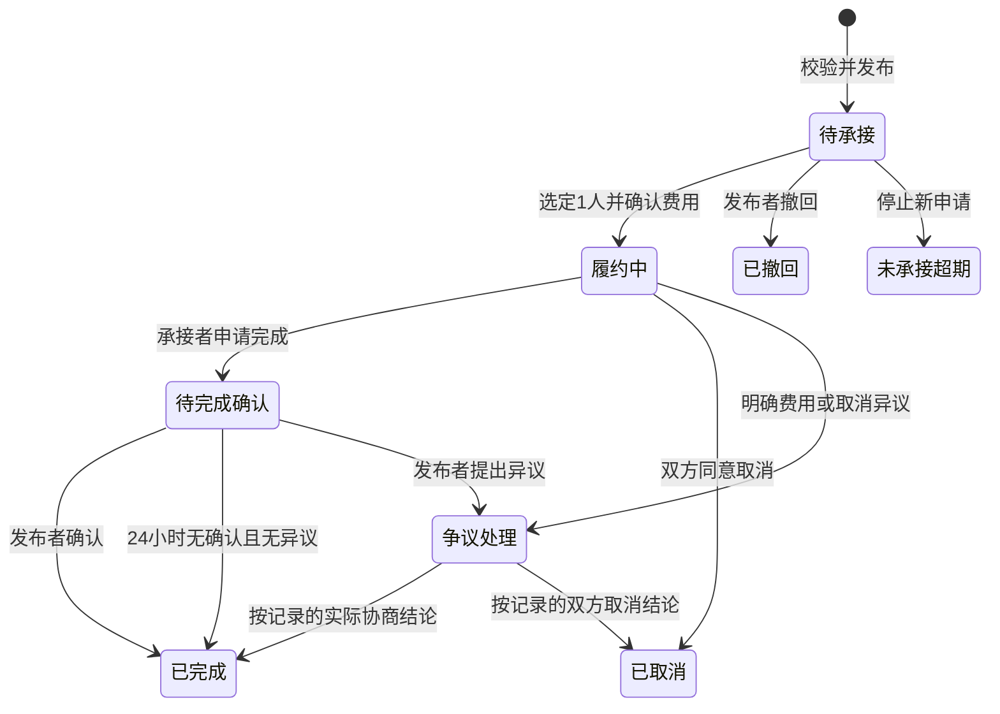
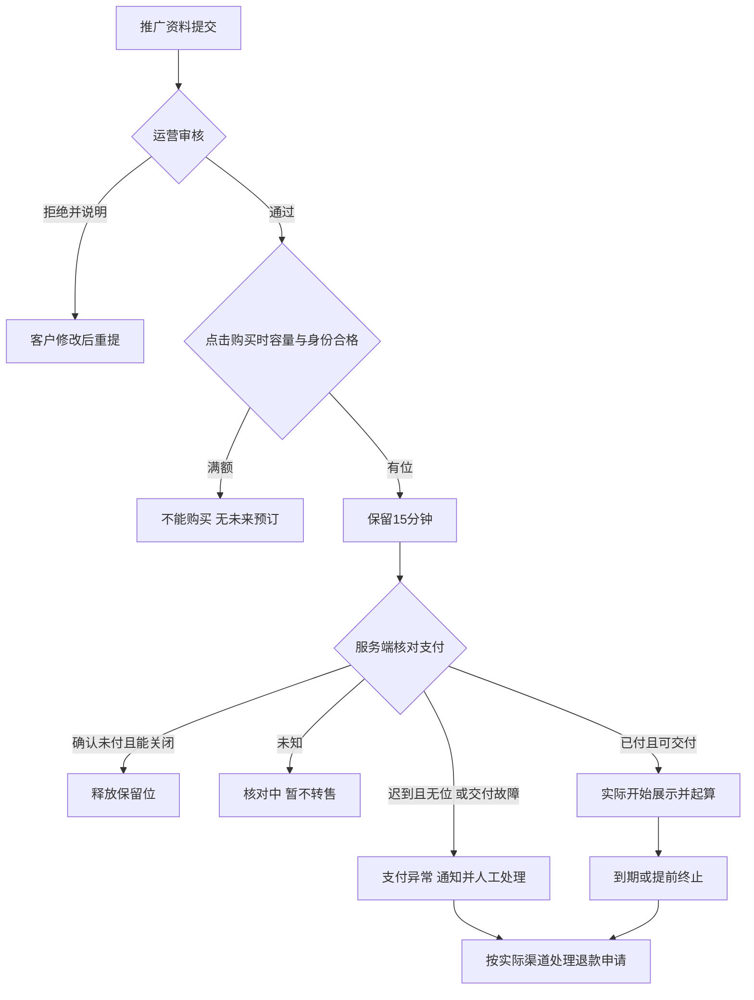
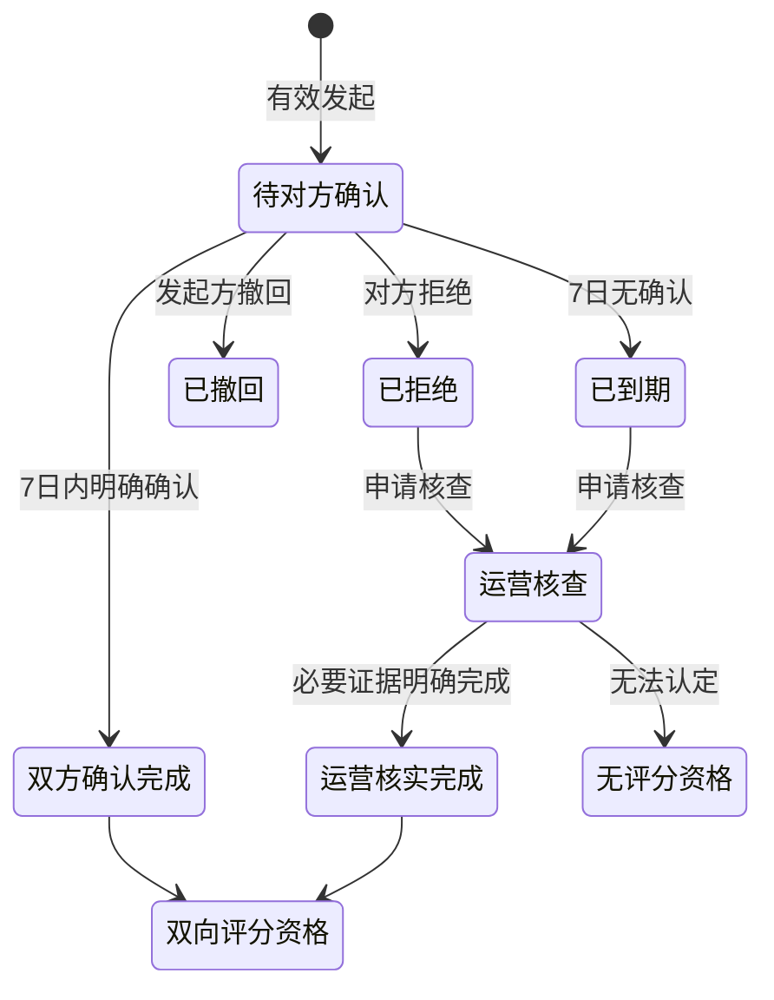

# 永兴乡镇生活服务微信小程序 PRD

开发阅读入口（2026-10-15补充确认）：先读[当前规则索引](module-specs/current-development-basis-20261015.md)及[本轮五项全A](module-specs/shared-understanding-confirmed-20261015.md)。此前45题及审计补充五题均已确认，共50项、0待答。历史长摘要、旧待定和旧技术采纳按当前主题覆盖读取；首版不做独立返修流程，原异议/投诉/申诉保留；商家Banner商业方案继续延后，产品未实现。

当前决定（2026-10-15）：[45题确认及管理账号安排](module-specs/business-closeout-confirmed-20261015.md)优先。CQ37选A，当前已列45道交易问题全部确认、0待答；本人及伙伴共用本人的一个管理账号，不要求两个独立运营账号或双人复核，日志只归登录账号，不声称识别实际自然人。以下此前“独立同权运营者”“操作归人”“剩余1/5题”等按历史及本次覆盖关系读取。商家Banner商业方案仍延后，未实现产品或启用真实权限/收费。

2026-10-10逐模块规划补充：[规划与实际确认记录](module-specs/README.md)。维修采用先申请、再由发布者选人且申请不强制报价；“其它”纳入业务规划。详细规则尚未齐备，以下v1.5保留作历史基线，不能据补充直接开放完整新流程。

版本：1.5（原基线、评分/评价及CR02第一版AI发布助手/运营看板规则已确认，外部启用条件待核实）
记录日期：2026-10-08（Asia/Shanghai）
需求状态：原P01—P10全部A继续有效；CR01的RV01B/RV02B/RV03A/RV04B/RV05B/RV06A/RV07A/RV08A/RV09A/RV10A及RC07B、其余RC全部A均已明确确认。首期业务决定已整理为字段、页面、权限、状态、计时、通知、统计及验收；E01—E06/QG01仍须取得实际依据。
实施状态：仅完成需求文档；未编写产品代码，未开通服务、收集真实证件或执行真实支付。
上线状态：E01—E06、QG01及新增AG01/DG01尚未核实通过。需求确认不等于官方准入、服务开通或上线授权。

最新CR03：商家广场VP04与营销服务探索VP05加入第二版；第一版成功跑通并连续稳定14天后提醒，故障从修复验收通过重新计时，详见第17节及路线记录。

CR02第一版变更：第一版保留M01—M10及R01—R08，新增M11文字AI发布助手（跑腿/二手）与M12运营看板；取消历史参考。第二版的图文整理、规则问答、运营助手只确认范围，详见第17节。[新增功能确认记录](ai-feature-decisions.md)保留实际选择与撤销来源。

## 0. 阅读方式、依据与验证方案

本文是后续产品设计、开发拆解和验收的业务依据。[规划记录](miniapp-planning.md)保留历次决定与研究；[P01—P10确认记录](prd-preparation.md)保留原选项和原“全A”的确认；[评分与业务评价确认记录](ratings-review-proposal.md)保留RV/RC原选项及实际回复。若历史记录的旧状态与本文不同，以本轮已确认决定为准，不恢复被撤销的住址、年龄标签、接单上限或免费推广体验。

本文的“必须/不得”是已确认要求；“尚未核实”仅用于明确的外部条件、实际经营资料与技术开通，不得被开发者默认为已经满足。未授权的新业务或新自动状态转换不能从功能名推导出来；若实现必须改变本文的费用、权限、范围或期限，先提交具体变更供用户确认并留痕。

验证分两层：

1. 本轮文档：逐条核对决定来源、P01—P10及RV/RC实际选择、字段/页面/通知/统计覆盖、状态转换与异常、权限和外部条件；验证UTF-8、链接、Git差异、提交范围及工作区状态。
2. 后续产品：按T01—T18、RT01—RT16、AT01—AT12与DT01—DT10执行行为验收，重点验证不同用户读取的真实响应、并发选人/占位、服务端计时、重复请求/回调、异常支付、跨用户越权、AI输入与失败恢复、统计归因/对账。真实服务条件未满足时只能验证受控测试场景，不能宣称生产验证通过。

本轮验证记录见[文档验证用例](planning-validation.md)。文档检查不能代替小程序运行、供应商接入或真实用户付费验证。

## 1. 问题与目标（Problem Statement）

用户希望为湖南省郴州市永兴县一个乡镇建立微信内生活服务入口，集中居民的维修求助、二手信息及日常跑腿需求，并允许普通居民同时发单与接单，减少对专职骑手招募的依赖。

用户本人晚间运营，固定伙伴白天值守；家里曾从事维修的长辈认识一些维修人员。维修人员数量、可提供的时段、跑腿供给和真实付费意愿没有调查结果，不据此推算用户数或收入。当地学校情况仅是历史背景，不形成校园业务或未满16岁接单功能。

目标是居民基本使用免费，服务人员基础展示免费，自愿购买明确标识的推广位置，为平台探索可持续收入。没有确认活跃人数、订单量、付费率、续购率或回本日期，本PRD不虚构商业成功阈值。

## 2. 解决方案与范围（Solution）

### 2.1 首期模块

| 编号 | 模块 | 必须交付的能力 | 业务边界 |
| --- | --- | --- | --- |
| M01 | 账号、身份与年龄 | 微信登录、昵称、手机号验证、姓名/身份证二要素、资格状态、核验失败说明 | 登录不等于实名；核验信息一致不证明实际操作者本人；不刷脸 |
| M02 | 维修求助 | 免费发布、搜索筛选、详情、联系申请、本人编辑/撤回/结束、历史，关联M10实际经历确认 | 信息/联系为主；新增确认仅用于评价，不增加维修报价/履约/平台支付订单 |
| M03 | 二手信息 | 免费发布、详情、联系申请、本人编辑/撤回、已售与历史，关联M10实际经历确认 | 联系获准不等于成交；双方完成确认仅用于评价，不托管二手款 |
| M04 | 跑腿 | 发布、多人申请报价、选1人、费用/任务变更、完成/取消/异议记录 | 用户即骑手，同时承接不限量，双方直接结算 |
| M05 | 免费服务目录 | 维修/跑腿服务资料、区域、时段、忙碌状态、联系申请 | 不额外逐人审批接单资格，营业执照选填 |
| M06 | 付费推广 | 各分类3位、审核、7/30天购买、15分钟保留、展示/到期、修改/终止、退款协助 | 仅在实际准入/支付获准后启用，不预订未来位置，不自动续购 |
| M07 | 搜索、私人工具与分享 | 收藏、草稿、地址簿、模板、再次发布、微信分享 | 私人数据不公开，不继承联系方式授权，不自动发布 |
| M08 | 通知、举报与运营 | 站内消息、有条件微信通知、举报/争议、整改/下架/限制/封禁、申诉、操作记录 | 本人管理账号供本人及伙伴共用；24小时首次回应不等于解决 |
| M09 | 核验标识与推广报表 | 限定核验说明，推广展示/详情/申请数量及有效期 | 不称平台担保，不展示访客身份，不把联系申请算成交 |
| M10 | 评分与有条件公开评价 | 全业务双向三维评分、维修/二手实际经历确认、受控图文评价/一次回应、公开分角色汇总、审核/申诉 | QG01等真实条件通过后启用；不增加公众话题/访客回复、平台交易付款或按评分重排推广 |
| M11 | 文字AI发布助手 | 跑腿/二手本次文字整理、明确字段提取、缺失提醒、差异选择、手工确认与失败降级 | 第一版不读图片/历史/私密字段；免费，限额核价后确认；AG01未通过不启用真实模型 |
| M12 | 供需与履约运营看板 | 三业务发布/详情/联系或申请、跑腿同批漏斗与库存、AI使用/质量/用量；每日截至前一日汇总 | 仅本人管理账号；不算维修/二手成交或居民资金结清；DG01未通过不采集真实新增统计 |

### 2.2 已纳入的8项扩展

| 编号 | 功能 | 不得省略的边界 | 对应模块 |
| --- | --- | --- | --- |
| R01 | 收藏信息/服务人员 | 仅本人可看，收藏不解码；失效对象显示失效 | M07 |
| R02 | 发布草稿 | 可半填保存，不进入公开搜索；明确提交前不发布，不绕过年龄 | M07 |
| R03 | 私人常用地址簿 | 可编辑/删除，不要求GPS，不作为首次发布资格；任务快照独立 | M07 |
| R04 | 模板/再次发布 | 重新确认当前地址、时间和价格；新编号、新申请、新授权 | M07 |
| R05 | 微信分享 | 仅公开标题/题图，不传完整联系、门牌、实名证件，不分享换奖励 | M07 |
| R06 | 服务时段/忙碌 | 只提示，不加接单并发上限，不取消订单或停止推广计时 | M05 |
| R07 | 限定核验标识 | 姓名/身份证信息一致的限定说明；执照仅提交不能标已认证 | M01/M05 |
| R08 | 推广效果报表 | 按S01—S04汇总本人推广期效果，不显示访客明细、不算成交 | M09 |

### 2.3 经营与资金边界

当前路线为新注册个体工商户主体小程序，不注册公司。2026-10-08用户报告已取得“永兴县渐循信息技术服务中心（个体工商户）”执照，名称来自用户提供照片及确认；没有登记系统独立核验。旧个人账号与cloud1保留作受控测试；新AppID/环境尚未取得，真实乡镇/村社区列表及准入材料仍待核实。当前事实与历史来源见[技术记录](technical-decision.md)。仅在微信生态经营，不增加独立公众网站或APP。

居民浏览、普通信息发布、服务目录基础展示免费。跑腿服务费、商品货款、打印/维修/洗护等门店费用由双方直接结算；平台不代收、不代结算、不抽跑腿佣金。平台自己的推广费按经微信确认适用的虚拟支付路线收取，与居民费用分开。

## 3. 用户故事（User Stories）

1. 作为访客，我希望无需登录就看维修、二手、跑腿及服务资料的公开内容，以了解本地需求。
2. 作为访客，我希望看到打码联系方式和粗略位置，以判断是否相关而不暴露对方私密资料。
3. 作为居民，我希望按关键词、业务分类和村/社区查找，以找到附近信息。
4. 作为用户，我希望微信登录和实名核验分别显示，以知道自己是否具备发布/接单资格。
5. 作为发布者，我希望首次需要发布资格时核验姓名和身份证，以按满16岁规则使用。
6. 作为承接者，我希望复用当前有效核验结果，以避免无理由重复核验收费。
7. 作为用户，我希望核验失败有明确状态，以更正资料而不被假标为已实名。
8. 作为未满16岁用户，我希望仍能浏览公开内容，同时不能发布或接单。
9. 作为居民，我希望首次维修/二手发布无需完整住址，以免为无关功能提供住所。
10. 作为维修求助者，我希望填写分类、说明、图片和粗略位置，以让合适人员发现需求。
11. 作为二手发布者，我希望填价格或面议，以表达售卖意向。
12. 作为普通发布者，我希望编辑/撤回自己的信息，以更新需求。
13. 作为二手发布者，我希望标已售并保存本人历史，以停止接受购买联系。
14. 作为发布者，我希望普通帖一直展示至主动结束，以免30天后无故消失。
15. 作为意向用户，我希望申请联系，以在对方同意后看到完整号码。
16. 作为发布者，我希望逐人同意多位联系人，以比较意向并控制资料提供。
17. 作为发布者，我希望拒绝或撤销联系权限，以处理不合适联系。
18. 作为用户，我希望号码变更使旧授权失效，以免旧对象自动获得新号码。
19. 作为跑腿用户，我希望同一账号既发单又接单，以在有空时帮助居民。
20. 作为跑腿发布者，我希望多人报价后选1人，以确定服务费与承接对象。
21. 作为申请者，我希望未被选中前改报价或撤回，以反映自身安排。
22. 作为承接者，我希望同时承接数量不限，以自主安排服务。
23. 作为发布者，我希望选人操作只能成功1次，以避免重复承接。
24. 作为双方，我希望正式承接后相互解码必要联系方式，以完成服务。
25. 作为承接者，我希望在承接前明确是否垫付及上限，以控制自愿垫资。
26. 作为发布者，我希望服务费与商品/门店费用分开，以明白需要支付的项目。
27. 作为双方，我希望修改地址/时间/物品/费用时明确同意并留版本，以防争议。
28. 作为承接者，我希望缺货/替代商品/超预算时先获同意，以免承担未约定支出。
29. 作为发布者，我希望未承接超期停止新申请、已承接超期只提醒，以避免系统擅自取消。
30. 作为承接者，我希望提交必填完成说明及可选凭据，以请求确认结果。
31. 作为发布者，我希望及时确认或提出异议，以控制完成状态。
32. 作为双方，我希望完成申请24小时无确认且无异议时自动完成，以避免无限等待。
33. 作为双方，我希望取消需要协商已发生费用，以免取消状态被误认为结清。
34. 作为争议当事人，我希望运营24小时内首次回应，以知道问题已有人处理。
35. 作为服务人员，我希望免费展示项目、区域、时段和忙碌状态，以被居民找到。
36. 作为服务人员，我希望营业执照可选填且标识如实，以免资料上传被误称认证。
37. 作为用户，我希望收藏、保存草稿和私人地址簿，以减少重复输入。
38. 作为用户，我希望模板/再次发布需要重新确认当前条件，以免复制旧地址或旧时间。
39. 作为用户，我希望分享公开卡片而不分享私密资料，以安全触达当地居民。
40. 作为服务人员，我希望自愿购买明确标识的7/30天推广，以让更多居民看到。
41. 作为推广客户，我希望先审后付、满额不能购买，以免买到没有位置的展示。
42. 作为推广客户，我希望从实际展示起算权益，以免等待支付/交付耗掉时间。
43. 作为推广客户，我希望查看支付异常、修改审核和到期状态，以了解权益是否有效。
44. 作为推广客户，我希望提前结束后按实际渠道申请退款，以处理未交付期间。
45. 作为iOS客户，我希望知道App Store退款机制，以免误以为平台能直接退款。
46. 作为推广客户，我希望看真实汇总效果，以评估续购，不把申请当成交。
47. 作为举报者，我希望登录提交原因和可选证据，以协助处置违规内容。
48. 作为受限制用户，我希望看到理由并申诉，以纠正错误处理。
49. 作为运营者，我希望处理审核、举报、订单争议、限制及支付异常并留记录，以交接和追踪。
50. 作为本人及运营伙伴，我们共用本人的一个管理账号，按既有分工维护；保留账号级记录，不要求两套运营账号。
51. 作为平台经营者，我希望区分试价、毛收入和真实成本，以评估可持续经营。
52. 作为开发/验收人员，我希望每个权限和状态变化有明确预期，以避免自行猜业务。
53. 作为实际完成跑腿的双方，我希望发布者确认后各自评分，以分别记录服务和履约体验。
54. 作为系统自动完成跑腿的发布者，我希望补确认实际服务，以取得评价资格而不改原订单结束/付款事实。
55. 作为维修求助或目录服务的当事人，我希望从历史获准联系对象发起实际完成确认，以评价确实发生的服务。
56. 作为二手买方或卖方，我希望另一方明确确认实际交易，以避免联系或单方已售被当成交。
57. 作为同两人再次发生真实服务的当事人，我希望新经历可以分别确认，同时同一次经历不被重复计分。
58. 作为确认接收者，我希望能明确确认/拒绝且无回应到期不自动确认，以防被强行形成交易经历。
59. 作为完成确认争议当事人，我希望运营依据必要证据核实并留理由，以处理对方拒绝确认而不假称款项结清。
60. 作为评价者，我希望填写态度/效率/沟通三项及选填短文和图片，以表达实际体验并保护他人隐私。
61. 作为评价者，我希望提交后7日内修改一次且保留版本，以纠正内容而不重复增加评分条数。
62. 作为被评价者，我希望在本方向评价下发表一次经审核的文字回应，以解释经历而不变成公开聊天。
63. 作为公众，我希望按业务和被评角色查看双方合法评价、均分及维度星级分布，以避免混算个人总分。
64. 作为运营者，我希望分别处理实际经历核实、图文/回应审核和申诉，以保护合法低分、隐私及审核留痕。
65. 作为跑腿或二手发布者，我希望将本次需求文字交给AI整理，再自行补图和确认发布，以减少表单整理工作。
66. 作为发布者，我希望AI只提取明确事实、一次列出缺失项，以避免错误金额、时间或物品描述。
67. 作为发布者，我希望已填字段冲突时保留原值、自行选择替换，以免我的填写被自动覆盖。
68. 作为发布者，我希望私密字段不送模型，敏感输入命中时先修改，以保护联系方式、住址及领取码。
69. 作为发布者，我希望AI失败或限额用尽时仍可合法手填发布，以免模型故障阻断基本服务。
70. 作为发布者，我希望AI不读取历史或第一版图片、不默认保存原始调用日志，以明确本次数据用途。
71. 作为运营者，我希望按日期与业务看截至前一日的统计和更新时间，以判断信息供需情况。
72. 作为运营者，我希望对同批跑腿需求追踪申请、承接与完成，以免不同批次混算转化率。
73. 作为运营者，我希望区分人工/自动完成与资金结清、联系与成交，以免报表虚构业务结果。
74. 作为运营者，我希望看到AI有效草稿、采用、修改、发布关联、耗时/用量及评测来源，以评估实际效果。

## 4. 实施与业务决定（Implementation Decisions）

### 4.1 术语与角色

“信息”指普通维修/二手帖子；“联系授权”指某用户对某信息完整联系方式的可见许可；“跑腿需求”在选定1人并确认最终费后正式承接；“推广订单”只支付本平台展示权益；“已完成”只表述任务状态；“退款成功”只能由实际渠道最终结果确认。“实际经历确认”是维修/二手用于评分资格的当事人声明或获批准的运营核实记录，不代表平台核实线下付款；“有效评分”与图文/回应公开审核结果分别记录。

角色是同一账号的能力，不另建互斥骑手账号：访客、已登录用户、符合身份/年龄资格的发布者、符合资格的申请者/承接者、免费服务资料所有者、推广购买者、运营者。用户能在不同任务中承担不同角色。

### 4.2 身份、年龄与手机号（ID01—ID10）

- ID01 发布、接单在首次需要对应资格时进行姓名＋身份证二要素，不做人脸核验。维修求助、二手发布、跑腿发单/接单都覆盖；普通浏览不要求提供身份证。
- ID02 年满16周岁才能发布/接单；未满16岁只浏览公开内容。不加公开年龄/生日标签，不恢复监护人代发流程。16—17岁普通业务流程同成年人，但具体适用条件须E02通过，不宣称其自动具完全民事行为能力。
- ID03 基于核验信息一致的证件所示出生日期计算年龄资格；核验接口没有出生日期返回时，不能虚构其返回年龄。二要素不证明操作者为证件本人或与微信实名一致；借证风险如实说明。
- ID04 同一账号1个当前有效身份，有效核验状态在发单/接单间复用，不无理由重复收费调用，不承诺永久有效。身份变更转人工处理，暂停新的发布/接单，不把旧身份订单/推广/徽章直接交给新身份。
- ID05 不一致、格式错误、无记录、供应商异常或不可用不记成功；依赖新核验的入口保持待核验，公开浏览继续可用；不能以自报生日、登录或号码验证放行。
- ID06 自有数据库不保存原始完整姓名/身份证号，不上传证件照片/人脸。保留受保护核验状态、时间、供应商凭据、年龄资格及证件去重标识；原始输入只用于经授权的必要核验传递，不写普通日志、分析报表、草稿、分享或运营日常界面。
- ID07 去重标识仍按个人信息保护，用于同一自然人同类最多1个推广位；不能把它当匿名公开标识。供应商留存、自有标识期限、注销/删除及必要保留记录必须按E03取得依据后明确，不能默填“永久”。
- ID08 联系电话必填，采用符合项目账号资格、经用户同意的微信手机号验证能力；微信号选填1—50字符、手工填写，不声称验证其归属。组件尚未开通；不自行追加短信采购或以手填号码替代已选择的验证要求。
- ID09 昵称必填1—20字符；营业执照接单侧选填，不因为没上传执照就增加本PRD没有批准的逐人资格审批。通过有效身份/年龄核实后按资格开通；实际业务法定准入条件仍由E01/E02验证。
- ID10 公开标识仅“姓名与身份证信息已核验”，不展示真实姓名/证件/生日，不称“本人刷脸认证”“平台担保”“服务质量保证”。执照仅上传标“已提交”；只有实际核查通过并说明范围才能给对应核验结论，身份失效及时撤下标识。

### 4.3 角色与数据可见性

| 数据/操作 | 公众及未获准用户 | 对应发布者/资料所有者 | 获准联系者/正式承接者 | 必要运营 |
| --- | --- | --- | --- | --- |
| 有效公开标题/说明/公开图片/村社区 | 可读 | 可读并编辑本人 | 可读 | 可读、按规则处置 |
| 打码电话/微信号 | 可读，登录不解码 | 管理本人字段 | 未获本对象授权前仍打码 | 仅处理必要联系事项 |
| 普通信息完整联系 | 不可读 | 本人可管理 | 仅该信息已获准对象可读 | 有处理必要时可读并留操作依据 |
| 跑腿正式承接双方完整联系 | 其他人不可读 | 作为当事人可读对方 | 仅该订单双方；履约/争议期间规则见CT09 | 骚扰/争议必要处理 |
| 跑腿取送详情/领取码/私密附件 | 候选、搜索、分享不可读 | 发布者可读 | 正式承接者可读 | 仅必要处置 |
| 姓名/完整证件 | 不公开，不在客户端业务响应 | 仅核验时输入，不建原证件查看页 | 不可读他人身份 | 无日常完整证件浏览入口 |
| 地址簿/草稿/收藏 | 不公开 | 仅本人读写 | 不因旧授权可读他人私人内容 | 无无关浏览权限 |
| 申请报价 | 不公开候选私密详情 | 对应跑腿发布者可读候选 | 本人申请；不能看其他候选私密信息 | 必要订单处理 |
| 支出/变更/完成凭据 | 不公开 | 对应任务当事人 | 对应任务当事人 | 必要争议处理 |
| 推广统计 | 不公开访客明细 | 本推广客户汇总可读 | 非本推广客户不可读 | 必要运营可读汇总 |
| 举报者/申诉资料 | 不向被举报人公开举报者身份 | 仅本人记录及允许的处理结果 | 不能窥见他人证据 | 处理必要信息、记录操作 |
| 双向有效评分/公开合法图文/回应 | 可读两方向公开字段，昵称按评价规则打码；不含私密原稿/订单/完整联系 | 本人评价按RA规则提交/一次修改；不能删对方差评 | 对应经历双方分别评分/回应；不能读其他记录私密证据 | 必要审核/核实/申诉，理由及操作留痕 |
| 实际经历确认/评价原稿/核实证据 | 不可读；公众只见业务/角色及允许公开的资格说明 | 对应经历必要信息及本人原稿/结果 | 同一经历必要确认资料；其他人不可读 | 必要处置，非日常随意浏览 |

读取、写入和图片/附件访问权限必须在服务端执行。禁止向未授权响应返回完整字段后仅在页面打码；私密文件链接不能成为无需授权的公开绕过入口。运营同权不代表可以无目的浏览敏感资料。

### 4.4 联系方式与授权（CT01—CT11）

- CT01 电话公开为前3位＋4个星号＋后4位；微信号保留首尾各1字符、中间统一4个星号，不足3字符全部打码。登录、收藏、分享不解码。
- CT02 电话/微信号只能写专用字段，正文和图片不得夹带。公开位置只村/社区或附近地标；首次发布不要求完整住址。任务必要详细地址按定向权限提供，不能进入卡片、列表、公开说明或报表。
- CT03 普通维修、二手、免费目录、推广：用户申请→所有者逐人同意→只该用户解码；可批准多人，不称已成交。不能向自己申请，不用证件资料作为同意联系的交换条件。
- CT04 每用户每信息最多1个待处理申请。重复提交返回现有状态，不新增申请或通知。拒绝、申请者撤回、所有者撤回已批准授权后，自该动作发生时起24小时可再申请；到时不自动申请。
- CT05 信息下架/撤回/结束/已售期间不能再申请，所有相关授权恢复打码；恢复展示也不恢复旧授权。
- CT06 修改电话/微信号撤销受影响信息已有授权、关闭待处理申请、通知相关用户；仅修改正文/图片/价格/粗略位置不撤销。目录与推广共用联系字段的影响范围见AD11。
- CT07 授权按“具体信息＋获准用户”生效，不跨服务人员，不由旧帖复制到新帖。历史已保存号码无法远程收回，界面与告知不得承诺远程删除。
- CT08 候选跑腿申请者无权看发布者完整联系或详细地址；正式选人和承接成功时双方相互解码，仅彼此可见。
- CT09 正式承接后的履约中/争议处理中不允许一般用户单方撤回该订单联系；完成、协商取消或争议关闭后恢复打码。此为P04A已批准的普通撤回例外，不能扩展到双方其他帖子。
- CT10 骚扰可举报。运营可为处置骚扰临时屏蔽联系，记录原因并通知另一方；不能将单方要求隐藏当作订单自动取消或免责。
- CT11 常用地址簿编辑/删除不改已承接任务的地址快照；已承接实际地址修改只能通过双方确认变更。详细地址及领取码不在站内通知正文/微信模板中发送。

普通联系状态：

| 当前状态 | 事件/角色 | 结果 | 全号码权限 |
| --- | --- | --- | --- |
| 无申请且无冷却 | 合格用户提交 | 待处理；通知所有者 | 无 |
| 待处理 | 重复提交 | 返回同一待处理申请 | 无 |
| 待处理 | 所有者同意 | 已授权；通知申请者 | 仅该对象 |
| 待处理 | 所有者拒绝/申请者撤回 | 结束申请，24小时冷却 | 无 |
| 已授权 | 所有者撤销 | 已撤销，24小时冷却并通知 | 恢复打码 |
| 待处理/已授权 | 联系字段变化 | 关闭待处理/撤销旧授权并通知 | 恢复打码 |
| 任意有效联系状态 | 信息结束/已售/下架/撤回 | 不再申请，权限失效 | 恢复打码 |

联系方式变更的重申请按信息当前有效性和冷却规则校验；不能自动替用户重新发起。

### 4.5 普通维修/二手及目录（POST01—POST08）

- POST01 表单/图片安全校验通过后自动公开，不逐帖人工预审；运营巡查/举报后处理。自动检测能力的资格/覆盖/费用在外部条件中核实，必要安全检测拒绝/不可用时不绕过，草稿可保留。
- POST02 普通维修/二手持续展示至本人撤回/结束、二手已售或运营下架；没有30天自动过期。
- POST03 本人可编辑/撤回维修及二手，维修可标结束，二手可标已售。已售退出在售，保留本人历史；旧分享不继续作为有效在售信息入口。
- POST04 信息仅用于展示与联系；没有维修/二手报价选择、验收付款、平台担保或完整交易订单。
- POST05 搜索公开标题/说明包含关键词，分类＋村/社区筛选共同生效；不搜索完整联系、私密地址、实名证件、草稿或退出公开列表对象。
- POST06 普通列表按首次发布时间倒序；编辑不自动置顶；每次20条继续加载。推广在独立顶部位置按AD规则，不能混成普通最新发布时间排序。
- POST07 免费目录需有效接单身份/年龄资格；名称、业务分类、服务项目、真实服务村/社区、联系电话必填，执照可选。首次提交/普通文案修改后展示，由巡查处理，不加逐人资格人工审批。
- POST08 免费文案和推广文案/图片独立；共用实时联系字段。免费资料撤下同时申请结束对应推广，按提前终止规则处理；到期仅撤付费位置，不撤仍有效免费资料。

### 4.6 跑腿范围、报价和支出（RUN01—RUN12）

允许任务：取快递及其他物品，送文件/生活物品，代买日用品/菜/饭，代打印/复印并送达，代送/取洗护物品，代送/取维修物品。禁止首期开放普通门店代排队/取号、烟酒、药品、代取现金；政务手续后置，不用“其他”任务绕过。

- RUN01 任务类型、标题、说明、村/社区、服务费预算、未来期望完成时间必填；实际取件步骤的地址、实际送件步骤的地址必填，代买内容/商品估算必填。不能使用默认账号住址替代未填写地址。
- RUN02 单需求申请总人数不设产品上限；同一用户仅1份有效申请，发布者不能接自己单。申请者被选中前可改报价/撤回，保留版本；不得因此添加1/3单同时承接上限。
- RUN03 发布者选当前有效申请，明确最终服务费、是否愿意垫付及最高金额；正式承接操作只能成功选1人，其他申请结束并通知。忙碌标记不自动撤销旧申请。
- RUN04 服务费、商品/门店费用、是否垫付/上限分开；金额是双方约定记录，不生成平台代收/结算余额。外部支出可由发布者直接付、预付给承接者或承接者自愿垫付，实际凭据结算。
- RUN05 承接前修改地址/时间/物品/预算/费用条件，原有效报价失效、保留历史并通知，允许重新申请。原报价不能自动等同同意新条件。
- RUN06 承接后地址、时间、物品或费用变更需双方明确确认，记录原值/新值/金额差/说明/发起者及同意时间。只允许1份待确认变更，同意前原版本有效，拒绝/撤回不改原版本。
- RUN07 缺货/替代商品、商家加价、额外运费/服务费、超垫付上限均先确认，未确认不增加支出；不回复不等于同意。不能协商则维持原约定，客观不能履行则协商取消/争议处理。
- RUN08 实际支出、退货安排、费用异议附双方说明及可选凭据；小程序不向商家退款、不代收差额、不向承接者转账。
- RUN09 收/发必要领取码仅任务必要对象可见；不收支付密码、银行卡密码/完整银行卡号。
- RUN10 发布者期望完成时间是申请入口期限与超时提醒依据；到期仍未承接停止新申请，已承接仅提醒，不自动取消或完成。不得把“停止申请”擅自扩成新自动付款、赔付或强制结案规则。
- RUN11 承接者提交完成说明必填、图片/凭据选填；发布者确认实际交付/结果。服务端从完成申请产生时起连续24小时内既未确认又无异议才自动完成，不从发布、期望时间、付款或午夜起算。
- RUN12 异议进入争议处理中并停止24小时自动完成计时。完成/取消/运营结案只改任务及协商记录，不证明线下款项结清。

跑腿履约状态与子记录：

| 状态/记录 | 进入条件 | 允许的已确认动作 | 禁止的自动结果 |
| --- | --- | --- | --- |
| 草稿 | 本人保存未完整表单 | 编辑、删除、校验后发布 | 自动发布/绕过年龄 |
| 待承接 | 合格用户提交有效需求 | 申请、更新/撤回报价、发布者修改/撤回、选定1人 | 代付/自动派单 |
| 未承接已超期 | 期望时间到且无正式承接 | 停止新申请，保留事实记录；本人可编辑/撤回 | 自动判已完成/已结清 |
| 履约中 | 选1人并确认最终费/垫付 | 双方沟通、变更请求、完成申请、取消协商、异议 | 因忙碌或超期自动取消 |
| 待发布者确认完成 | 承接者提交完成申请 | 发布者确认或明确异议；23小时提醒；满24小时按条件自动完成 | 有异议后自动完成 |
| 争议处理中 | 费用/完成/取消存在异议 | 运营首次回应、收集必要凭据、协助协商、记录处理结论 | 超时默认同意/代扣/司法裁判 |
| 已完成 | 发布者确认或满24小时无确认/异议 | 当事人查看必要历史，联系恢复打码 | 推定付款成功 |
| 已取消/已撤回 | 未承接本人撤回；承接后双方同意取消 | 保留费用协商记录及历史，联系恢复打码 | 推定支出已结清 |

变更请求、取消请求、费用协商作为履约的独立记录，分别保留待确认、同意、拒绝/撤回/争议结果，不因发起请求就覆盖原履约事实。取消只有双方确认后生效；不同意进入争议。有实际费用先协商，费用结果和取消结果分别记录，不设无人回应自动同意取消规则。

主流程图仅示已确认转换，不增加未批准的转换：

### 4.7 推广审核、占位、支付和展示（AD01—AD15）

| 配置 | 确认值 |
| --- | --- |
| 开放分类 | 维修、跑腿；二手不新增付费推广分类 |
| 每分类同时容量 | 3个固定同时展示位置 |
| 同一自然人同分类占位 | 同时最多1个，使用受保护身份去重，不靠换账号重复占位 |
| 7天套餐 | 9.9元，连续7×24小时 |
| 30天套餐 | 29.9元，连续30×24小时 |
| 初始免费体验 | 无；免费的是基础目录展示 |
| 审核 | 提交后24小时内给结果，先审后付 |
| 购买保留 | 审核通过后点击购买且有位时保留15分钟 |
| 起算 | 服务端确认支付且实际展示成功时 |
| 正常排序 | 本轮实际开始时间先开始排前；同时开始按内部唯一订单编号升序 |
| 到期/续购 | 到期撤付费位置，保留有效免费资料；手动重新审核/购买，建立新周期 |
| 广告标识 | 顶部位置明确“广告/推广”，不能伪成平台质量担保 |
| 满额 | 暂停新购买，空位再开放，无未来时段预订 |

- AD01 推广审核检查公开内容、电话/微信专用字段、业务范围、真实服务资料与所需资格；给通过/驳回及原因。申请通过不是已占位、已付费或展示开始。
- AD02 容量同时计算有效展示、未到期保留、仍占位的支付核对中、已付待启动且仍占位订单；并发购买/重复点击/重复通知不得超过3位或同人同类1位。
- AD03 客户支付前看到审核版本、期限、价格、容量规则、广告标识、实际起算及按渠道可履行退款条款并确认。实际通道未获准不提供真实付款入口。
- AD04 保留到期先核对支付状态：确认未付且能按实际通道关闭支付订单再释放；已付按AD06；支付未知或服务不可用显示核对中，暂不再出售该位置。关闭/查询接口须按真实通道文档核实，不猜名称/参数。
- AD05 客户端付款完成回调不足以确认收款；以服务端实际通道可核实结果确认。重复通知只更新原订单，不重复交付或开始新周期。
- AD06 迟到已付且仍有空位、无该人同类其他占位、审核内容仍有效时自动恢复并展示；无位、资格失效或交付故障进入支付异常，通知客户及必要运营，不开始展示计时，不静默预订未来位置，不要求重复付款。
- AD07 起算只在实际展示成功，结束时间＝开始时间＋购买周期；等待核对/未展示不倒扣权益。广告客户可以查看支付状态、实际起止、异常处理和退款进度。
- AD08 推广文案/图片修改提交新版本复审；待审原有效内容继续，通过后替换，不重置周期。驳回给原因，原有效内容保留，客户改后重提；不自动运营代改。
- AD09 客户可撤回待审修改，不影响原有效版本；到期时待审修改不得阻止撤下，之后通过也不复活已到期订单，重买须新周期。
- AD10 免费文案与广告文案/图片分开，免费文案改动不自动改广告，防止绕过推广审核。
- AD11 电话/微信号为服务人员目录及本人推广的共用实时字段；修改后立即撤销相关各处授权并显示新打码，不等待广告复审，不重置周期。这是P08A已批准的推广联系方式复审例外，不扩展到文案/图片。
- AD12 用户撤下免费服务资料时同时申请结束对应推广，记录实际停止展示时间，按退款规则处理；普通到期不撤有效免费资料。
- AD13 用户可主动申请提前结束，记录原因与实际停止时间，停止权益；不因为申请退款把已交付时间清零。
- AD14 运营下架违规广告记录事实/理由、停止时间并通知客户；退款单独处理，不能默认全部没收，不能伪报退款到账。
- AD15 周期到期按服务端时间不可再作为有效广告读取；后台定时任务延迟不能造成免费延长售卖或旧广告仍被返回。价格变更留版本，不修改已购买订单价格；第一版按试价，不在本轮更改真实收款配置。

推广状态分为相互关联且独立的记录，不能用1个“成功”覆盖全部：

| 记录 | 主要状态 | 关键转换/结果 |
| --- | --- | --- |
| 内容版本 | 草稿、待审、驳回、通过、撤回 | 审核只处理该版本，展示期间待审不覆盖原版本 |
| 购买/占位 | 待购买、保留待付、核对中、已付待启动、支付异常、结束 | 先有位才保留；未知不盲释放；付款迟到按AD06 |
| 付款 | 未确认、核对中、已确认付款 | 客户端不直接置已确认，重复结果幂等，金额/订单归属必须一致 |
| 展示权益 | 未开始、展示中、已到期、已终止 | 实际展示才起算，到期不复活，终止记录交付期间 |
| 修改版本 | 待审、通过、驳回、撤回 | 通过且原权益有效才替换，原周期不重置 |
| 退款 | 待处理、提交中、渠道处理中、成功、失败；iOS申请协助/已知结果 | 独立于付款/展示，不伪造渠道结果 |

图中到期不意味着每单自动产生退款；只有存在应处理的未交付/提前结束事项才走退款规则。到期正常完整交付仍只撤位。

### 4.8 提前终止与退款（RF01—RF08）

- RF01 普通支持开发者退款渠道：平台原因完全未开始展示且无法交付，申请全额退款；已经展示而提前终止，申请退未展示期间费用。
- RF02 拟退金额＝实际支付金额×未交付秒数÷购买周期秒数，向下取整到分，取值0至实际付款，累计退款不超实际付款。以实际停止时间和实际交付记录计算；停展前已交付期间不重复退款。
- RF03 平台故障造成的未交付期间由运营留依据计入；不能编造丢失时段或把记录未知直接当作全周期已交付。
- RF04 退款状态区分待处理、提交中、渠道处理中、成功、失败，记录原支付订单、申请原因、拟退金额、渠道及实际结果。失败通知原因并人工继续处理，重复提交不重复超额退款。
- RF05 iOS由用户在App Store申请、Apple决定；小程序提供规则说明与协助记录，不创建虚假的开发者退款任务，不保证同一比例退回或一定获准。
- RF06 普通渠道退款任务提交不等于成功，渠道处理中不能显示已到账。客户仅查看本人退款；运营看到处理必要信息。
- RF07 违规下架、争议及退款之间分别记录原因与结果，不预设“一概不退/全部没收”；适用法定义务和渠道条款必须在E04核实。
- RF08 售卖前展示实际可履行的条款；没有核实项目权益分类、退款能力或条款不能开放支付。9.9/29.9是已确认试价，不证明本地接受或支付资格已通过。

### 4.9 私人工具、分享、服务时段（TOOL01—TOOL08）

- TOOL01 收藏维修/二手及服务资料只本人可看，不公开收藏关系、不解码；对象无效时显示失效，不能从收藏访问旧私密内容。
- TOOL02 草稿允许字段不完整，明确点击保存；不进入公开列表/搜索，不自动发布或刷新。公开提交重新校验身份/年龄、字段、时限及安全规则。
- TOOL03 常用地址本人管理；联系人、电话、村社区、详细地址必填，最多1个默认地址，备注可选；不强制GPS，不作为浏览或首次发布资格。
- TOOL04 从地址簿选入任务形成该任务快照；编辑/删除地址簿不改既有任务。私密取送地址不是分享卡片字段。
- TOOL05 模板/再次发布创建新需求，不复用旧联系人授权/申请/推广周期；提交前本人重新确认当前地址/未来时间/费用与内容，不自动派单。
- TOOL06 分享只取公开标题/首张公开图片，无图用统一分类图；不取私密凭据、详细地址、完整联系、证件。接收者按当前信息状态与自身授权读取，旧卡片不提供永久权限。
- TOOL07 可服务时段为每周星期＋起止时间，多段可填，结束晚于开始，重叠合并；忙碌手动开关，默认否。
- TOOL08 忙碌/非服务时段只展示提示，不自动拒绝已有申请、不限制同时承接、不取消订单、不停广告计时，不承诺该时段一定接单。

### 4.10 举报、限制、申诉与运营（OPS01—OPS09）

- OPS01 举报需登录并选原因；普通补充/图片选填，“其他”须写说明。原因：疑似诈骗、虚假信息、违规内容、骚扰/隐私泄露、服务/费用争议、其他。
- OPS02 运营可下架、要求整改、限制发布/接单、封禁，必填理由；期限为1/3/7/30天或永久。操作记录操作者、时间、对象、前后状态、理由。
- OPS03 申诉说明必填，支持查看首次回应及处理记录；举报/争议/申诉24小时内首次回应，不保证24小时结案。
- OPS04 限制新发布/接单不自动取消旧订单，不阻止必要履约、双方取消协商、费用/完成异议、举报/申诉；封禁不得导致已付推广或旧订单没有处置记录。
- OPS05 本人及运营伙伴共用本人的一个管理账号，不要求独立伙伴账号、成员管理或双人复核；权限校验与账号级日志保留，记录账号、时间、对象、改动前后及必要理由，不声称区分实际自然人操作者。
- OPS06 伙伴白天、用户晚间；确切时段/交接还需实际经营资料，不填成24小时值守。首次回应与解决时间分别记录，自动受理提示不能伪装运营实际回应。
- OPS07 推广审核从提交时起24小时给结果；独立于举报首次回应、跑腿完成24小时、冷却24小时和展示周期。
- OPS08 不向被举报人披露举报者身份；运营查看证据限处理必要用途，不给公众争议讨论页。
- OPS09 争议记录处理事实/沟通/实际协商结果；运营不代付、扣费或作司法裁判，无人回复不自动推定另一方同意赔付。

## 5. 页面与字段合同

以下F01—F12、V01—V16和共同格式已经用户P10A采纳。页面可以合并，不得省略操作/权限/状态；字段限制改变需留痕，涉及关键业务变更另确认。

### 5.1 字段 F01—F18

| 编号 | 对象 | 必填、选填及限制 | 行为与可见范围 |
| --- | --- | --- | --- |
| F01 | 账号资料 | 昵称必填1—20字符；联系电话须微信手机号验证；微信号选填1—50字符；姓名/身份证在首次资格核验时提供；接单营业执照选填，最多1张清晰图片 | 昵称公开；电话/微信按授权显示；姓名/证件不公开。执照图片仅本人及必要运营可看，公开只标“已提交”或实际核查后的限定结论 |
| F02 | 普通维修求助 | 标题1—30字符、说明1—1000字符、维修分类、村/社区必填；附近地标选填0—50字符；图片0—9张；不要求完整住址 | 发布后自动公开，不逐帖人工预审；本人编辑/撤回/标记结束；通知/授权按本文普通信息联系规则；列表持续至撤回/结束/运营下架 |
| F03 | 二手发布 | 标题1—30、说明1—1000、物品分类、村/社区必填；价格选“明确金额”或“面议”，金额须大于0且最多2位小数；图片0—9张、地标0—50选填 | 不做平台支付或成交担保；可编辑、撤回、标已售；已售退出在售并恢复打码，本人历史保留 |
| F04 | 跑腿需求 | 任务类型、标题1—30、说明1—1000、村/社区、服务费预算大于0/最多2位小数、未来期望完成时间必填；取件/送件类相应地址必填；代买必填购买内容及商品费用估算；附件0—9张 | 地址、领取码、非公开附件仅任务必要对象可见；公开内容不得夹带门牌/完整联系方式。期望时间以服务端提交校验为准，不因为保存草稿而绕过 |
| F05 | 跑腿申请/承接 | 报价大于0/最多2位小数、是否愿意垫付必填；愿垫付时最高金额大于0必填；说明0—300选填；正式承接需发布者确认最终费及垫付上限 | 候选只见公开需求/打码联系方式；每人1份有效申请，允许未选中前更新/撤回；发布者查看报价选1人；选人后其他申请结束 |
| F06 | 完成/取消/变更/异议 | 完成说明1—500必填、图片0—9选填；取消或异议说明1—500必填、附件0—9选填；任务变更需字段差异及费用差额，原因1—500 | 完成申请只由承接者发起，发布者确认/异议；取消双方确认；有实际费用时提交协商金额/凭据，不由平台转账 |
| F07 | 免费服务资料 | 展示名称1—30、维修或跑腿分类、服务项目1—500、至少1个真实服务村/社区、联系电话必填；图片0—9、服务时段及微信号选填，忙碌默认否 | 需已具备接单身份/年龄资格；首次提交及普通修改后展示，运营巡查；不增加逐人接单资格审批。撤下免费资料同时申请结束对应推广，按提前结束规则处理 |
| F08 | 推广资料/购买 | 分类、关联本人服务资料、标题1—30、文案1—500必填；图片0—3；选择7天9.9元或30天29.9元；支付前展示名额、广告标识、实际起算、退款条款并确认 | 只有审核通过版本可购买；无名额不能付款；状态含草稿、待审、驳回、通过待购、保留待付、核对中、已付待启动、展示中、到期、已终止、支付异常；付款/退款分别记录 |
| F09 | 私人地址簿 | 联系人1—20、联系电话11位数字、村/社区、详细地址1—200必填；备注0—100选填；默认地址最多1个 | 地址簿电话为任务收件联系方式，不声称已验证其控制权。只供本人管理，任务选用后形成快照，编辑/删除不篡改既有任务；不是首次发布资格 |
| F10 | 收藏/草稿/模板/分享 | 收藏对象为信息或服务资料；草稿允许字段不全，明确点击保存；再发布需重新确认内容/地址/费用/未来时间；分享题图取公开首图，没有图片使用统一分类图 | 收藏仅本人，失效对象显示失效且不能解码；草稿不公开、不自动发布；地址不随分享发送；再发布新编号/新申请/新授权，不继承旧联系人或推广位 |
| F11 | 时段/忙碌/核验标识 | 时段为每周星期＋开始/结束，结束须晚于开始；可填多段，重叠段合并；忙碌为开/关；核验标识仅“姓名与身份证信息已核验”，说明核验范围 | 用户手动设置；非可服务时段/忙碌只显示提示，不自动拒绝申请、不限制并发、不取消任务、不停止付费周期；核验状态失效同步撤下标识 |
| F12 | 举报/申诉/后台处置 | 举报原因必选：疑似诈骗、虚假信息、违规内容、骚扰/隐私泄露、服务/费用争议、其他；补充0—1000、图片0—9选填；选其他时说明必填。申诉说明1—1000必填；运营动作理由1—1000必填 | 需登录且不得窥见举报者资料；运营看必要详情。记录操作者、时间、对象、前后状态、理由；首次回应计时独立于结案。本人及伙伴共用一个管理账号 |
| F13 | 维修/二手实际经历确认 | 必有来源业务/原信息或维修目录引用、历史获准联系双方及角色、发起方、实际完成声明、状态/版本/发起和截止时间；确认/拒绝/撤回/到期、核查结论、资格时间由对应实际动作产生 | 对方从本来源历史获准联系对象选择，不能手填任意手机号冒充交易对象；双方/必要运营可读；不额外把金额、付款凭据或完整住址作为普通确认必填；争议必要证据按既有举报规则另传 |
| F14 | 双向三维评分 | 关联唯一正式跑腿订单或有效实际经历ID、作者/对象受保护自然人标识、被评角色、3项整数态度/效率/沟通各1—5、首次提交及截止/修改记录、资格及有效状态 | 3项必填，无0/半星；整体均分按RS计算不手填；每经历/作者自然人/方向1份有效记录；公众可读合法数值但不返回受保护自然人标识 |
| F15 | 评价内容及版本 | 文字选填，填时1—300字符；图片选填0—3张JPEG/PNG单张最多5MB；内容版本、安全检测/人工结果/原因、提交/审核时间、当前公开版本 | 文字和图片为1份审核单元；无图文不建空审核；原稿/未审核图仅必要权限可读，公开只使用已合格版本，图片及元数据不能携带私密定位/联系/证件；一次修改含全部内容与三维数值 |
| F16 | 一次回应 | 关联原有效评分方向与被评对象；文字必填1—300字符，不配图；版本、检测/人工审核结果/原因、提交/通过时间及唯一公开回应位置 | 被评对象本人填写；驳回可按原因重提同一位置，最多1条公开回应；公开后不自行编辑，错误经申诉处理；不开放他人回复 |
| F17 | 文字AI整理与采用 | 业务仅跑腿/二手；本次文字1—1000字符，字符口径沿用共同格式；候选标题1—30、说明1—1000，其余候选值遵守F03/F04；缺失/歧义列表、请求/表单版本、用户选择及最后采用关联；图片仍0—9选填 | 不读图片/历史/私密字段；检测命中先阻止；已有字段不自动覆盖，用户确认采用后才填入，正式发布仍另确认；失败不自动重试，不默认记录原始输入/输出；AG01前关闭真实AI |
| F18 | 平台运营统计 | 开始/结束日期与业务类型为筛选；日期为Asia/Shanghai自然日且结束不晚于前一日；类型为全部/维修/跑腿/二手；统计截止、更新时间、汇总版本、BS/AM定义的数量/比例/样本和用量状态 | 仅获授权的本人管理账号读取汇总；无访客身份、私密字段、居民成交额或付款结清栏目；同批跑腿与每日事件分开；无数据/无分母/未采集/未更新/用量未知分别显示；DG01前只合成演示 |

共同格式：

- 普通内容图片仅JPEG/PNG，单张不超过5MB；服务端检查实际类型与大小，上传失败保留已有表单、不误发帖。图片总数按各表指定。
- 本文字符长度指用户可见文本字符，不以中文UTF-8字节数计算；去除首尾空白后校验。价格上限为99,999.99元，仅为输入防误填，不表示适合本平台交易；不能输入负数、超过2位小数或货币表达式。
- 电话/微信号只在专用字段。文本识别明确电话/微信联系方式时提示移除；图片结合可用内容检测和巡查/举报处置，不承诺自动识别全部联系方式。官方检测资格、覆盖及调用费用上线前核实；必要检测拒绝或不可用时不绕过发布安全校验，草稿可保存。
- 列表每次20条、继续加载；普通信息按首次发布时间倒序，编辑不自动置顶。关键词为标题/公开说明的包含匹配，分类和村/社区筛选共同生效；不搜索私密地址、完整联系字段、身份资料、草稿或已退出公开列表对象。
- 分类先使用主业务维修/跑腿/二手及已确认任务模板，不凭空生成本地门店/村名。细分分类、模板显示名称及初始服务人员由运营依据真实资料配置；不可为空却默填虚假值。
- 私人常用地址、草稿、收藏仅本人读写；服务资料/推广仅本人或有处理必要的运营编辑，所有者不能修改别人内容。后台可以按职责查看争议所需记录，但无完整证件浏览入口。
- 未核验用户不能借草稿/再发布/分享/直接接口绕过发布与接单资格；未满16岁保留公开浏览。当前产品不设计监护人代发、未成年年龄公开标签或证件公开页。
- 账号停用、数据删除和供应商保存期限按外部核验表E03落实后写入最终隐私/数据清单；本PRD不自行填未经核实的法定年限。

取送私密地址与公开说明分开保存。打印/复印资料按已确认图片/描述入口与双方外部联系交接，本文未批准额外的PDF/Word通用文件上传或站内自由聊天。详细业务分类、真实区域、模板和初始服务人员只能用核实资料配置，不编造名称。

### 5.2 页面 V01—V21

| 编号 | 页面或页面组 | 主要入口、操作和权限 |
| --- | --- | --- |
| V01 | 首页/分类列表/搜索 | 所有人可看有效公开信息及打码联系；广告单独3位且标识清楚；分类/村筛选及关键词组合；不显示真实身份/详细地址 |
| V02 | 维修/二手详情 | 浏览公开资料；符合规则用户申请联系；本人编辑、撤回、结束/已售；分享/收藏不解码 |
| V03 | 跑腿详情及候选申请 | 公开需求及打码联系；符合接单资格者报价/撤回；发布者看候选列表和当前报价并选人，候选之间不看身份/私密地址 |
| V04 | 发布选择/业务表单/草稿 | 维修、二手、跑腿分别填写；存草稿/从模板填入/校验提交；跑腿/二手可选AI帮我整理，文字→候选/缺失/差异确认→补充可选图片→正式提交；AI不读旧模板资料；首次发布不要求账号完整住址 |
| V05 | 登录/资料/核验状态 | 微信登录与核验分开显示；按P01/02采集授权与输入；明确失败原因可改资料，不把用户声明已实名视为成功 |
| V06 | 我的发布/发布历史 | 本人当前信息与结束历史；编辑/撤回/已售/再次发布；运营下架显示原因及申诉入口 |
| V07 | 我的跑腿及履约详情 | 本人发出、申请、承接订单；承接后私密任务快照、变更/支出记录、完成/取消/异议；非当事人无此权限 |
| V08 | 联系申请/已授权对象 | 本人收到/发出的联系申请；同意/拒绝/撤回/剩余重申请时间；授权变更清楚，跑腿正式承接后双方解码，履约/争议中不允许单方撤回 |
| V09 | 收藏/草稿/私人地址簿 | 仅本人管理；失效信息提示；编辑地址不篡改旧任务；删除对象需明确对象确认 |
| V10 | 我的服务资料/时段/忙碌 | 本人创建/修改/撤下，选择真实服务区域，核验标识有说明；免费文案与推广文案独立、联系方式共用 |
| V11 | 推广提交/审核结果/购买 | 本人查看版本/驳回理由/撤回修改/7或30天选择/可购容量；支付入口前展示费用与退款规则 |
| V12 | 推广订单/支付异常/退款协助 | 本人查付款、实际展示起止、到期/终止、渠道退款状态；未知付款显示核对中；iOS提示App Store申请规则 |
| V13 | 推广效果报表 | 仅本推广客户及必要运营查看本人汇总；总量/按日/周期起止，无访客手机号、实名或个人明细 |
| V14 | 站内消息/举报/申诉 | 本人接收通知、提交证据、查看首次回应及处理记录；无自由聊天或访客自由评论，关联业务评价见V17—V20 |
| V15 | 运营审核/举报/争议/限制 | 本人管理账号供本人及伙伴共用；按队列处理、记录原因、必要证据、首次回应及状态；动作不代表资金已结算 |
| V16 | 运营分类/区域/推广异常/操作记录 | 配置真实分类/村社区、核对占位及异常支付、按本文退款规则协助；价格改动留版本且不改旧订单价格，收款配置不在本轮实际执行 |
| V17 | 实际经历确认/历史 | 维修求助、维修目录及二手历史获准联系入口；任一实际当事人发起，对方确认/拒绝，发起人撤回待确认；显示7日期限/24小时重试、实际记录及运营核查结果，不恢复联系方式 |
| V18 | 评分/一次修改/回应及我的评价 | 按有效资格与各自时间显示可评/已评/过期/修改次数；3维必填、可选图文；分开显示数值、图文、回应状态/原因；被评对象一次文字回应，双方各方向独立，保留举报/申诉 |
| V19 | 公开评价资料/列表 | 从对应公开信息/目录/评分记录进入被评对象业务角色资料；双方6个角色均可看合法评分/图文/回应，分别均分/条数/各维度星分布；昵称打码，20条按首次评分倒序；不返回私密经历原稿或证件去重标识 |
| V20 | 运营评价审核/实际经历核查/申诉 | 本人管理账号供本人及伙伴共用；图文整份、回应及版本独立队列，实际经历核查证据/理由/操作者/时间、24小时目标与异常可见；合法低分/付费客户不偏置，无一键删差评权益 |
| V21 | 平台运营看板 | 从小程序运营入口进入；仅本人管理账号；日期/业务筛选、统计截止/更新状态、三业务数量/库存、跑腿同批漏斗/每日事件、AI使用/质量/用量；仅汇总，不新增访客明细或交易结算入口 |

本表是功能页面，不规定必须有21个独立路由。后续可以合并同类界面，但不得省略权限、字段或操作；合并不构成业务范围变化。AI整理位于V04，不新增自由聊天页；V21布局尚未出图，沿用已采用视觉变量而非宣称已有新原型。

## 6. 通知与计时

### 6.1 通知 N01—N09

| 编号 | 触发事件 | 接收对象及内容边界 |
| --- | --- | --- |
| N01 | 联系申请/同意/拒绝/撤销/冷却结束 | 对应申请者或发布者；显示信息标题及状态，不在消息正文发送完整电话/证件/地址。冷却结束不再次自动申请 |
| N02 | 申请报价变更/撤回/选中/未选中/未承接超期 | 相关发布者/申请者；选中后去订单内看私密资料，其他人不得收到该资料 |
| N03 | 任务变更/支出请求/完成申请/异议/取消 | 对应双方；每个状态事件产生1条站内通知，重复请求不重复；完成申请给发布者，计时仍按服务端原事件 |
| N04 | 已承接超期/完成自动确认 | 已承接超期双方各1次；完成申请后第23小时仍待确认且无异议时提醒发布者1次，第24小时按原规则完成并通知双方 |
| N05 | 推广审核/支付状态/异常/上架/修改/到期/终止/退款变化 | 仅客户及需处理的运营；到期前24小时提醒1次，不自动续购；不把退款申请通知写成已到账 |
| N06 | 举报/申诉受理、首次回应及处置 | 提交者及受影响账号按需接收，不将举报者身份公开给被举报人；争议通知相关双方，不承诺处理结果获双方认可 |
| N07 | 实际经历发起/确认/拒绝/撤回/到期/核查结论与资格形成 | 发起给另一方；拒绝/撤回/到期给对应双方状态，明确未自动确认；确认或有依据核实完成通知双方评分资格/截止时间；重复事件只1条，无完整联系/证件/住址 |
| N08 | 评分提交/修改、评价图文审核结果 | 提交或成功修改通知被评对象；图文结果给作者并带必要原因，数值与内容状态不混用；进入记录看合法公开部分，不通过通知发出未审核文字/图片或私密证据 |
| N09 | 回应提交及审核结果 | 审核结果及原因给回应者；合格回应通知原评价作者可查看；驳回重提仍同一回应位置，通知按实际事件去重，不开放通知内自由对话 |

站内通知为主；微信通知只在具备资格、模板支持且用户授权时尝试。发送失败记录并保留站内通知，不回滚订单、不延迟到期、不重复扣款。不能要求每个事件均获微信模板批准。

### 6.2 不得混用的计时

| 事件 | 起点 | 期限/提醒 | 结果 |
| --- | --- | --- | --- |
| 联系拒绝/申请撤回/授权撤回 | 对应动作实际时间 | 24小时后 | 可重新申请，非自动申请 |
| 推广审核 | 本次版本提交时间 | 24小时内 | 给审核结果，非已付/已展示 |
| 举报/订单争议/申诉 | 提交记录实际时间 | 24小时内首次回应 | 不保证同期解决 |
| 未承接跑腿 | 必填期望完成时间 | 到该时间 | 停止新申请，不判已完成 |
| 已承接超期 | 期望完成时间 | 双方各提醒1次 | 不自动取消/完成 |
| 完成确认 | 承接者完成申请产生时间 | 第23小时提醒；第24小时按条件 | 无确认且无异议才自动完成 |
| 推广保留 | 有位时点击购买产生保留 | 15分钟 | 先核实支付再按规则释放/异常 |
| 推广权益 | 真正成功开始展示 | 7×24小时/30×24小时 | 到期退出付费位置，不自动续购 |
| 推广到期提醒 | 实际到期时间 | 前24小时提醒1次 | 不扣款、不预订 |
| 统计自然日 | Asia/Shanghai日期 | 当日去重，日结束后24小时内删除临时标识 | 不伪称跨设备唯一人数 |
| 维修/二手实际经历确认 | 服务端有效发起时间 | 7×24小时，截止时未确认则到期 | 无回应不自动确认，不产生评分资格 |
| 实际经历确认重试 | 拒绝/发起人撤回/到期关闭时间 | 24小时 | 原发起人可再发，不自动发起 |
| 双方首次评分 | 首次形成实际完成资格时间 | 各自窗口7×24小时 | 到期不能首次评分，另一方不评分不代评 |
| 评分修改 | 该作者首次有效评分提交时间 | 7×24小时内最多1次 | 包括3维/文字/图片，重复请求不多耗次数 |
| 评价图文/回应审核 | 该内容当前版本实际提交时间 | 24小时内给结果 | 待审/失败/超时不自动公开；数值不随内容拒绝抹除 |
| 实际经历核查/评价举报申诉 | 对应请求实际提交时间 | 24小时内首次回应 | 不承诺同期结案，不自动开放资格或删除低分 |

服务端时间是状态依据。客户端时钟变化、退后台、网络断开或通知失败不能延长保留/周期、篡改完成起点或重复扣款。

## 7. 推广报表口径

用户P10A已确认以下统计规则：
- S01 展示次数：广告卡片在前台列表进入可视区域至少1秒记1次；同一用户/同一推广/同一自然日最多计1次。登录使用账号匿名化计数标识；未登录仅用必要临时访问标识去重，不能宣称跨设备唯一人数。
- S02 详情访问：从该广告卡片进入其公开详情记1次；同一计数标识/同一推广/自然日最多1次；通过普通目录、收藏、分享打开不伪计为广告点击。
- S03 联系申请：从该推广入口提交成功的新联系申请数；重复提交现有待处理申请不计；拒绝后按冷却重新有效申请属于新事件。报表标“申请次数”，不标“成交人数/成交额”。
- S04 客户本人及运营测试访问不计；只统计实际展示期事件。按当日和整个周期汇总，历史周期分开；不曝光查看者明细。临时去重标识最长保留至当日结束后24小时，日汇总只保留数量；仍须在隐私说明中如实说明计数方式并核实平台规定。

客户端报送必须与当前有效推广及实际前台展示相符；不得按接口请求量编造曝光，不承诺能完全识别每个跨设备访客。推广报表无成交数/成交额栏目；CR01实际经历确认只用于评价资格，不转成推广成交统计或线下付款证明。

## 8. 逻辑数据对象与实现边界

| 逻辑对象 | 必须承载的事实 | 不得混入的内容 |
| --- | --- | --- |
| 账号与资格 | 登录主体、昵称/验证手机号、受保护核验状态/凭据/年龄资格/去重标识 | 原始完整证件/人脸、自动当成微信实名 |
| 公开信息 | 所有者、业务/村分类、标题/说明/公开图、联系字段、首次发布时间、当前状态 | 详细任务地址/私密证据、完整联系给未获准对象 |
| 联系申请/授权 | 信息＋申请者、待处理/同意/拒绝/撤回、冷却起点、授权失效记录 | 全局永久授权、分享继承权限 |
| 跑腿任务及申请 | 当前版本、私密取送快照、期望时间、各人报价版本、唯一正式承接者 | 平台收款余额、多个正式承接者 |
| 履约子记录 | 任务/费用变更、双方同意、支出凭据、完成申请时间、取消/异议/协商结论 | 线下付款自动核实、平台扣款 |
| 服务资料 | 免费文案、区域/时段/忙碌、共用验证联系方式、核验标识 | 仅上传即资质认证、质量担保 |
| 推广内容与权益 | 审核版本、分类/主体、占位、实际起止/终止、排序、修改记录 | 候选新周期覆盖旧周期、未来隐式预订 |
| 支付/退款 | 官方可核实状态、原订单、金额/币种、异常、退款请求/最终结果 | 客户端成功即收款成功、iOS伪开发者退款 |
| 私人工具 | 收藏、草稿、地址簿、模板复制后新对象 | 公开草稿、改地址簿篡改旧任务 |
| 通知/运营/统计 | 幂等事件、必要处理事实、审计原因、日汇总、有限去重标识 | 举报者身份公开、访客明细/成交虚构 |
| 实际经历与资格 | 来源、双方受保护身份/角色、历史联系依据、确认/拒绝/撤回/到期、运营例外理由、首次资格时间 | 联系许可当成交、自动确认维修/二手、历史联系复活、付款已核实 |
| 双向评分及统计 | 经历/方向唯一、原始3维、首次/一次修改版本、有效状态、分自然人/业务/角色汇总 | 全站混合总分、导入线下自报好评、未评造0/五星、推广加分 |
| 评价内容/回应审核 | 图文整份版本、单方向唯一公开回应、安全/人工结果及原因、当前公开版本 | 未审原图公开、失败自动通过、回应配图/访客回复、商家自行删差评 |

上表是业务事实合同，未选数据库、云平台、SDK、接口地址、任务调度方案或部署框架。不允许把逻辑对象名称伪装为已经存在的服务接口。具体接入应先查官方资料，满足真实权限和隐私条件后设计，不新增与既有能力重复的接口。

必须守住：服务端权限、并发只能选1人/容量不超3、同人同类1位、相同请求/回调幂等、状态与版本留痕、客户端不能改价格/身份/他人订单。备份、恢复、日志期限、监控阈值等随E03/E06技术核实明确，不能自行定为永久或承诺无依据的可用性百分比。

## 9. 功能测试与验收（Testing Decisions）

优先从可观察行为验证：不同角色看到什么、允许哪些操作、数据和计时怎样变化；不要只写与代码逐行相同的测试。当前项目只有规划文档，没有可以复用的小程序代码/测试模块，不假称已有集成测试通过。

测试覆盖身份/权限、公开信息、联系申请、任务报价及履约、推广容量/支付/修改/退款、私人工具、统计、通知和运营；新增实际经历确认、双向三维评分、图文整份审核与一次回应按RT01—RT16。敏感权限要检查真实响应及附件访问，不只看页面。并发/幂等应同时使用不同账号和重复事件；支付失败/未知/迟到、供应商不可用应有受控场景；用可控制时间验证15分钟/23小时/24小时/7天/30天，避免用真实长时间等待代替边界测试。

这些是后续开发必须验证的功能场景，本轮没有运行小程序。每个场景的前置身份按本文核验规则及真实服务条件设置。

| 编号 | 输入或事件 | 应观察到的结果 |
| --- | --- | --- |
| T01 | 未登录、已登录未获授权访问同一信息 | 均返回打码联系方式，响应中不存在完整电话/微信号/详细地址/实名证件 |
| T02 | A申请获准、B未获准；随后撤销A权限 | 仅A获完整联系；B仍打码；撤销后A再次读取打码；不声称清除已保存截图 |
| T03 | 联系方式修改/正文修改/信息撤回或已售 | 修改联系方式撤销授权并关闭待处理申请，其他公开字段编辑不撤销；信息结束恢复打码；已售退出在售，历史可由本人看，旧分享不再显示有效详情 |
| T04 | 15岁、16岁、17岁以及供应商失败/未知身份 | 未满16不发布/接单；16—17只有满足已核实条件才开放；失败/未知不假报实名成功，不绕过年龄；浏览仍可用 |
| T05 | 没填完整住址首次发布维修/二手 | 不因缺少住址拒绝；任务实际取送字段仍按对应模板校验 |
| T06 | 多人申请、重复申请、发布者自接、并发选两人 | 同人不产生多份有效申请，禁止自接，并发选人只有1人成功；同时多单承接不加1/3单上限 |
| T07 | 承接前重大修改、承接后费用增加或替代商品 | 承接前重大修改使原报价失效并允许重申；承接后双方明确同意才生效；未同意不能把新费用记为既成约定 |
| T08 | 未承接超期、已承接超期、完成申请后无异议24小时 | 未承接停止新申请；已承接仅提醒；只有完成申请满24小时且无确认/异议才自动完成 |
| T09 | 完成申请后第23小时59分提出异议；协商取消有已发生费用 | 自动完成被阻止并进入争议；取消须双方确认，状态不把费用写为已结清 |
| T10 | 正式承接后撤回联系、取消/完成/争议关闭 | 承接双方相互解码，履约/争议中不允许单方撤回，结束后恢复打码；不影响其他信息；结束后恢复打码不清除必要任务记录 |
| T11 | 同类3个名额含保留位；两客户并发购最后1位 | 不超过3；无位不能付款；同一自然人同类只有1位，预订未来时段入口不存在 |
| T12 | 15分钟到期且支付未知/通知迟到/重复回调/已付未显示 | 先核对不盲释放；有名额且符合条件自动恢复，否则通知并交运营异常处理；只启动1周期，不倒扣等待时间，不静默未来排期；异常有可查记录 |
| T13 | 广告修改待审/驳回/撤回/审核通过前已到期 | 原有效内容保留且期不重置；驳回有原因；到期即撤下，修改通过不复活已到期周期 |
| T14 | 免费目录修改和电话变更、推广提前结束、iOS退款请求 | 免费与广告文案独立/联系共用；提前结束按未交付期间计算普通渠道退款申请；身份/联系变化不能保留错误授权；退款状态不伪报成功，iOS不调用开发者主动退款 |
| T15 | 保存半填草稿/收藏/再发布/分享/地址簿删改 | 草稿不公开，收藏不解码，新帖不继承权限，分享无私密字段，已承接任务地址不被地址簿改动篡改 |
| T16 | 服务人员设忙碌或不在时段；执照仅上传 | 原订单和推广周期继续；无新增并发上限；执照仅标“已提交”，核验标识不称担保 |
| T17 | 广告重复曝光/普通目录进入/重复联系申请/运营测试 | 按S01—S04计数，普通访问不伪记广告点击，重复待处理申请不计，报表无个人明细且不叫成交 |
| T18 | 限制新发布/接单、举报/申诉、微信通知失败 | 既有履约/取消/异议/申诉入口仍可用；记录原因与操作；24小时首次回应独立于结案；微信失败不改变订单/付款状态 |

验收材料必须记录场景、前置账号资格、操作/事件、实际结果、失败处理及复验结果。没有满足E02/E04的项目实测不能写为“身份/支付生产验收通过”；不得使用真实证件测试或真实付款而未获对应授权。

## 10. 外部条件及启用门槛

E01—E06尚未核实通过。业务需求可以作为后续开发依据；受阻能力不得用伪数据或绕过准入的实现启用。责任分工：助手整理官方规则/接入证据及可审阅方案；经营者提供真实主体/区域/运营资料并作经营决策；监管、微信、供应商就其职责提供实际结论。对外发送咨询、注册、采购、真实核验/支付与上线须有相应授权，本轮不执行。

| 编号 | 必须取得的证据/资料 | 尚缺时受阻范围 | 解除条件 |
| --- | --- | --- | --- |
| E01 | 本项目个体工商户、多提供者跑腿、UGC及推广真实模式的主体/类目/许可材料要求，含QG01全业务双向评分/图文/回应 | 全功能商业上线，不能套个人维修类目 | 获得针对真实模式的明确依据，实际主体与后台类目/材料相符 |
| E02 | 二要素服务对该主体/业务/16—17岁支持、合法年龄判断/未成年保护条件、手机号组件和微信通知权限 | 新真实核验、相关身份/年龄权限、手机号/微信通知通道 | 实际服务开通与适用条件确认，不能凭文档存在假称获权限 |
| E03 | 逐类处理目的/字段/提供对象/访问、供应商留存、自有状态与去重标识期限、注销/删除与依法需留范围、最终隐私/授权文本，含公开双方评价/图片元数据、实际经历与审核核查证据 | 真实证件收集及生产个人信息处理；未定期限不能交开发者猜 | 写出具体期限/删除触发/保留依据、授权与权限后并经确认；无原证件存储符合本文 |
| E04 | 本项目权益分类、虚拟支付权限/费率、查询/关闭/通知/退款能力、iOS条款、售卖退款说明 | 真实购买/收款/退款接入启用 | 获得本项目实际适用规则并验证可履行交付/退款，不伪造iOS开发者退款 |
| E05 | 真正乡镇/村社区、初始服务资料、值守/交接、供需和购买意愿、认证/主体最终费用、资源用量、预算 | 无真实配置不能正式经营；预算/试运营评估未通过 | 使用实际资料配置，费用/用量可核，经营者确认预算与试运营指标 |
| E06 | 技术部署、备份/恢复、实际所需域名/备案、安全与故障验证 | 对应技术采购、生产部署、恢复能力声明 | 形成可审阅技术方案并通过需要的实际检查，另有实施/上线授权 |

已有研究边界与来源（2026-10-06本项目此前已核；本轮不将其升级为项目正式许可）：
- 微信小程序实名验证处于灰度、暂未开放；因此本次已选独立二要素，而不是承诺可查询微信实名。[微信支付实名验证](https://pay.wechatpay.cn/doc/v2/merchant/4011987263)
- 微信登录只提供登录态，手机号能力不提供姓名/证件/年龄；手机号快速验证当前标准每次成功0.03元，账号适用资格仍需满足。[微信登录](https://developers.weixin.qq.com/miniprogram/dev/api/open-api/login/wx.login.html)、[手机号能力](https://developers.weixin.qq.com/miniprogram/dev/framework/open-ability/getPhoneNumber.html)
- 二要素核对姓名/身份证真实性及一致性，不返回生日，不证明操作者本人；服务开通与16—17岁支持未获本项目结论。[腾讯云二要素接口](https://cloud.tencent.com/document/product/1007/33188)、[接入条件](https://cloud.tencent.com/document/product/1007/45893)
- 微信类目要求与湖南依托微信经营的说明需按真实模式核验，不能从一般说明推断本项目已经免证或过审。[微信类目](https://developers.weixin.qq.com/miniprogram/product/material.html)、[湖南通信管理局说明](https://hunca.miit.gov.cn/bsfw/bszn/art/2025/art_45d6faf9fa014557a8627f3b466caf8a.html)
- iOS不支持开发者主动退款，用户App Store申请由Apple决定；普通任务提交不等于退款成功。[微信虚拟支付](https://developers.weixin.qq.com/miniprogram/dev/platform-capabilities/business-capabilities/virtual-payment.html)
- 现行实名要求不意味着所有场景必须用身份证，姓名/身份证是本次产品选择；16—17岁适用义务与最小必要/授权仍需落实。[移动互联网应用程序规定](https://www.cac.gov.cn/2022-06/14/c_1656821626455324.htm)、[未成年人网络保护条例](https://www.cac.gov.cn/2023-10/24/c_1699806932316206.htm)、[个人信息保护法](https://www.cac.gov.cn/2021-08/20/c_1631050028355286.htm)

## 11. 收费、成本及试运营记录

只确认9.9元/7天、29.9元/30天试价，并非本地市场最优价或实际收费结果。居民基本功能免费、目录基础免费、推广自愿购买，不加免费推广体验。推广效果按S01—S04反馈，不承诺成交。

维修与跑腿共6位若全部售出30天套餐，一期毛收入6×29.9＝179.4元，未扣认证、核验、云资源、支付费用、税费或运营投入；不是利润或其他销售组合收入上限。后续真实支付/续购/维护工时及服务成本用于评估，未设无证据目标值。

此前取得的候选价格，不能据此自动采购或选择架构：
- CloudBase个人版19.9元/月限时、40,000资源点；标准版199元/月、330,000资源点。规格适用性与超额/备份仍未验证。[官方价格](https://cloudbase.cloud.tencent.com/pricing)、[资源点规则](https://cloud.tencent.com/document/product/876/136006)
- 二要素新开通日结后付费0.30元/计费调用，信息不一致等计费依官方返回规则；不是成功用户人数×固定单价。[核验价格](https://cloud.tencent.com/document/product/1007/84321)
- 手机号成功调用0.03元与二要素是不同产品，按真实调用分别核算；体验额度不当长期免费。
- 虚拟支付此前核到相关类目Android/鸿蒙/Windows当前1%/标准10%，iOS当前12%/标准17%；本项目实际类目/费率未确认，不保证优惠长期。iOS通常按自然月结束后45—60天结算机制，不写成每笔支付后固定到账。[虚拟支付费率](https://developers.weixin.qq.com/miniprogram/dev/platform-capabilities/business-capabilities/virtual-payment/devplan.html)、[结算说明](https://developers.weixin.qq.com/miniprogram/dev/platform-capabilities/business-capabilities/virtual-payment.html)
- 微信认证/主体路线最终费、通知/安全检测/存储/流量/备份、真实用量及预算没有项目最终数据，不套其他主体报价、不填0元。人脸/三要素历史候选不纳入当前选择。

预算按用户决定先核费用再定；构成＝实际基础套餐＋超额/必要资源＋实际计费核验/手机号调用＋支付收入×实际费率＋认证等固定费＋用户确认纳入运营成本。预付资源/年费的现金支出与按月摊销/实际消耗分开，不编造平台固定月总价。

新增评分/评价的费用核验须包含图片存储/访问、安全检测、公开列表/统计查询，以及图文、回应、实际经历核查/申诉的处理工时。实际用量与工时尚无数据，不编造新增固定月费，不因此新增居民评分收费；按E05核实后确定预算。

## 12. 首期之外（Out of Scope）

招聘及相关资质核验；普通门店代排队/取号；政务代办；烟酒/药品/现金代取；未满16岁发布/接单及年龄标签/监护人代发；人脸核验；跑腿平台代收结算/抽佣；维修/二手完整交易付款系统；公众论坛/自由聊天/访客自由评论；门店赞助、内容制作服务、流量主广告；推广免费体验/自动续购/未来时段预订/同人同类多位；额外PDF/Word通用上传；独立公众网站/APP。

评分与关联业务评价已按本轮用户新请求转入CR01，不继续笼统列为禁止新增；RV01—RV10和RC01—RC10业务规则已确认并纳入M10/第14节；启用条件尚未核实通过。内容制作服务本次按CR03转入第二版VP05；商家广场及其客户评论按VP04单独核实，不纳入第一版。门店赞助、流量主广告及全民自由讨论仍未获批准。以上其他事项没有因原“全A”自动获准。后续新增需说明范围、主体/类目/成本/运营影响，明确确认后更新PRD与验收，不提前写入首期接口或收费。

## 13. 决定追踪、交付与变更（Further Notes）

| 本轮决定 | 实际选择与结果 | PRD落点 | 验收 |
| --- | --- | --- | --- |
| P01 | A，发单/接单二要素复用，不刷脸，姓名证件不公开，落实证件年龄 | ID01—ID07，E02/E03 | T04/T05 |
| P02 | A，微信验证电话必填，微信号选填，固定打码 | ID08，CT01，F01 | T01/T02 |
| P03 | A，单个待处理申请、24小时冷却，改联系方式撤授权，正文等不撤 | CT03—CT07，普通联系状态表 | T02/T03 |
| P04 | A，正式承接双向联系、履约/争议禁止单方撤，结束恢复打码 | CT08—CT11 | T10 |
| P05 | A，任务修改/报价失效、双方确认变更、代购异常先同意 | RUN02—RUN09 | T06/T07/T09 |
| P06 | A，先核支付，有位且合格自动恢复，其他异常人工处理 | AD02—AD07 | T11/T12 |
| P07 | A，提前终止，普通渠道按未交付期间申请退款，iOS走Apple | RF01—RF08 | T14 |
| P08 | A，免费/广告文案独立、联系共用并即时更新为复审例外 | POST08，AD08—AD14 | T13/T14 |
| P09 | A，1/3/7/30天或永久，理由/申诉/记录，保留旧履约入口 | OPS01—OPS09 | T18 |
| P10 | A，全部具体字段/页面/通知/统计/验收 | F01—F12，V01—V16，N01—N06，S01—S04，T01—T18 | T01—T18 |

历史关键来源：第27项的普通帖持续展示、接单不限量等；第28项/C01—C10的试价、无免费体验、搜索/时限/通知、24小时首次回应及两人同权；第29—31项的不刷脸、接单二要素、取消首发完整住址、R01—R08；第32项/P01—P10全A补充发单二要素及收尾细节。新增第34—35项/RV/RC实际回复按第14节落实；历史选项与原回复保留，不把未采纳的选项混入当前要求。

本版可以作为后续需求拆解/技术方案的输入；没有自动授权代码实现、安装依赖、主体注册、对外咨询、采购、真实证件/支付或上线。正式实现时仍需满足相应外部条件并获得任务授权。

业务范围/关键字段/费用/权限/状态/验收改变，要记录变更原因、用户明确决定、受影响编号及对应验收更新；每次项目改动完成验证并创建独立Git提交。本PRD不承诺一次通过微信审核。

## 14. 新增评分与条件评价变更（CR01）

变更来源：用户先要求“还需要增加评分功能。如果能过审，那么我希望加上评价功能”，随后回复“1B、2B、4B、5B，其余A”；补充RC十题回复“7B，其余A”。RV/RC共20项业务选择均已明确，本节为正式需求；原A/B和实际选择见[评分与业务评价确认记录](ratings-review-proposal.md)。QG01及E01—E06未通过，需求批准不等于官方许可。

### 14.1 RV决定追踪

| 编号 | 实际选择 | 当前正式规则 | 落点/验收 |
| --- | --- | --- | --- |
| RV01 | B | 维修、跑腿、二手全业务；维修/二手双方确认实际发生服务/交易，或按RC05A明确运营核实例外；联系获准及单方已售不足。 | ER01—ER12，RT02/RT12/RT13 |
| RV02 | B | 双方互评；服务/交易分与发布者履约分分开，不混成一个总分；每个方向独立提交、修改、回应。 | 角色表，RA01—RA16，RT04/RT14 |
| RV03 | A | 跑腿须发布者明确确认实际完成，才同时开启双方评分资格；24小时系统自动完成本身不足，可补确认实际服务，不改变原结束时间及付款事实。 | ER02，RA02，RT03 |
| RV04 | B | 3项各1—5整数，三项必选，无0分/半星；3项均值，显示1位小数；名称按RC06A确定为态度、效率、沟通。 | F14，RA03，RS01—RS05，RT09/RT14 |
| RV05 | B | 文字选填，填写时1—300字符；图片选填0—3张，JPEG/PNG、单张最多5MB；三维数值必填。 | F14/F15，RA04，RT05/RT15 |
| RV06 | A | 合格数值提交计入；内容/回应安全检测＋人工先审后发，24小时内给结果；违法文字被拒不自动抹掉合法数值；图片并入RC09A审核单元。 | RA05—RA08，审核状态表，RT05/RT06 |
| RV07 | A | 取得实际完成资格起7×24小时内首次评分；未评不计均分，超时不自动造五星或0分。 | RA02，评分计时表，RT07 |
| RV08 | A | 各作者首次评分提交时起7×24小时内自行修改1次；最新有效数值仍计1条；新文字复审，旧合法内容保留；修改涵盖图片和三维数值。 | RA07/RA08，RT04/RT07/RT15 |
| RV09 | A | 被评对象可回应1次，1—300字符；两评价方向分别适用；不提供访客回复、楼中楼、点赞或独立话题。 | F16，RA09，RT08/RT16 |
| RV10 | A | 显示均分（四舍五入1位小数）、有效条数、各维度星级数量；每条最新有效评分同等权重，无评分显示“暂无评价”；共同规则/页面/RT01—RT11采纳并细化。 | RS01—RS05，V17—V20，RT01—RT16 |

### 14.2 RC决定追踪

| 编号 | 实际选择 | 当前正式规则 | 落点/验收 |
| --- | --- | --- | --- |
| RC01 | A | 维修求助帖和维修服务目录都覆盖；推广共用目录实际经历，不建第二套；跑腿目录直接联系没有正式订单则不能评分。 | ER01，V17，RT12 |
| RC02 | A | 曾获准联系的任一实际当事人可从历史记录发起，由另一方确认；已售/结束仍能选历史当事人，不恢复联系、不自动改原帖、不证明付款。 | ER03—ER05，RT02/RT12 |
| RC03 | A | 对方确认窗口7×24小时；拒绝/撤回/无回应到期均不自动确认；实际明确确认时同时开启双方7日首次评分窗口。 | ER06/ER07，RA02，RT07/RT13 |
| RC04 | A | 同来源/双方自然人组合最多1条待确认；不同真实经历可新建，同一次不得换账号/来源重复计分；拒绝/撤回/到期后发起人冷却24小时再发。 | ER08—ER10，RT04/RT13 |
| RC05 | A | 实际经历遭拒确认或争议可请求运营核查；必要证据明确认定实际完成才开资格，记录理由/通知双方；24小时首次回应，无法认定不开。已批准双方确认原则的此项运营核实例外。 | ER11/ER12，RT03/RT13 |
| RC06 | A | 双方统一3维态度、效率、沟通；服务方看服务/交付，顾客/买方看交易态度与配合效率；二手物品质量写文字，不增第4维。 | 角色表，RA03，RT14 |
| RC07 | B | 双方评分及审核合格内容均可公开；公众只见打码昵称及公开字段。按自然人、业务、被评角色分别统计，不拼全站总分。 | 可见性表，RS01，V19，RT10/RT14 |
| RC08 | A | 原始三维分求单条及汇总均值，显示时才四舍五入1位小数；显示各维度均分及1—5星数量，不对总体小数硬凑整数星分布。 | RS01—RS05，RT09/RT14 |
| RC09 | A | 文字＋0—3图整份内容审核，24小时结果；任一违规整份不公开，合法数值独立；一次修改包括所有项，复审/驳回保留旧合法版本。 | RA04—RA08，内容状态表，RT05/RT06/RT15 |
| RC10 | A | 每条有效评分的被评对象最多1条已公开文字回应，不配图；驳回可按原因重提同一位置，公开后不自行改文，错误走申诉；双方方向分别适用。 | F16，RA09，RT08/RT16 |

### 14.3 角色、方向与公开权限

| 业务来源 | 顾客/发布者/买方 | 服务方/承接者/卖方 | 评分方向及归属 |
| --- | --- | --- | --- |
| 维修求助帖 | 原维修求助发布者 | 本来源历史获准联系的实际维修人员 | 顾客评维修服务方；服务方评顾客履约，两个被评角色分开 |
| 维修免费目录/推广共用资料 | 本来源历史获准联系的顾客 | 维修资料所有者 | 与维修求助同属维修业务，仍按实际被评角色分组；同一次经历不因入口重复计分 |
| 跑腿正式订单 | 原发布者 | 唯一正式承接者 | 发布者评承接者；承接者评发布者履约 |
| 二手信息 | 本来源历史获准联系的实际买方 | 原二手发布者/实际卖方 | 买方评卖方；卖方评买方履约 |

双方在同一次经历中的提交/修改/回应均独立。维修顾客、维修服务方、跑腿发布者、跑腿承接者、二手买方、二手卖方共6个被评角色分别汇总；同一自然人在不同业务/角色不能混成全站个人总分。公开页面允许查看两方向的有效数值、已通过审核的图文及回应，未评分一方不能被对方或运营代填。

| 数据 | 公众 | 对应当事人 | 必要运营 |
| --- | --- | --- | --- |
| 有效3维/总体分、分业务角色汇总、公开合法图文/回应 | 可读两方向；作者/回应者打码昵称首字符＋两个星号，未取得用“用户”；不额外读取头像 | 可读公开部分并按本人的对应方向操作 | 必要处理 |
| 首次评分公开时间、业务与被评角色、实际完成资格依据类型 | 可读允许公开的说明，不公开订单编号/私密明细 | 可核对本人经历与资格 | 可核对实际证据 |
| 原稿、待审/被拒图文、历史版本、核实/申诉证据 | 不可读，不返回私密原图地址 | 本人原稿及结果、同一经历必要确认资料；不据此任意读取对方私密申诉证据 | 必要审核/核查，留操作依据 |
| 实名/证件、受保护自然人标识、完整电话/微信号、详细地址/领取码/定位元数据 | 不可读，不因评分恢复联系 | 仍按原身份/联系/任务权限；评价不新增解码 | 仍按原最小必要规则 |

公开图片只使用已审核合格且符合隐私边界的版本；私密原稿、未审附件及元数据不得通过公开链接泄露。服务端响应、图片访问、分享和通知均须执行权限，不能在客户端遮挡后把原值交给公众。公开用户评价资料使用业务公开对象关系，不对外返回证件去重标识。

### 14.4 实际经历与资格（ER01—ER12）

- ER01 跑腿以唯一正式订单及实际完成确认取得资格。维修以求助帖或维修目录的历史获准联系关系，二手以原帖历史获准联系关系创建轻量实际经历记录；推广沿用共用维修资料关系。跑腿目录直接联系没有正式订单不能形成评分资格。
- ER02 跑腿发布者明确确认实际完成时同时形成双方资格。24小时系统自动完成只改变任务状态，不直接开评分；发布者可在本人历史订单补确认实际服务。补确认产生新的首次资格时间，不篡改原订单结束、付款或原完成依据；仅运营关闭跑腿争议不是发布者实际确认。
- ER03 维修/二手实际完成后，任一曾获准联系的真实当事人可发起。双方对象/角色从本来源历史关系确定，不能手填陌生电话或借已获其他信息授权越权选择；双方同一自然人不允许自评确认。
- ER04 源帖结束/已售/撤回或联系已恢复打码，不抹掉真实历史联系关系。必要本人历史入口仍能选择该当事人处理实际经历，但不恢复旧授权/完整联系，不向公众暴露历史私密资料。
- ER05 发起时明确展示来源业务/标题、所选实际当事人及“实际服务/交易已完成且不是重复记录”的确认声明。对方须明确确认同一次经历；联系获准、单方已售、收藏、分享、付款截图本身或不回应不能替代该确认。记录只用于评价，不自动改变原帖/任务状态，不建维修/二手报价/履约/平台支付订单。
- ER06 从有效发起时间起7×24小时内，对方可确认或拒绝；发起方可在待确认时撤回。到期仍未确认转已到期，不自动确认/造评价；终态转换幂等，并发只生效一次。
- ER07 双方明确确认时，以该确认时间首次建立共同资格时间；从该时间起两方各有7×24小时首次评分窗口，各自是否提交不影响另一方。不得用发起时间提前消耗评分窗口，也不得把另一方首次评分时间当共同起点。
- ER08 同一来源与双方自然人组合最多1条待确认记录，组合不因双方发起方向调换而产生2条；重复发起返回现有记录，不能重复通知/占记录。不同真实经历可另建已确认记录；不设同两人永久只能评价1次。
- ER09 同一次实际经历不得通过不同账号、维修求助/目录/推广入口等重复记分。新确认不能把已记录的同一次经历伪装新服务；没有客观证据时不仅因同IP/住址或互相给低分判虚假。需要核查时用必要证据与操作记录处理，不承诺可自动证明线下每次经历唯一。
- ER10 拒绝/发起人撤回/到期关闭后，原发起人从该关闭时间起满24小时才能向同一来源/对象再次发起；冷却到时不自动发起。已确认的有效经历不因另一方另发申请或改电话被替换；评分唯一性仍按经历＋自然人＋方向。
- ER11 维修/二手实际经历遭拒确认、无回应或有争议时，可申请运营核查。已批准RC05A为双方确认原则的明确例外：运营仅在必要证据能明确认定实际完成时建立“运营核实完成”资格，以该认定时间开始双方窗口，记录原记录/证据依据、理由、操作者和时间并通知双方。无法认定则不开资格；不假称已付款/质量担保，不恢复联系。
- ER12 核查/举报/申诉24小时内首次回应，不承诺同期结案。争议处理中不开新评分；结案后按实际完成依据核查，不因关争议自动开资格。客观核实经历/评分失实的处置留依据和申诉记录，数值失效与非法内容处理分开；合法差评不因对方拒确认、付费或不满意被删。

| 实际经历状态 | 进入依据 | 评分资格/允许动作 |
| --- | --- | --- |
| 待对方确认 | 有历史联系依据的有效发起 | 无资格；对方确认/拒绝，发起方撤回，到期处理 |
| 双方确认完成 | 对方在7日截止前明确确认 | 首次形成双方资格；不增加平台付款事实 |
| 已拒绝/已撤回/已到期 | 相应动作或截止无回应 | 无自动资格；原发起人按24小时冷却重试，可申请核查 |
| 运营核实完成 | ER11必要证据明确认定及理由记录 | 尚无资格时按认定时间形成资格；不因重复核查重启已有7日窗口 |
| 资格失效 | 经有依据的核查确定不满足实际经历/评分资格 | 不允许新评分，关联已失效评分不纳入汇总；保留依据并按E03处置数据 |

图中运营核查为独立处理记录，不把拒绝/到期原因覆盖丢失；已撤回或待确认有争议时也按ER11核查。资格仅首次形成一次，已有资格后核查不重新赠送7日窗口。

### 14.5 评分、修改、图文及回应（RA01—RA16）

- RA01 评分者须满足已有登录、身份/年龄及真实业务条件，并是对应订单/实际经历当事人；只允许评价本经历另一自然人，不给访客、未选中候选、自己或同身份换账号自评权限。限制/身份变更按既有规则和必要核查，不转移旧身份的评分。
- RA02 以服务端首次资格时间为起点，首次评分允许在起点及起点＋7×24小时截止前提交；到截止时不再允许首次评分。两方各自1份，另一方未评不代评；未评不造五星/0、不计均分。资格形成后不因通知失败、客户端改时钟或另一方提交而重启窗口。
- RA03 态度、效率、沟通3项均必填1—5整数。给服务方/卖方看实际服务/交付态度、完成效率与沟通；给顾客/发布者/买方看交易态度、约定配合效率与沟通。三项没有默认五星、0分或半星；二手物品质量可写短文，不增第4维度。
- RA04 数值评分可单独提交；文字选填，填写时1—300字符；图片0—3张，仅JPEG/PNG、单张最多5MB，沿用F01全局图片上限。文字＋全部图片作为1份内容版本；无文字且无图不产生空内容审核任务；作者在一次允许的修改中明确清空图文时，停止公开本人旧图文，必要历史版本按E03保留，数值仍有效，运营/被评对象不能借此代删合法差评。
- RA05 合格数值提交成功即成为有效记录并计入公开统计，与文字/图片/回应状态分别记录。作者不能因文字未通过被静默抹掉合法分数；非法内容、私密泄露、客观虚假经历按各自依据处理，不把评分低本身视为不合格。
- RA06 图文安全检测及人工先审后发，当前版本提交起24小时内给结果；文字或任一图违规则整份当前内容不公开，给明确原因。待审、检测失败/未知、人工尚无结果或超时都不是通过，不自动公开；后台记录异常及逾期，不虚报完成审核。
- RA07 各作者从首次有效评分提交时间起7×24小时截止前可自行修改1次，修改包含3维、文字、图片，保留版本。合法提交的新数值替换旧值且仍计1条，新文字复审并同图片整份复审；等待/驳回期间保留上一合法图文并标明待审或驳回，数值按最新有效值显示。
- RA08 第一次有效修改提交即消耗该次机会，即使图文后续被拒也不再增加自改次数；字段校验未通过、请求未成功或同一次请求重试不额外耗次数。初稿被拒可在原窗口与一次机会内修改；已超期/用完则通过申诉处理，运营不因服务方要求代改合法分数。
- RA09 每条有效评分的对应被评对象可提交1份回应，文字必填1—300字符，不配图，安全检测＋人工审核24小时结果。驳回可按原因重提同一位置，最多1条公开回应；公开后不自行编辑，错误走申诉。双向两个评分各有被评对象，互不共用回应位置。
- RA10 审核和公开版本须相互对应；作者修改或回应驳回重提后，旧版本的迟到审核结果不能覆盖当前候选内容。重复操作/回调不重复公开、计分、消耗修改或通知；并发只能形成一份有效方向评分和一条公开回应。
- RA11 公开评价列表按首次评分提交时间倒序，每页20条；修改/审核通过/回应不把旧评价重新置顶。同一首次时间用评分唯一编号稳定区分顺序，技术选型不影响业务顺序。
- RA12 公开作者/回应者只用打码昵称首字符＋两个星号，未取得用“用户”；不额外收头像，不公开原证件、证件去重标识、电话/微信号、详细住址、领取码、私密凭据/定位元数据。内容合格不代表整个订单、原图或审核证据可公开。
- RA13 合法低分不因不好看、服务方要求或购买推广被拒/删除；不卖好评/删差评，不给五星返券，不导入自报线下好评。原推广按开始时间排序继续有效，评分不提高/降低推广排名，不暂停/延长权益。
- RA14 每订单或已确认实际经历、每作者自然人、每方向1份有效评分，最新合法3维计1条；有依据确定无资格/虚假记录才从统计排除并留处理理由。相同IP/住址、双方分数不一致或低分都不能独立证明虚假。
- RA15 原稿/版本/举报及核查证据仅必要权限；投诉证据不能经私下入口变相公开。作者数据请求、删除与依法必要保留按E03明确依据处理，不默填永久/一概不能删。
- RA16 评分/回应不恢复任何旧联系授权，不公开结束订单地址，不改变订单完成/取消或支付状态。通知按N07—N09，举报/申诉24小时首次回应而非必结案；不在消息/分享中透出私密数据。

### 14.6 独立状态、审核与计时

| 对象 | 状态 | 公开及变更结果 |
| --- | --- | --- |
| 数值评分 | 未提交/有效/有依据失效 | 未提交不计分；有效用最新3维统计；失效依依据排除，不由图文拒绝自动触发 |
| 图文内容 | 无内容/检测与人工待审/通过/拒绝或检测异常 | 无内容只显示评分；合格当前版本才公开；未通过不公开初稿，修改待审/拒绝仍保留旧合法版本 |
| 一次回应 | 未提交/检测与人工待审/拒绝或异常/通过公开 | 被拒可纠正重提同一位置；通过后最多1条，不配图、不自行编辑 |
| 运营核查/举报/申诉 | 已提交/已首次回应/处理中/已有结论 | 首次回应与结论分开，保留理由、操作者、必要证据；不是自动完单/付款/评分 |

图文/回应的审核结果不能作为数值是否有效的唯一依据；去掉违法图文不等于去掉合法分数。作者一次修改可让当前数值与仍公开的旧图文版本暂时不同，界面须说明最新分数及内容修改审核状态，不能将旧文字伪称最新已审内容。

| 计时 | 精确起点 | 截止规则 |
| --- | --- | --- |
| 维修/二手对方确认 | 服务端记录有效发起时间 | 起点＋7×24小时；到截止仍未确认即到期，不默认同意 |
| 维修/二手再次发起 | 原记录拒绝/撤回/到期关闭时间 | 满24小时才允许原发起人重试，不自动发 |
| 两方首次评分 | 首次形成实际完成资格时间 | 每方均在起点＋7×24小时前；不是原自动完单时间/通知送达时间 |
| 作者一次修改 | 该作者首次有效评分提交时间 | 起点＋7×24小时前，成功提交修改最多1次；与首次评分窗口分开 |
| 当前图文/回应审核 | 该当前版本有效提交时间 | 24小时内给结果，不等于允许超时自动公开 |
| 核查/举报/申诉 | 请求实际提交时间 | 24小时首次回应，结论据实际处理，不混成24小时必结束 |

争议阻止新评分，但不会因关争议或重复核查重新赠送已开始的7日窗口。原跑腿完成申请24小时、推广保留15分钟、推广审核24小时及权益7/30天仍使用原起点，与评分计时各自独立。

### 14.7 评分统计（RS01—RS05）

- RS01 统计分组＝受保护自然人＋业务（维修/跑腿/二手）＋被评角色。维修来自求助或目录可汇入相同维修角色，但同一次实际经历只计一次；双方角色都可公开，不显示全站混合个人总分。
- RS02 有效条数n为本组当前有效评分记录数；各记录只取最新有效3维，修改不增条数。未评分、无资格、有依据失效不入组，图文/回应未通过不剔除合法数值；每记录相同权重，付费不加权。
- RS03 单条总体分＝该条3项原始整数之和÷3；总体均分＝本组所有有效记录3项原始分之和÷（3×n）；每维度均分＝该维度原始整数之和÷n。全部在最后显示时四舍五入到1位小数，不先对单条舍入再平均。
- RS04 星级分布分别统计态度/效率/沟通各自1、2、3、4、5星条数，每个维度5档之和＝n。总体分可能为小数，不硬分到整数星桶，不启用未选的总体区间分布方案。
- RS05 n＝0显示“暂无评价”，不显示虚构5.0或0.0；n大于0显示总体/三个维度均分、有效条数、三个维度各自星级数量。修改/资格失效需同步重算，列表和汇总一致；不把均分称安全担保、已付款或实际操作者身份证明。

纯算法样例（不是项目真实交易数据）：两条有效评分为（5,4,3）与（4,3,2），单条总体4.0、3.0，汇总总体3.5；态度/效率/沟通均分4.5、3.5、2.5。态度4/5星各1条，效率3/4星各1条，沟通2/3星各1条，各维度总数均为2。原S01—S04推广报表仍只统计展示/详情/联系申请，不把实际经历或评分条数当广告成交。

### 14.8 新增功能验收 RT01—RT16

| 编号 | 输入或事件 | 应观察到的结果 |
| --- | --- | --- |
| RT01 | 访客、未满足身份/年龄、未选中候选、自评、同身份另一账号请求评分/回应 | 服务端拒绝无资格；原公开浏览可用，不仅藏按钮；同自然人不能借账号自评。 |
| RT02 | 维修/二手仅获联系许可、单方已售、收藏/分享；未创建/未确认实际经历 | 都不产生实际完成评分资格；需要ER记录，不把联系人数变成交人数。 |
| RT03 | 跑腿人工完成、24小时自动完成、补确认、争议关闭、协商取消 | 人工实际完成确认开双方资格；系统自动完成及仅关争议不开；发布者补确认才开，不篡改原结束/付款事实；取消不获得完成体验资格。 |
| RT04 | 同方向重复评分、并发提交/修改、同身份换账号、重复实际经历 | 每实际经历/订单＋自然人＋方向只有1条有效评分；重复请求返回现有结果，不重算条数或耗第二次修改，不换来源重复记同一真实经历。 |
| RT05 | 合法1分、违法文字、仅评分、图片含电话/门牌/证件/定位元数据 | 合法低分计入；文字/任一图违规整份内容不公开，数值独立；仅评分不产生空审核；公众不获得私密原图/元数据。 |
| RT06 | 安全检测未知/失败、人工待审超过24小时、初稿拒绝、修改复审 | 未得完整通过不得公开，不因超时自动放行；记录异常/原因；新内容待审或拒绝仍保留旧合法内容，不把拒绝当数值失效。 |
| RT07 | 服务端时间到确认/首次评分/修改/重试期限边界；客户端改时钟 | 确认7日无回应到期不获资格；首次评分在资格时间＋7日截止前；修改从各自首次提交＋7日且仅1次；重试从关闭＋24小时；未评不造0/五星，客户端时钟不能延长。 |
| RT08 | 各方向被评对象回应、访客尝试回复、要求删差评、回应配图 | 仅对应对象在同方向1—300字文字回应；拒绝访客/配图/楼中楼/点赞/自由话题；服务方不能删除合法差评，购买推广不改审核。 |
| RT09 | 修改三维值、审核拒绝、客观核实虚假、零记录、跨角色混算 | 用最新有效原始三维值重算总体/维度均值、条数和每维度星数；内容拒绝不减合法数值；客观失效才排除并留依据；无记录“暂无评价”；不混业务/角色。 |
| RT10 | 双方公开评分资料、头像/实名证件、已打码联系、历史地址、私密原稿/证据链接 | RC07B允许双方已合法公开部分；作者/回应者昵称首字符＋两个星号或“用户”；响应与附件均不泄露私密字段，不恢复旧授权，未审核附件不可公开直链读取。 |
| RT11 | 举报/申诉、合法低分、相同IP/住址、个人数据请求/留存 | 24小时首次回应而非必结案；低分或同IP/住址不单独认定虚假；处理留理由/操作/证据，个人数据请求按E03实际依据，不能猜永久保存或绝对不删。 |
| RT12 | 维修求助/维修目录/推广入口、二手买卖；原帖结束/已售/撤回；跑腿目录无订单 | 按来源确定双方角色；历史获准联系任一实际当事人可发起，不重新解码；维修推广与免费目录不重复记同一次经历；跑腿无正式订单不开放评分。 |
| RT13 | 双方同时发起、确认与撤回/到期并发、拒绝后立即重试、运营核查 | 同来源同自然人组合最多1待确认；终态只形成一次；未获确认及冷却内不放行；运营必要证据明确完成才形成例外资格，记录认定时间/理由/操作者并通知双方，不假称付款核实。 |
| RT14 | 6个业务角色互评、两方不同时间评分、一方未评分、算法示例 | 维修顾客/服务方、跑腿发布者/承接者、二手买方/卖方各角色分开；双方均可公开，互评独立不代评；3维态度/效率/沟通，每维星级分布数量之和都等于有效条数；先原始求均值再显示舍入。 |
| RT15 | 初稿配图、修改数值/文字/图片、第二次修改、失败/重复请求 | 三维必填，文字选填1—300、0—3JPEG/PNG单张5MB；整份内容先审，修改一次覆盖所有项；已成功提交修改即记录消耗，格式不合格/未成功/重试同请求不额外消耗；旧合法文字/图待审或驳回继续显示。 |
| RT16 | 回应初稿被拒后重提、重复提交、两版本并发通过、已公开回应改文 | 被拒可纠正重提同一回应位置，公开最多1条；版本串行生效不双发，旧版本结果不能覆盖当前；已公开后无自行编辑入口，错误走申诉，不新增回应7日自行修改规则。 |

这些是后续开发必须执行的功能验收，本轮只做需求文档验证，未运行评分代码或真实提交审核。外部条件未满足时不能以受控样例宣称实际身份证、交易或生产支付已验证。

### 14.9 启用条件及官方证据

公开文字/图片/回应仍以真实主体、类目、材料及适用管理要求允许为前提，数值评分也须其自身可依法启用；不能保证任何一项过审。QG01补充E01/E03/E06，未取得本项目明确答复；不把数值自动当免UGC，也不直接把业务评价判为必须论坛或必然免备案。

- [微信小程序服务类目](https://developers.weixin.qq.com/miniprogram/product/material.html)：2026-10-06直接读取HTTP 200，Last-Modified为2026-09-24；未取得本项目订单评分/评价的明确分类答复。
- [现行跟帖评论规定](https://www.cac.gov.cn/2022-11/16/c_1670253725725039.htm)：实名、个人信息保护、审核巡查、举报/申诉及相关适用条件需核实；不能声称所有业务评价依法必须人工先审。
- [电子商务法第39条](https://www.samr.gov.cn/zfjcj/tzgg/art/2023/art_d337c3291e8b40459ca03dea54395856.html)：如适用平台评价义务，不得把低分、商家付费或对方不满意当删评价理由，违法/隐私/虚假信息处置需依据和申诉。

CR01不改变原满16岁、双侧二要素、联系授权、任务完成/取消与付款区分、跑腿费双方直接结算、推广容量/试价/开始时间排序等规则。官方咨询草稿已按RV/RC全部确认规则同步（包括双方公开评价与运营核实例外），但仍未发送；不运行评分代码，不进行真实咨询、提交审核或上线。

| 条件 | 已有规则与待核证据 | 未通过时的范围 |
| --- | --- | --- |
| QG01 | 原双向数值/图文/一次回应的业务合同已确认，实际主体/类目/管理、检测及数据处理仍须E01/E03/E06项目依据 | 尚未核实通过；受控测试不能作为真实公开评价的启用证据 |

## 15. CR02第一版文字AI发布助手

### 15.1 输入、候选与确认规则

本节与第16节是第一版必交付范围，原M01—M10/R01—R08不缩减。AI助手是V04的可选整理区，不是自由聊天或自动交易入口。规则来源为[FC01—FC18确认记录](ai-feature-decisions.md)。字符计数、图片、金额和发布资格继续使用第5节共同格式。

| 编号 | 规则 | 可观察的执行要求 |
| --- | --- | --- |
| AI01 | 业务与入口 | 只在跑腿/二手发布表单提供“AI帮我整理”。先选择业务，再输入本次文字并明确点击整理；维修不显示该入口。未登录先走现有登录，需具备原满16岁与有效发布资格；受限账号不能借AI执行被限制的发布。 |
| AI02 | 输入长度 | 本次输入去首尾空白后1—1000字符；空输入、1001字符及以上先提示，不调用模型、不计模型请求。系统规则、合法选项和服务端时间不属于用户1000字符额度，但实际Token费用包含供应商计费的全部输入。 |
| AI03 | 一个需求 | 多个独立需求先列出识别到的需求，用户选择本次一个后再整理；不得直接生成多条发布或把不相干需求合并为一条。选择与再次整理均是用户明确动作。首次识别可返回“需选择需求”，不算可用草稿；用户选定后主动再次整理为新请求。两次实际调用分别计请求与费用，不自动调用。 |
| AI04 | 取消历史参考 | 模型只接收本次输入及完成任务所需的平台规则/合法选项/时区时间，不读取历史发布、地址簿、旧草稿、联系记录或账号资料。模板/再次发布不自动把旧文案送模型；用户主动复制粘贴的文字作为本次输入。第一版图片不进入模型。 |
| AI05 | 私密信息隔离 | 昵称/姓名证件、手机号/微信专用字段、详细取送地址、领取码、私密凭据不作为模型输入。自由文本检测命中疑似联系方式、证件、详细住址或领取码时阻止请求，标出片段并提示删改，不能把原文交给模型脱敏。检测能力/误报及供应商留存须AG01/E03实测核实，不承诺识别全部隐私。 |
| AI06 | 整理范围与事实 | 生成标题/说明，提取文字明确提供且属于合法配置的分类/村社区/粗略地标、二手价格或面议、跑腿类型/服务费预算/商品估算及期望时间。金额含义不清、未知分类/村名、相对或模糊时间须提示用户确认/补填，不补造金额、地址、成色、型号、承诺或具体时刻。服务费与商品费用必须分开；无价格不自动设面议；禁止任务不能改写成允许任务。 |
| AI07 | 缺失与冲突 | 按当前业务完整F03/F04合同一次列出仍缺失/有歧义的项；当前表单已有合法手填值可以消除相应缺失，但不把这些字段另送模型。已有非空字段与AI不同，保留原值并展示原值/候选值，由用户逐项选择；未选择不得替换。 |
| AI08 | 两次明确动作 | 整理结果是可编辑候选，用户明确采用后才填入表单；正式发布必须另行确认。用户补齐F03/F04必填及任务私密字段，选填0—9张图片，再走原资格/格式/内容安全校验。AI成功不代表可以发布，不新增普通帖人工预审，也不绕过推广/评价审核。 |
| AI09 | 失败与手填 | 请求失败、超时、限额、模型未启用或输出不符合合同，保留本页输入、已填字段和已选图片；不自动重试，允许明确手动重试或手填。保存到云端私人草稿仍需用户点击保存，不承诺未保存页面退出后永久恢复。 |
| AI10 | 免费与费用门禁 | 用户使用免费，日次数/平台预算/并发/超时/输出Token上限由AG01核价、实测并确认具体值后执行。未确定不得默认无限量、固定单次价格或零成本。额度耗尽不关闭合法手填；不能以充值、看广告等未批准方案解锁。 |
| AI11 | 日志与评测用途 | 原始输入/输出不默认进入运行日志、错误堆栈、埋点或评测库；禁止响应体被网关/SDK调试日志复制。仅保存第15.2节必要元数据，保存与删除按E03/AG01确认。用户主动保存/发布的正文是业务内容，不自动转训练/评测资料；评测先用人工合成且有标准答案的样例。 |
| AI12 | 请求去重 | 同一用户同一整理操作具有去重关联，重复点击/请求/断网重放不能再次调用或重复计数。若已处理但未保留输出，返回本次处理状态，提示使用已收到草稿或另行手动发起，不为恢复而暗中重调模型。新一次手动整理是新操作，实际用量如实记录。 |
| AI13 | 输出校验 | 模型返回后由服务端校验字段类型、长度、合法选项、金额精度/范围、时间与任务限制；不合法或结构不完整响应不得记“可用草稿”。结构不完整指缺少合同必需的键/类型；业务事实未知可按合同为空并列缺失提示，不因用户尚未补齐发布字段而把合法候选判失败。未知值不伪补；模型内容作为数据处理，不执行其指令、工具调用、数据库动作或链接。格式通过也不等于事实准确，事实质量另按AT12评测。 |
| AI14 | 版本与迟到结果 | 每次整理关联本次输入/表单版本；用户改输入、发起新整理或切业务后，旧结果不得覆盖新表单或替代当前候选。采用时再次检查所属用户、业务、请求状态和版本；恢复普通草稿不自动发起AI。 |
| AI15 | 发布关联 | 正式新发布只关联同一表单最后一次明确采用且有效的AI草稿。放弃的候选不归因；同一发布最多1次AI参与，同一草稿不得跨新发布复用归因；模板/再次发布创建新对象，不继承旧AI关联。字段冲突中保留手填值的项不算采用AI字段。 |
| AI16 | 权限与原业务 | 服务端检查AI请求/采用/发布关联归属，模型密钥不下发前端；额度与关闭开关不能由客户端改。AI不能改变身份/年龄、公开联系打码、地址权限、唯一承接、费用结算、评分资格或推广权益。AG01未通过真实模型保持关闭；受控演示明确标注合成，不冒充真实生成。 |

### 15.2 数据与独立状态

这些是逻辑合同，不是已存在的接口或数据库表名；实际协议、索引、比较标识保护及事务在DP41/DP42据文档与平台能力确认。

| 对象 | 必要字段与用途 | 禁止与保留条件 |
| --- | --- | --- |
| 整理操作 | 本人归属、业务、请求/表单版本、服务端开始/结束、请求状态、失败类别、模型/提示/规则版本、供应商请求关联 | 无公开读取/他人采用；归属及供应商关联是受保护数据，不公开至报表；原始文字/原始返回不进入此分析记录 |
| 候选与采用 | 当前页面候选字段、缺失/歧义/冲突、用户选择、最后采用关联；用于填表与版本校验 | 默认本页临时使用；用户点击保存才按私人草稿保留；不创建历史参考库或自动恢复旧调用 |
| 字段比较记录 | 被明确采用的非空字段名称及必要的受保护比较标识，比较该次模型候选与最终首次发布字段是否不同 | 不保存原始模型返回用于比较，不暴露可关联标识；私密字段/图片/原先保留的手填值排除；方案、期限和删除须E03确认，未定不采集生产数据 |
| 用量与质量 | 已知输入/缓存/输出/思考Token等实际用量、计价版本/渠道、估算与对账状态；合成评测版本/样例/评分报告来源 | 供应商没返回用量/账单不能填0或称无费用；不把采用/修改作为准确性证明，不默认采集居民原文作为评测集 |

状态分开记录：整理请求为待校验/被阻止/处理中/需选择需求/可用草稿/失败/结果过时；候选为未采用/已采用/已放弃；普通发布仍使用各业务原状态。被阻止未调用与调用后失败分开，失败不能获得发布资格。AI阶段不新增站内/微信通知；页面给出结果、原因和可执行的修改/重试/手填动作。

### 15.3 实际启用门槛

| 条件 | 必须取得的证据 | 未通过时的范围 |
| --- | --- | --- |
| AG01 | E01/E03/E06适用条件；实际供应商/模型与调用渠道、目标账号可用性、协议与结构化能力、合法选项、输入/输出/思考/缓存计价和用量来源；日次数、日/月预算、并发、超时、输出Token上限的明确数值与失败策略；供应商留存/训练用途、隐私告知与本项目AI公开内容/标识适用要求；实际版本合成评测标准、结果、失败/撤权/限额及费用验证 | 均尚未核实通过。只准备文档与授权范围的合成受控测试，不调用真实居民原文。任一必需值未定或对应证据缺失，AI生产门禁关闭；完整第一版不能因此被宣称已交付/已上线。 |

免费次数不是本次确定的数值，接口调用单价也不是月总费用。官方参考与项目证据分别记录在[外部证据台账](external-evidence.md)。未经授权不采购、充值、切套餐或开启后付费。

### 15.4 AI产品验收 AT01—AT12

| 用例 | 输入/动作 | 预期结果 |
| --- | --- | --- |
| AT01 | 跑腿/二手/维修入口，空白、1/1000/1001字符及多字节文本 | 两业务可整理，维修无入口；按共同字符口径校验，越界不调用；标题/说明分别仍30/1000上限。 |
| AT02 | 有/无明确金额、面议、模糊时间、未知分类/村名、服务费与货款混用 | 只提取明确且合法事实；模糊项列出需确认，预算/商品估算分开；缺失不编造，未来时间正式提交再校验。 |
| AT03 | 同文取快递＋出售物品，用户选择一个需求 | 首次返回需选择需求，不算可用草稿；用户选一个后主动再次整理，实际两次调用各计用量；无自动拆单、合并混杂或发布。 |
| AT04 | 私密字段已有号码/地址/码，输入检测命中敏感片段，图片/历史/模板存在 | 请求载荷不含专用私密值、历史/图片；命中先阻止，不让模型先脱敏；普通模板不会自动送AI，人工粘贴按新输入。 |
| AT05 | 已填值与候选冲突、已填合法必填项、多个缺失项，未点采用/未点发布 | 原值保留，差异由用户选；完整缺失清单一次列出；两次确认独立，采用不自动发布。 |
| AT06 | 输出非法枚举/金额/超长/截断/非结构化/注入指令/不允许任务 | 服务端拒非法候选，不能记可用草稿或执行指令；格式合格仍需用户确认，不能改写绕过禁止任务。 |
| AT07 | 超时/服务失败/限额/未启用，用户已输入/选图，退出未保存页 | 本页值保留，无自动重试；合法手填可继续；只有明确保存才云存草稿，不承诺退出未保存数据恢复。 |
| AT08 | 双击、并发同请求、调用完成后断网重放、明确新一次重试 | 同一操作最多一次模型调用/计数；结果不可恢复如实提示，不暗重调；新操作单独记实际用量。 |
| AT09 | 返回前改输入/切业务、新结果先到旧结果迟到、冒用他人请求采用 | 旧版本不覆盖当前，跨用户/业务采用被拒；草稿恢复不会自动调用。 |
| AT10 | SDK/网关/错误日志、合成评测、用户主动保存草稿/发布、供应商不返回用量 | 分析/调试无原始输入输出或私密信息；业务正文不默认转评测；未知用量显示未知，不填0。 |
| AT11 | 多次生成/采用/放弃、重复发布、模板/再发布复用旧关联 | 只归因最后有效采用草稿，发布/请求去重，不继承旧AI标记；不能仅靠客户端自报生成成功/真实发布。 |
| AT12 | 每候选模型/提示版本在有标准答案的合成用例集上重复评测，含提取/缺失/编造/隐私/误报/失败 | 留样例版本、预期、实际评分、耗时和用量；规则门禁用例须通过，事实评测标准在AG01明确确认，未评测/未达标不启用。样例结果不伪称真实用户增长或准确率。 |

## 16. CR02第一版供需与履约运营看板

### 16.1 统计与展示规则 BS01—BS12

| 编号 | 规则 | 精确口径 |
| --- | --- | --- |
| BS01 | 权限与筛选 | V21仅获授权的本人管理账号可读汇总，服务端直接请求也验角色。筛选为开始/结束日期及全部/维修/跑腿/二手，不增加村社区/细分分类筛选或访客明细。开始不晚于结束，结束不晚于前一日；缺省展示最近7个完整自然日，此为展示默认值，不是新增数据留存期限。 |
| BS02 | 日界与快照 | 全部日期按Asia/Shanghai。每日汇总，统计截至前一自然日结束；同屏模块使用同一截止/汇总版本，显示数据截止与本次成功更新时间。今天尚未纳入统计与订单/审核页面照常更新并存。未采集、未更新、已采集为0分别显示，不把失败清零。 |
| BS03 | 新发布与基本数量 | 首次通过原发布校验并成功公开的业务对象记1次新发布；草稿/点击提交/失败/编辑/模板填入不计，重复成功不加次，再发布的新对象可计。三业务分别展示新发布数；维修/二手展示详情访问次数、新联系申请次数及批准次数；跑腿展示申请与履约指标，不混普通联系申请。 |
| BS04 | 详情与联系 | 有效公开详情成功前台加载才记访问，同访问计数标识/对象/自然日最多1次；预加载/失败/后台请求不计。本人浏览及已标记运营测试访问排除，不称跨设备唯一人数。联系申请取服务端新有效申请，重复待处理不计，合法冷却后重新申请可新计；批准取真实批准事件且重放不加次。 |
| BS05 | 跑腿同批漏斗 | 发布批次为首次成功发布时间落在所选日期范围内的跑腿需求集合，记P。截止快照时间：曾收到有效候选申请的去重需求数A；曾正式承接的去重需求数H；当前有效已完成需求数C。展示P/A/H/C，获申请率A/P、承接率H/P、已承接完成比例C/H；不是不同日期事件数相除。仍进行中的需求使比例未成熟，须显示截止日期。 |
| BS06 | 申请与承接事实 | 候选申请以服务端有效提交为准，改价/重放不增加“曾获申请需求数”；之后撤回仍保留曾有申请事实，不等于当前可选人数。H只取唯一正式承接成功，不计草选、报价或联系批准；之后取消仍保留曾承接事实。 |
| BS07 | 完成与资金 | C只取原履约有效已完成状态，分“发布者确认完成”和“24小时条件自动完成”，两者之和为C。自动完成后补实际确认用于评分资格，不重复加C或改原完成方式/时间；争议中、待完成确认、取消不计C。任务完成/结束不证明居民货款或服务费结清，无居民成交额/支付成功指标。 |
| BS08 | 分支与库存 | 同批另列截止时已撤回/已取消、未承接已超期及仍待承接、履约中、待完成确认、争议中数量，遵守原状态不造新终态。期末库存按该日截止状态：有效维修求助、在售二手、各跑腿未结束状态，以及展示中维修/跑腿服务资料条数；资料条数不是保证有空的人员或骑手数量。 |
| BS09 | 每日事件独立 | 按原权威业务生效时间展示各日新发布、正式承接、完成、取消/撤回事件数量；不与BS05同批转化率混表头或互为分母。服务端正式事实和唯一业务事件去重，不使用客户端时钟、自报完成或报价推定。 |
| BS10 | 零分母与范围 | 比例以未舍入计数计算，百分比四舍五入1位；分母0显示“暂无可计算数据”，不显示0%/100%。不在已启用采集范围内的日期显示“未采集”，不补造历史；局部未更新标记原因和实际截止，不假称全量实时。 |
| BS11 | 幂等与迟到 | 任务重跑、重复事件/请求不重复累计；迟到事实按原权威时间修正受影响日/批次并产生新汇总版本，不改原订单时间。失败保留上次成功汇总及其真实截止并标未更新；历史查询的库存必须使用截止快照，不能以今天状态冒充过去状态。 |
| BS12 | 边界与数据 | 仅计真实生产的合法业务事实，合成/测试记录排除。原R08/S01—S04推广报表、RS评分统计独立，不借实际经历确认/标已售/评价计算推广成交或居民GMV。访客标识、请求归属、比较标识、去重与汇总目的/期限按DG01/E03确认；推广临时标识原S04期限保持，不能据新看板延长或扩大旧用途。 |

BS04是新增普通详情统计用途；即使复用推广埋点技术也不能混来源、替代S01—S04的可视/排除/期限规则。服务目录不新增二手服务者身份或已确认之外的经营业务。

### 16.2 AI使用、质量与费用 AM01—AM08

日期筛选的AI使用指标按该范围内实际发起的模型请求批次，观察截至快照截止的结果；每日调用/Token费用另按实际发生时间列示并标明口径，不能混分母。只看某业务时筛选对应请求业务；维修显示“本版本无AI发布助手”，不能伪填使用为0来代表已启用。

| 编号 | 指标 | 计算与显示 |
| --- | --- | --- |
| AM01 | 实际请求数 | 服务端已发起模型调用的不同整理操作数量R；校验阻止/未启用/限额前拒绝不计R，可另列被阻止数量及原因类别；处理中/成功/失败分别显示，重复操作不加次。 |
| AM02 | 可用草稿生成 | 经AI13服务端校验的请求数S，可用草稿生成率S/R；模型HTTP成功但格式/安全不合格、只有需选择需求且尚无候选均不计S，服务端生成不等于用户已收到或采用。 |
| AM03 | 草稿采用 | 用户至少明确采用1个非空AI候选字段的去重请求数U，采用率U/S；同请求多次点击不加次，生成未采用/只保留手填字段不计U，采用不等于发布。 |
| AM04 | 发布前字段修改 | 最后有效采用草稿所关联的首次成功发布数B；其中至少1个被采用的非空AI候选字段与最终发布值不同的发布数E，修改率E/B。按同字段值比较，标题/说明首尾空白处理沿用普通表单；图片/私密字段、缺失后补填、冲突中保留手填值的字段排除。比较标识方案须E03确认，不据修改推定AI错误。 |
| AM05 | AI参与发布 | B按AI15最后采用关联计，发布参与转化B/U；一发布最多关联1请求、一个草稿不能归因多个新发布；跨日期按请求批次观察至截止，另列发布发生日数量，不借此宣称提高发布率或节省时间。 |
| AM06 | 请求耗时 | 服务端调用开始至合法需选择需求/可用草稿/最终失败的毫秒数，仅有完整起止的请求参加；处理中不填0。展示样本数、P50/P95，按耗时升序最近秩ceil(p×n)取值；n=0显示“暂无样本”，需选择需求、可用草稿与失败结果可区分，不能把供应商时延等同用户整体发布耗时。 |
| AM07 | 用量与费用 | 根据供应商实际返回或对账记录计输入/缓存/输出/思考Token等计费项；未知项显示“未知”，实际0与未知分开。按本次模型/通道/计价版本计算估算，账单核实后标已对账；无单价/用量不能填0元。云函数/检测/存储等费用另核，不把Token费用当总成本。 |
| AM08 | 质量来源 | 展示当前模型/提示版本对应AT12合成评测报告的版本、样本数、字段提取/缺失提醒/编造与隐私结果及来源；未有报告显示“未评测”。不新增完整评测台，不收集未授权生产原文；采用率、修改率与准确性分开，不展示虚构真实用户效果。 |

这些比率的分母为0同BS10处理。R、S、U及B在同一请求批次与截止内比较，不能用今天调用与昨天发布直接求转化。AI质量报告与业务统计版本均要可追溯，统计访问不额外解码任何联系。

### 16.3 启用条件与验收

| 条件 | 必须取得的证据 | 未通过时的范围 |
| --- | --- | --- |
| DG01 | E03/E06落实新增统计目的/告知、普通详情标识、请求/采用/字段比较/汇总等各类保存期限、删除触发及必要保留；数据源/服务端事实、日界与截止快照、唯一事件、迟到修正、权限与失败恢复实际测试；本人管理账号真实配置 | 均尚未核实通过。只允许授权的合成对账/受控演示；具体期限未定不采集真实新增分析数据。旧R08权限/用途/期限不因此改变；完整第一版必须通过本门槛。 |

| 用例 | 输入/动作 | 预期结果 |
| --- | --- | --- |
| DT01 | 访客/普通用户/推广客户/本人管理账号直接请求统计，冒用角色/他人汇总 | 仅本人管理账号可读平台汇总，无访问者身份/私密字段；推广客户仍只能读自身R08，统计不解码。 |
| DT02 | 日期反序/今天结束日期/跨午夜、任务延迟、部分汇总失败 | 非法范围被拒，Asia/Shanghai自然日一致；同屏截止/版本一致，保留旧成功数据并标实际截止，不伪实时或清零。 |
| DT03 | 草稿/失败/成功/重复提交/编辑/再发布、预加载/后台/本人/测试/同日重复访问 | 首次成功才新发布，再发布新对象可计；有效前台详情按对象日去重，测试及不合格访问排除，不称唯一人数。 |
| DT04 | 重复联系/批准、冷却后新申请、报价改价/撤回、草选/正式承接/取消 | 联系事件去重；曾获有效申请、正式承接需求各按对象计一次，不把联系/报价/草选当承接或成交。 |
| DT05 | 一批本期发布下期承接，另一批上期发布本期完成，尚未完成需求 | 漏斗仅同批P/A/H/C截至截止计算；每日事件另列，跨批不混分母，截止未成熟不伪称最终成功率。 |
| DT06 | 人工完成、自动完成后补确认、待确认/争议/取消、线下未付款 | C的两完成方式去重分开，补确认不新增完成或改原方式；无结清/GMV推定，评分资格事实不改推广成交。 |
| DT07 | 分母0、未采集日期、真实计数0、过往库存后来状态改变 | 零分母无比例；0/未采集/未更新分别显示；历史库存按当时快照，不用今天状态代替。 |
| DT08 | 请求校验阻止/格式失败/成功、采用多次、多候选最后采用、跨日成功发布/模板复用 | R/S/U/B及AI归因按定义去重，保留手填不当采用，跨日按请求批次，不继承旧关联，实际业务源校验。 |
| DT09 | 无供应商用量、实际0Token、价格变化、耗时空样本/有序样例、字段补填/修改 | 未知与0分开，费用版本可追溯，P50/P95按最近秩；只比较实际采用字段，不把补填/图片变更算AI修改或准确性。 |
| DT10 | 重复日汇总/中断重跑/迟到修正、删除与去重到期、运行/错误日志检查 | 不重复累计，原业务时间不改，汇总版本一致且失败不清零；落实DG01/E03删除用途，S04旧期限不延长，无原始AI文案/私密值泄露。 |

## 17. 第二版及未定版本范围

最新CR03（2026-10-08）：用户明确“那这部分放到第二版吧”，将商家广场和营销服务探索加入第二版；同时要求第一版成功跑通并稳定两周后提醒做第二版。第一版M01—M12/R01—R08和48项开发任务保持本轮既有范围。最新落点见[第二版路线与提醒记录](v2-roadmap.md)。

“第一版/第二版”是产品发布范围，与本PRD文档版本1.5、视觉设计v2不同。以下只确认能力目标，不把未讨论的字段、授权、阈值、供应商或路由写成已确认合同。

| 编号 | 第二版已确认目标 | 进入开发前必须补齐 |
| --- | --- | --- |
| VP01 | 跑腿/二手文字＋图片共同整理 | 图片输入范围/格式/数量/隐私与安全检测、图片事实证据与不确定说明、文字图像冲突及用户确认、费用/延迟/失败与评测；不得自动读私密凭据、历史或把维修AI混入。 |
| VP02 | 有出处的平台规则问答 | 经运营维护的本平台规则版本与来源、答案逐条出处、适用日期/冲突/过期处理、无依据拒答及人工入口、权限与知识更新/引用评测；不生成外部法律结论或替代真实项目准入证据。 |
| VP03 | AI运营处理助手 | 处理队列/必要输入及脱敏、事实/建议区分、来源证据、权限/记录/确认、误判评测；建议须运营确认，模型输出不直接下架、封禁、退款、裁决或改变首次回应事实。 |
| VP04 | 商家发帖广场 | 商家可发主帖；客户可评论、收藏、微信分享。商家身份/代表授权、准入与类目、帖子/评论字段及审核、反刷屏、举报申诉、隐私与保存期限、与原评分的区别、费用及可验证效果须详细确认；居民原维修/跑腿/二手发布不受广场主帖角色限制影响。 |
| VP05 | 商家营销服务及宣传收费探索 | 包含图片优化、菜单/海报/宣传内容制作和可选付费展示的方向；入驻费、推流费、服务费的具体权益/价格/交付量/修改次数/退款及支付通道未定，基础免费亦仅为建议。自己的服务收款与居民交易分佣分开核实，不增加第三方交易入驻、居民货款代收/分佣或成交保证。 |

第二版需另行完成具体设计、用户确认、费用/数据/真实适用验证及开发拆解；当前不启动实现，不因为目标确认宣称规则问答/运营助手已可用。商家广场VP04已明确安排第二版，客户互动仅属该广场；面向所有居民的普通发帖、评论广场仍未确认范围与版本，不自动扩展。原业务信息收藏与微信分享仍按M07执行。

CR02文档同步以[开发计划](development-plan.md)DP41—DP48及新增AT/DT验收为落点；实际前置、费用与启用保持[技术记录](technical-decision.md)/[证据台账](external-evidence.md)的未完成状态。文档验证通过不等于模型评测、真实数据统计或上线审核通过。
