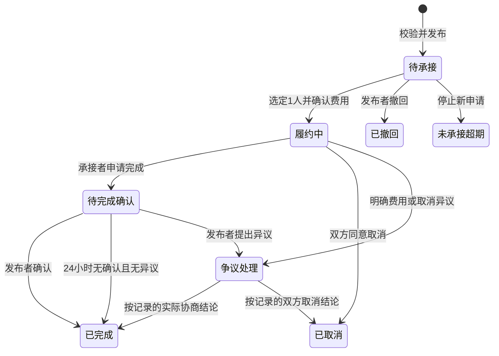
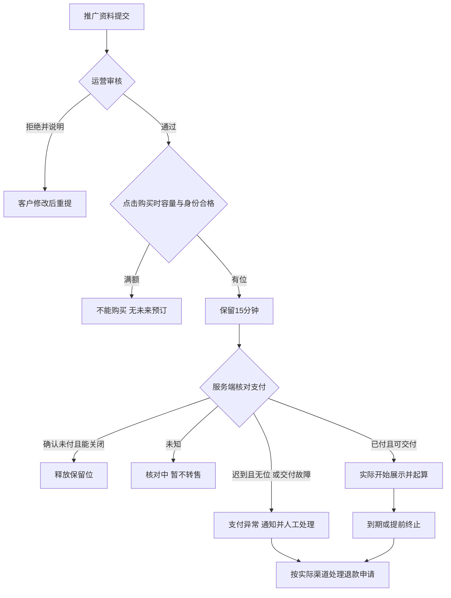

# 永兴乡镇生活服务微信小程序 PRD

版本：1.0
记录日期：2026-10-06（Asia/Shanghai）
需求状态：用户已明确回复“全A”，P01—P10的A及其附录已采纳，作为首期需求基线。
实施状态：仅完成需求文档；未编写产品代码，未开通服务、收集真实证件或执行真实支付。
上线状态：E01—E06外部条件尚未核实通过。需求确认不等于官方准入、服务开通或上线授权。

## 0. 阅读方式、依据与验证方案

本文是后续产品设计、开发拆解和验收的业务依据。[规划记录](miniapp-planning.md)保留历次决定与研究；[P01—P10确认记录](prd-preparation.md)保留原选项和本轮“全A”的确认。若历史记录的旧状态与本文不同，以本轮已确认决定为准，不恢复被撤销的住址、年龄标签、接单上限或免费推广体验。

本文的“必须/不得”是已确认要求；“尚未核实”仅用于明确的外部条件、实际经营资料与技术开通，不得被开发者默认为已经满足。未授权的新业务或新自动状态转换不能从功能名推导出来；若实现必须改变本文的费用、权限、范围或期限，先提交具体变更供用户确认并留痕。

验证分两层：
1. 本轮文档：逐条核对决定来源、P01—P10全A、字段/页面/通知/统计覆盖、状态转换与异常、权限和外部条件；验证UTF-8、链接、Git差异、提交范围及工作区状态。
2. 后续产品：按T01—T18执行行为验收，重点验证不同用户读取的真实响应、并发选人/占位、服务端计时、重复请求/回调、异常支付及跨用户越权。真实身份与支付开通条件未满足时只能验证受控测试场景，不能宣称生产验证通过。

本轮验证记录见[文档验证用例](planning-validation.md)。文档检查不能代替小程序运行、供应商接入或真实用户付费验证。

## 1. 问题与目标（Problem Statement）

用户希望为湖南省郴州市永兴县一个乡镇建立微信内生活服务入口，集中居民的维修求助、二手信息及日常跑腿需求，并允许普通居民同时发单与接单，减少对专职骑手招募的依赖。

用户本人晚间运营，固定伙伴白天值守；家里曾从事维修的长辈认识一些维修人员。维修人员数量、可提供的时段、跑腿供给和真实付费意愿没有调查结果，不据此推算用户数或收入。当地学校情况仅是历史背景，不形成校园业务或未满16岁接单功能。

目标是居民基本使用免费，服务人员基础展示免费，自愿购买明确标识的推广位置，为平台探索可持续收入。没有确认活跃人数、订单量、付费率、续购率或回本日期，本PRD不虚构商业成功阈值。

## 2. 解决方案与范围（Solution）

### 2.1 首期模块

| 编号 | 模块 | 必须交付的能力 | 业务边界 |
| --- | --- | --- | --- |
| M01 | 账号、身份与年龄 | 微信登录、昵称、手机号验证、姓名/身份证二要素、资格状态、核验失败说明 | 登录不等于实名；核验信息一致不证明实际操作者本人；不刷脸 |
| M02 | 维修求助 | 免费发布、搜索筛选、详情、联系申请、本人编辑/撤回/结束、历史 | 信息与联系流程，不增加维修报价/履约/平台支付订单 |
| M03 | 二手信息 | 免费发布、详情、联系申请、本人编辑/撤回、已售与历史 | 联系获准不等于成交，不托管二手款 |
| M04 | 跑腿 | 发布、多人申请报价、选1人、费用/任务变更、完成/取消/异议记录 | 用户即骑手，同时承接不限量，双方直接结算 |
| M05 | 免费服务目录 | 维修/跑腿服务资料、区域、时段、忙碌状态、联系申请 | 不额外逐人审批接单资格，营业执照选填 |
| M06 | 付费推广 | 各分类3位、审核、7/30天购买、15分钟保留、展示/到期、修改/终止、退款协助 | 仅在实际准入/支付获准后启用，不预订未来位置，不自动续购 |
| M07 | 搜索、私人工具与分享 | 收藏、草稿、地址簿、模板、再次发布、微信分享 | 私人数据不公开，不继承联系方式授权，不自动发布 |
| M08 | 通知、举报与运营 | 站内消息、有条件微信通知、举报/争议、整改/下架/限制/封禁、申诉、操作记录 | 两运营者同权；24小时首次回应不等于解决 |
| M09 | 核验标识与推广报表 | 限定核验说明，推广展示/详情/申请数量及有效期 | 不称平台担保，不展示访客身份，不把联系申请算成交 |

### 2.2 已纳入的8项扩展

| 编号 | 功能 | 不得省略的边界 | 对应模块 |
| --- | --- | --- | --- |
| R01 | 收藏信息/服务人员 | 仅本人可看，收藏不解码；失效对象显示失效 | M07 |
| R02 | 发布草稿 | 可半填保存，不进入公开搜索；明确提交前不发布，不绕过年龄 | M07 |
| R03 | 私人常用地址簿 | 可编辑/删除，不要求GPS，不作为首次发布资格；任务快照独立 | M07 |
| R04 | 模板/再次发布 | 重新确认当前地址、时间和价格；新编号、新申请、新授权 | M07 |
| R05 | 微信分享 | 仅公开标题/题图，不传完整联系、门牌、实名证件，不分享换奖励 | M07 |
| R06 | 服务时段/忙碌 | 只提示，不加接单并发上限，不取消订单或停止推广计时 | M05 |
| R07 | 限定核验标识 | 姓名/身份证信息一致的限定说明；执照仅提交不能标已认证 | M01/M05 |
| R08 | 推广效果报表 | 按S01—S04汇总本人推广期效果，不显示访客明细、不算成交 | M09 |

### 2.3 经营与资金边界

当前经营者为个人主体，最多注册个体工商户，不能注册公司。具体乡镇名、村/社区列表、营业执照、AppID、主体迁移/新建路线尚未确定。仅在微信生态经营，不增加独立公众网站或APP。

居民浏览、普通信息发布、服务目录基础展示免费。跑腿服务费、商品货款、打印/维修/洗护等门店费用由双方直接结算；平台不代收、不代结算、不抽跑腿佣金。平台自己的推广费按经微信确认适用的虚拟支付路线收取，与居民费用分开。

## 3. 用户故事（User Stories）

1. 作为访客，我希望无需登录就看维修、二手、跑腿及服务资料的公开内容，以了解本地需求。
2. 作为访客，我希望看到打码联系方式和粗略位置，以判断是否相关而不暴露对方私密资料。
3. 作为居民，我希望按关键词、业务分类和村/社区查找，以找到附近信息。
4. 作为用户，我希望微信登录和实名核验分别显示，以知道自己是否具备发布/接单资格。
5. 作为发布者，我希望首次需要发布资格时核验姓名和身份证，以按满16岁规则使用。
6. 作为承接者，我希望复用当前有效核验结果，以避免无理由重复核验收费。
7. 作为用户，我希望核验失败有明确状态，以更正资料而不被假标为已实名。
8. 作为未满16岁用户，我希望仍能浏览公开内容，同时不能发布或接单。
9. 作为居民，我希望首次维修/二手发布无需完整住址，以免为无关功能提供住所。
10. 作为维修求助者，我希望填写分类、说明、图片和粗略位置，以让合适人员发现需求。
11. 作为二手发布者，我希望填价格或面议，以表达售卖意向。
12. 作为普通发布者，我希望编辑/撤回自己的信息，以更新需求。
13. 作为二手发布者，我希望标已售并保存本人历史，以停止接受购买联系。
14. 作为发布者，我希望普通帖一直展示至主动结束，以免30天后无故消失。
15. 作为意向用户，我希望申请联系，以在对方同意后看到完整号码。
16. 作为发布者，我希望逐人同意多位联系人，以比较意向并控制资料提供。
17. 作为发布者，我希望拒绝或撤销联系权限，以处理不合适联系。
18. 作为用户，我希望号码变更使旧授权失效，以免旧对象自动获得新号码。
19. 作为跑腿用户，我希望同一账号既发单又接单，以在有空时帮助居民。
20. 作为跑腿发布者，我希望多人报价后选1人，以确定服务费与承接对象。
21. 作为申请者，我希望未被选中前改报价或撤回，以反映自身安排。
22. 作为承接者，我希望同时承接数量不限，以自主安排服务。
23. 作为发布者，我希望选人操作只能成功1次，以避免重复承接。
24. 作为双方，我希望正式承接后相互解码必要联系方式，以完成服务。
25. 作为承接者，我希望在承接前明确是否垫付及上限，以控制自愿垫资。
26. 作为发布者，我希望服务费与商品/门店费用分开，以明白需要支付的项目。
27. 作为双方，我希望修改地址/时间/物品/费用时明确同意并留版本，以防争议。
28. 作为承接者，我希望缺货/替代商品/超预算时先获同意，以免承担未约定支出。
29. 作为发布者，我希望未承接超期停止新申请、已承接超期只提醒，以避免系统擅自取消。
30. 作为承接者，我希望提交必填完成说明及可选凭据，以请求确认结果。
31. 作为发布者，我希望及时确认或提出异议，以控制完成状态。
32. 作为双方，我希望完成申请24小时无确认且无异议时自动完成，以避免无限等待。
33. 作为双方，我希望取消需要协商已发生费用，以免取消状态被误认为结清。
34. 作为争议当事人，我希望运营24小时内首次回应，以知道问题已有人处理。
35. 作为服务人员，我希望免费展示项目、区域、时段和忙碌状态，以被居民找到。
36. 作为服务人员，我希望营业执照可选填且标识如实，以免资料上传被误称认证。
37. 作为用户，我希望收藏、保存草稿和私人地址簿，以减少重复输入。
38. 作为用户，我希望模板/再次发布需要重新确认当前条件，以免复制旧地址或旧时间。
39. 作为用户，我希望分享公开卡片而不分享私密资料，以安全触达当地居民。
40. 作为服务人员，我希望自愿购买明确标识的7/30天推广，以让更多居民看到。
41. 作为推广客户，我希望先审后付、满额不能购买，以免买到没有位置的展示。
42. 作为推广客户，我希望从实际展示起算权益，以免等待支付/交付耗掉时间。
43. 作为推广客户，我希望查看支付异常、修改审核和到期状态，以了解权益是否有效。
44. 作为推广客户，我希望提前结束后按实际渠道申请退款，以处理未交付期间。
45. 作为iOS客户，我希望知道App Store退款机制，以免误以为平台能直接退款。
46. 作为推广客户，我希望看真实汇总效果，以评估续购，不把申请当成交。
47. 作为举报者，我希望登录提交原因和可选证据，以协助处置违规内容。
48. 作为受限制用户，我希望看到理由并申诉，以纠正错误处理。
49. 作为运营者，我希望处理审核、举报、订单争议、限制及支付异常并留记录，以交接和追踪。
50. 作为两位运营者，我们希望拥有相同全部后台权限，以按白天/晚间分工维护。
51. 作为平台经营者，我希望区分试价、毛收入和真实成本，以评估可持续经营。
52. 作为开发/验收人员，我希望每个权限和状态变化有明确预期，以避免自行猜业务。

## 4. 实施与业务决定（Implementation Decisions）

### 4.1 术语与角色

“信息”指普通维修/二手帖子；“联系授权”指某用户对某信息完整联系方式的可见许可；“跑腿需求”在选定1人并确认最终费后正式承接；“推广订单”只支付本平台展示权益；“已完成”只表述任务状态；“退款成功”只能由实际渠道最终结果确认。

角色是同一账号的能力，不另建互斥骑手账号：访客、已登录用户、符合身份/年龄资格的发布者、符合资格的申请者/承接者、免费服务资料所有者、推广购买者、运营者。用户能在不同任务中承担不同角色。

### 4.2 身份、年龄与手机号（ID01—ID10）

- ID01 发布、接单在首次需要对应资格时进行姓名＋身份证二要素，不做人脸核验。维修求助、二手发布、跑腿发单/接单都覆盖；普通浏览不要求提供身份证。
- ID02 年满16周岁才能发布/接单；未满16岁只浏览公开内容。不加公开年龄/生日标签，不恢复监护人代发流程。16—17岁普通业务流程同成年人，但具体适用条件须E02通过，不宣称其自动具完全民事行为能力。
- ID03 基于核验信息一致的证件所示出生日期计算年龄资格；核验接口没有出生日期返回时，不能虚构其返回年龄。二要素不证明操作者为证件本人或与微信实名一致；借证风险如实说明。
- ID04 同一账号1个当前有效身份，有效核验状态在发单/接单间复用，不无理由重复收费调用，不承诺永久有效。身份变更转人工处理，暂停新的发布/接单，不把旧身份订单/推广/徽章直接交给新身份。
- ID05 不一致、格式错误、无记录、供应商异常或不可用不记成功；依赖新核验的入口保持待核验，公开浏览继续可用；不能以自报生日、登录或号码验证放行。
- ID06 自有数据库不保存原始完整姓名/身份证号，不上传证件照片/人脸。保留受保护核验状态、时间、供应商凭据、年龄资格及证件去重标识；原始输入只用于经授权的必要核验传递，不写普通日志、分析报表、草稿、分享或运营日常界面。
- ID07 去重标识仍按个人信息保护，用于同一自然人同类最多1个推广位；不能把它当匿名公开标识。供应商留存、自有标识期限、注销/删除及必要保留记录必须按E03取得依据后明确，不能默填“永久”。
- ID08 联系电话必填，采用符合项目账号资格、经用户同意的微信手机号验证能力；微信号选填1—50字符、手工填写，不声称验证其归属。组件尚未开通；不自行追加短信采购或以手填号码替代已选择的验证要求。
- ID09 昵称必填1—20字符；营业执照接单侧选填，不因为没上传执照就增加本PRD没有批准的逐人资格审批。通过有效身份/年龄核实后按资格开通；实际业务法定准入条件仍由E01/E02验证。
- ID10 公开标识仅“姓名与身份证信息已核验”，不展示真实姓名/证件/生日，不称“本人刷脸认证”“平台担保”“服务质量保证”。执照仅上传标“已提交”；只有实际核查通过并说明范围才能给对应核验结论，身份失效及时撤下标识。

### 4.3 角色与数据可见性

| 数据/操作 | 公众及未获准用户 | 对应发布者/资料所有者 | 获准联系者/正式承接者 | 必要运营 |
| --- | --- | --- | --- | --- |
| 有效公开标题/说明/公开图片/村社区 | 可读 | 可读并编辑本人 | 可读 | 可读、按规则处置 |
| 打码电话/微信号 | 可读，登录不解码 | 管理本人字段 | 未获本对象授权前仍打码 | 仅处理必要联系事项 |
| 普通信息完整联系 | 不可读 | 本人可管理 | 仅该信息已获准对象可读 | 有处理必要时可读并留操作依据 |
| 跑腿正式承接双方完整联系 | 其他人不可读 | 作为当事人可读对方 | 仅该订单双方；履约/争议期间规则见CT09 | 骚扰/争议必要处理 |
| 跑腿取送详情/领取码/私密附件 | 候选、搜索、分享不可读 | 发布者可读 | 正式承接者可读 | 仅必要处置 |
| 姓名/完整证件 | 不公开，不在客户端业务响应 | 仅核验时输入，不建原证件查看页 | 不可读他人身份 | 无日常完整证件浏览入口 |
| 地址簿/草稿/收藏 | 不公开 | 仅本人读写 | 不因旧授权可读他人私人内容 | 无无关浏览权限 |
| 申请报价 | 不公开候选私密详情 | 对应跑腿发布者可读候选 | 本人申请；不能看其他候选私密信息 | 必要订单处理 |
| 支出/变更/完成凭据 | 不公开 | 对应任务当事人 | 对应任务当事人 | 必要争议处理 |
| 推广统计 | 不公开访客明细 | 本推广客户汇总可读 | 非本推广客户不可读 | 必要运营可读汇总 |
| 举报者/申诉资料 | 不向被举报人公开举报者身份 | 仅本人记录及允许的处理结果 | 不能窥见他人证据 | 处理必要信息、记录操作 |

读取、写入和图片/附件访问权限必须在服务端执行。禁止向未授权响应返回完整字段后仅在页面打码；私密文件链接不能成为无需授权的公开绕过入口。运营同权不代表可以无目的浏览敏感资料。

### 4.4 联系方式与授权（CT01—CT11）

- CT01 电话公开为前3位＋4个星号＋后4位；微信号保留首尾各1字符、中间统一4个星号，不足3字符全部打码。登录、收藏、分享不解码。
- CT02 电话/微信号只能写专用字段，正文和图片不得夹带。公开位置只村/社区或附近地标；首次发布不要求完整住址。任务必要详细地址按定向权限提供，不能进入卡片、列表、公开说明或报表。
- CT03 普通维修、二手、免费目录、推广：用户申请→所有者逐人同意→只该用户解码；可批准多人，不称已成交。不能向自己申请，不用证件资料作为同意联系的交换条件。
- CT04 每用户每信息最多1个待处理申请。重复提交返回现有状态，不新增申请或通知。拒绝、申请者撤回、所有者撤回已批准授权后，自该动作发生时起24小时可再申请；到时不自动申请。
- CT05 信息下架/撤回/结束/已售期间不能再申请，所有相关授权恢复打码；恢复展示也不恢复旧授权。
- CT06 修改电话/微信号撤销受影响信息已有授权、关闭待处理申请、通知相关用户；仅修改正文/图片/价格/粗略位置不撤销。目录与推广共用联系字段的影响范围见AD11。
- CT07 授权按“具体信息＋获准用户”生效，不跨服务人员，不由旧帖复制到新帖。历史已保存号码无法远程收回，界面与告知不得承诺远程删除。
- CT08 候选跑腿申请者无权看发布者完整联系或详细地址；正式选人和承接成功时双方相互解码，仅彼此可见。
- CT09 正式承接后的履约中/争议处理中不允许一般用户单方撤回该订单联系；完成、协商取消或争议关闭后恢复打码。此为P04A已批准的普通撤回例外，不能扩展到双方其他帖子。
- CT10 骚扰可举报。运营可为处置骚扰临时屏蔽联系，记录原因并通知另一方；不能将单方要求隐藏当作订单自动取消或免责。
- CT11 常用地址簿编辑/删除不改已承接任务的地址快照；已承接实际地址修改只能通过双方确认变更。详细地址及领取码不在站内通知正文/微信模板中发送。

普通联系状态：

| 当前状态 | 事件/角色 | 结果 | 全号码权限 |
| --- | --- | --- | --- |
| 无申请且无冷却 | 合格用户提交 | 待处理；通知所有者 | 无 |
| 待处理 | 重复提交 | 返回同一待处理申请 | 无 |
| 待处理 | 所有者同意 | 已授权；通知申请者 | 仅该对象 |
| 待处理 | 所有者拒绝/申请者撤回 | 结束申请，24小时冷却 | 无 |
| 已授权 | 所有者撤销 | 已撤销，24小时冷却并通知 | 恢复打码 |
| 待处理/已授权 | 联系字段变化 | 关闭待处理/撤销旧授权并通知 | 恢复打码 |
| 任意有效联系状态 | 信息结束/已售/下架/撤回 | 不再申请，权限失效 | 恢复打码 |

联系方式变更的重申请按信息当前有效性和冷却规则校验；不能自动替用户重新发起。

### 4.5 普通维修/二手及目录（POST01—POST08）

- POST01 表单/图片安全校验通过后自动公开，不逐帖人工预审；运营巡查/举报后处理。自动检测能力的资格/覆盖/费用在外部条件中核实，必要安全检测拒绝/不可用时不绕过，草稿可保留。
- POST02 普通维修/二手持续展示至本人撤回/结束、二手已售或运营下架；没有30天自动过期。
- POST03 本人可编辑/撤回维修及二手，维修可标结束，二手可标已售。已售退出在售，保留本人历史；旧分享不继续作为有效在售信息入口。
- POST04 信息仅用于展示与联系；没有维修/二手报价选择、验收付款、平台担保或完整交易订单。
- POST05 搜索公开标题/说明包含关键词，分类＋村/社区筛选共同生效；不搜索完整联系、私密地址、实名证件、草稿或退出公开列表对象。
- POST06 普通列表按首次发布时间倒序；编辑不自动置顶；每次20条继续加载。推广在独立顶部位置按AD规则，不能混成普通最新发布时间排序。
- POST07 免费目录需有效接单身份/年龄资格；名称、业务分类、服务项目、真实服务村/社区、联系电话必填，执照可选。首次提交/普通文案修改后展示，由巡查处理，不加逐人资格人工审批。
- POST08 免费文案和推广文案/图片独立；共用实时联系字段。免费资料撤下同时申请结束对应推广，按提前终止规则处理；到期仅撤付费位置，不撤仍有效免费资料。

### 4.6 跑腿范围、报价和支出（RUN01—RUN12）

允许任务：取快递及其他物品，送文件/生活物品，代买日用品/菜/饭，代打印/复印并送达，代送/取洗护物品，代送/取维修物品。禁止首期开放普通门店代排队/取号、烟酒、药品、代取现金；政务手续后置，不用“其他”任务绕过。

- RUN01 任务类型、标题、说明、村/社区、服务费预算、未来期望完成时间必填；实际取件步骤的地址、实际送件步骤的地址必填，代买内容/商品估算必填。不能使用默认账号住址替代未填写地址。
- RUN02 单需求申请总人数不设产品上限；同一用户仅1份有效申请，发布者不能接自己单。申请者被选中前可改报价/撤回，保留版本；不得因此添加1/3单同时承接上限。
- RUN03 发布者选当前有效申请，明确最终服务费、是否愿意垫付及最高金额；正式承接操作只能成功选1人，其他申请结束并通知。忙碌标记不自动撤销旧申请。
- RUN04 服务费、商品/门店费用、是否垫付/上限分开；金额是双方约定记录，不生成平台代收/结算余额。外部支出可由发布者直接付、预付给承接者或承接者自愿垫付，实际凭据结算。
- RUN05 承接前修改地址/时间/物品/预算/费用条件，原有效报价失效、保留历史并通知，允许重新申请。原报价不能自动等同同意新条件。
- RUN06 承接后地址、时间、物品或费用变更需双方明确确认，记录原值/新值/金额差/说明/发起者及同意时间。只允许1份待确认变更，同意前原版本有效，拒绝/撤回不改原版本。
- RUN07 缺货/替代商品、商家加价、额外运费/服务费、超垫付上限均先确认，未确认不增加支出；不回复不等于同意。不能协商则维持原约定，客观不能履行则协商取消/争议处理。
- RUN08 实际支出、退货安排、费用异议附双方说明及可选凭据；小程序不向商家退款、不代收差额、不向承接者转账。
- RUN09 收/发必要领取码仅任务必要对象可见；不收支付密码、银行卡密码/完整银行卡号。
- RUN10 发布者期望完成时间是申请入口期限与超时提醒依据；到期仍未承接停止新申请，已承接仅提醒，不自动取消或完成。不得把“停止申请”擅自扩成新自动付款、赔付或强制结案规则。
- RUN11 承接者提交完成说明必填、图片/凭据选填；发布者确认实际交付/结果。服务端从完成申请产生时起连续24小时内既未确认又无异议才自动完成，不从发布、期望时间、付款或午夜起算。
- RUN12 异议进入争议处理中并停止24小时自动完成计时。完成/取消/运营结案只改任务及协商记录，不证明线下款项结清。

跑腿履约状态与子记录：

| 状态/记录 | 进入条件 | 允许的已确认动作 | 禁止的自动结果 |
| --- | --- | --- | --- |
| 草稿 | 本人保存未完整表单 | 编辑、删除、校验后发布 | 自动发布/绕过年龄 |
| 待承接 | 合格用户提交有效需求 | 申请、更新/撤回报价、发布者修改/撤回、选定1人 | 代付/自动派单 |
| 未承接已超期 | 期望时间到且无正式承接 | 停止新申请，保留事实记录；本人可编辑/撤回 | 自动判已完成/已结清 |
| 履约中 | 选1人并确认最终费/垫付 | 双方沟通、变更请求、完成申请、取消协商、异议 | 因忙碌或超期自动取消 |
| 待发布者确认完成 | 承接者提交完成申请 | 发布者确认或明确异议；23小时提醒；满24小时按条件自动完成 | 有异议后自动完成 |
| 争议处理中 | 费用/完成/取消存在异议 | 运营首次回应、收集必要凭据、协助协商、记录处理结论 | 超时默认同意/代扣/司法裁判 |
| 已完成 | 发布者确认或满24小时无确认/异议 | 当事人查看必要历史，联系恢复打码 | 推定付款成功 |
| 已取消/已撤回 | 未承接本人撤回；承接后双方同意取消 | 保留费用协商记录及历史，联系恢复打码 | 推定支出已结清 |

变更请求、取消请求、费用协商作为履约的独立记录，分别保留待确认、同意、拒绝/撤回/争议结果，不因发起请求就覆盖原履约事实。取消只有双方确认后生效；不同意进入争议。有实际费用先协商，费用结果和取消结果分别记录，不设无人回应自动同意取消规则。

主流程图仅示已确认转换，不增加未批准的转换：

### 4.7 推广审核、占位、支付和展示（AD01—AD15）

| 配置 | 确认值 |
| --- | --- |
| 开放分类 | 维修、跑腿；二手不新增付费推广分类 |
| 每分类同时容量 | 3个固定同时展示位置 |
| 同一自然人同分类占位 | 同时最多1个，使用受保护身份去重，不靠换账号重复占位 |
| 7天套餐 | 9.9元，连续7×24小时 |
| 30天套餐 | 29.9元，连续30×24小时 |
| 初始免费体验 | 无；免费的是基础目录展示 |
| 审核 | 提交后24小时内给结果，先审后付 |
| 购买保留 | 审核通过后点击购买且有位时保留15分钟 |
| 起算 | 服务端确认支付且实际展示成功时 |
| 正常排序 | 本轮实际开始时间先开始排前；同时开始按内部唯一订单编号升序 |
| 到期/续购 | 到期撤付费位置，保留有效免费资料；手动重新审核/购买，建立新周期 |
| 广告标识 | 顶部位置明确“广告/推广”，不能伪成平台质量担保 |
| 满额 | 暂停新购买，空位再开放，无未来时段预订 |

- AD01 推广审核检查公开内容、电话/微信专用字段、业务范围、真实服务资料与所需资格；给通过/驳回及原因。申请通过不是已占位、已付费或展示开始。
- AD02 容量同时计算有效展示、未到期保留、仍占位的支付核对中、已付待启动且仍占位订单；并发购买/重复点击/重复通知不得超过3位或同人同类1位。
- AD03 客户支付前看到审核版本、期限、价格、容量规则、广告标识、实际起算及按渠道可履行退款条款并确认。实际通道未获准不提供真实付款入口。
- AD04 保留到期先核对支付状态：确认未付且能按实际通道关闭支付订单再释放；已付按AD06；支付未知或服务不可用显示核对中，暂不再出售该位置。关闭/查询接口须按真实通道文档核实，不猜名称/参数。
- AD05 客户端付款完成回调不足以确认收款；以服务端实际通道可核实结果确认。重复通知只更新原订单，不重复交付或开始新周期。
- AD06 迟到已付且仍有空位、无该人同类其他占位、审核内容仍有效时自动恢复并展示；无位、资格失效或交付故障进入支付异常，通知客户及必要运营，不开始展示计时，不静默预订未来位置，不要求重复付款。
- AD07 起算只在实际展示成功，结束时间＝开始时间＋购买周期；等待核对/未展示不倒扣权益。广告客户可以查看支付状态、实际起止、异常处理和退款进度。
- AD08 推广文案/图片修改提交新版本复审；待审原有效内容继续，通过后替换，不重置周期。驳回给原因，原有效内容保留，客户改后重提；不自动运营代改。
- AD09 客户可撤回待审修改，不影响原有效版本；到期时待审修改不得阻止撤下，之后通过也不复活已到期订单，重买须新周期。
- AD10 免费文案与广告文案/图片分开，免费文案改动不自动改广告，防止绕过推广审核。
- AD11 电话/微信号为服务人员目录及本人推广的共用实时字段；修改后立即撤销相关各处授权并显示新打码，不等待广告复审，不重置周期。这是P08A已批准的推广联系方式复审例外，不扩展到文案/图片。
- AD12 用户撤下免费服务资料时同时申请结束对应推广，记录实际停止展示时间，按退款规则处理；普通到期不撤有效免费资料。
- AD13 用户可主动申请提前结束，记录原因与实际停止时间，停止权益；不因为申请退款把已交付时间清零。
- AD14 运营下架违规广告记录事实/理由、停止时间并通知客户；退款单独处理，不能默认全部没收，不能伪报退款到账。
- AD15 周期到期按服务端时间不可再作为有效广告读取；后台定时任务延迟不能造成免费延长售卖或旧广告仍被返回。价格变更留版本，不修改已购买订单价格；第一版按试价，不在本轮更改真实收款配置。

推广状态分为相互关联且独立的记录，不能用1个“成功”覆盖全部：

| 记录 | 主要状态 | 关键转换/结果 |
| --- | --- | --- |
| 内容版本 | 草稿、待审、驳回、通过、撤回 | 审核只处理该版本，展示期间待审不覆盖原版本 |
| 购买/占位 | 待购买、保留待付、核对中、已付待启动、支付异常、结束 | 先有位才保留；未知不盲释放；付款迟到按AD06 |
| 付款 | 未确认、核对中、已确认付款 | 客户端不直接置已确认，重复结果幂等，金额/订单归属必须一致 |
| 展示权益 | 未开始、展示中、已到期、已终止 | 实际展示才起算，到期不复活，终止记录交付期间 |
| 修改版本 | 待审、通过、驳回、撤回 | 通过且原权益有效才替换，原周期不重置 |
| 退款 | 待处理、提交中、渠道处理中、成功、失败；iOS申请协助/已知结果 | 独立于付款/展示，不伪造渠道结果 |

图中到期不意味着每单自动产生退款；只有存在应处理的未交付/提前结束事项才走退款规则。到期正常完整交付仍只撤位。

### 4.8 提前终止与退款（RF01—RF08）

- RF01 普通支持开发者退款渠道：平台原因完全未开始展示且无法交付，申请全额退款；已经展示而提前终止，申请退未展示期间费用。
- RF02 拟退金额＝实际支付金额×未交付秒数÷购买周期秒数，向下取整到分，取值0至实际付款，累计退款不超实际付款。以实际停止时间和实际交付记录计算；停展前已交付期间不重复退款。
- RF03 平台故障造成的未交付期间由运营留依据计入；不能编造丢失时段或把记录未知直接当作全周期已交付。
- RF04 退款状态区分待处理、提交中、渠道处理中、成功、失败，记录原支付订单、申请原因、拟退金额、渠道及实际结果。失败通知原因并人工继续处理，重复提交不重复超额退款。
- RF05 iOS由用户在App Store申请、Apple决定；小程序提供规则说明与协助记录，不创建虚假的开发者退款任务，不保证同一比例退回或一定获准。
- RF06 普通渠道退款任务提交不等于成功，渠道处理中不能显示已到账。客户仅查看本人退款；运营看到处理必要信息。
- RF07 违规下架、争议及退款之间分别记录原因与结果，不预设“一概不退/全部没收”；适用法定义务和渠道条款必须在E04核实。
- RF08 售卖前展示实际可履行的条款；没有核实项目权益分类、退款能力或条款不能开放支付。9.9/29.9是已确认试价，不证明本地接受或支付资格已通过。

### 4.9 私人工具、分享、服务时段（TOOL01—TOOL08）

- TOOL01 收藏维修/二手及服务资料只本人可看，不公开收藏关系、不解码；对象无效时显示失效，不能从收藏访问旧私密内容。
- TOOL02 草稿允许字段不完整，明确点击保存；不进入公开列表/搜索，不自动发布或刷新。公开提交重新校验身份/年龄、字段、时限及安全规则。
- TOOL03 常用地址本人管理；联系人、电话、村社区、详细地址必填，最多1个默认地址，备注可选；不强制GPS，不作为浏览或首次发布资格。
- TOOL04 从地址簿选入任务形成该任务快照；编辑/删除地址簿不改既有任务。私密取送地址不是分享卡片字段。
- TOOL05 模板/再次发布创建新需求，不复用旧联系人授权/申请/推广周期；提交前本人重新确认当前地址/未来时间/费用与内容，不自动派单。
- TOOL06 分享只取公开标题/首张公开图片，无图用统一分类图；不取私密凭据、详细地址、完整联系、证件。接收者按当前信息状态与自身授权读取，旧卡片不提供永久权限。
- TOOL07 可服务时段为每周星期＋起止时间，多段可填，结束晚于开始，重叠合并；忙碌手动开关，默认否。
- TOOL08 忙碌/非服务时段只展示提示，不自动拒绝已有申请、不限制同时承接、不取消订单、不停广告计时，不承诺该时段一定接单。

### 4.10 举报、限制、申诉与运营（OPS01—OPS09）

- OPS01 举报需登录并选原因；普通补充/图片选填，“其他”须写说明。原因：疑似诈骗、虚假信息、违规内容、骚扰/隐私泄露、服务/费用争议、其他。
- OPS02 运营可下架、要求整改、限制发布/接单、封禁，必填理由；期限为1/3/7/30天或永久。操作记录操作者、时间、对象、前后状态、理由。
- OPS03 申诉说明必填，支持查看首次回应及处理记录；举报/争议/申诉24小时内首次回应，不保证24小时结案。
- OPS04 限制新发布/接单不自动取消旧订单，不阻止必要履约、双方取消协商、费用/完成异议、举报/申诉；封禁不得导致已付推广或旧订单没有处置记录。
- OPS05 两位运营者相同全部后台权限，不做管理员/普通运营分权；各自操作要能追溯，不默认共享同一无法追踪账号。
- OPS06 伙伴白天、用户晚间；确切时段/交接还需实际经营资料，不填成24小时值守。首次回应与解决时间分别记录，自动受理提示不能伪装运营实际回应。
- OPS07 推广审核从提交时起24小时给结果；独立于举报首次回应、跑腿完成24小时、冷却24小时和展示周期。
- OPS08 不向被举报人披露举报者身份；运营查看证据限处理必要用途，不给公众争议讨论页。
- OPS09 争议记录处理事实/沟通/实际协商结果；运营不代付、扣费或作司法裁判，无人回复不自动推定另一方同意赔付。

## 5. 页面与字段合同

以下F01—F12、V01—V16和共同格式已经用户P10A采纳。页面可以合并，不得省略操作/权限/状态；字段限制改变需留痕，涉及关键业务变更另确认。

### 5.1 字段 F01—F12

| 编号 | 对象 | 必填、选填及限制 | 行为与可见范围 |
| --- | --- | --- | --- |
| F01 | 账号资料 | 昵称必填1—20字符；联系电话须微信手机号验证；微信号选填1—50字符；姓名/身份证在首次资格核验时提供；接单营业执照选填，最多1张清晰图片 | 昵称公开；电话/微信按授权显示；姓名/证件不公开。执照图片仅本人及必要运营可看，公开只标“已提交”或实际核查后的限定结论 |
| F02 | 普通维修求助 | 标题1—30字符、说明1—1000字符、维修分类、村/社区必填；附近地标选填0—50字符；图片0—9张；不要求完整住址 | 发布后自动公开，不逐帖人工预审；本人编辑/撤回/标记结束；通知/授权按本文普通信息联系规则；列表持续至撤回/结束/运营下架 |
| F03 | 二手发布 | 标题1—30、说明1—1000、物品分类、村/社区必填；价格选“明确金额”或“面议”，金额须大于0且最多2位小数；图片0—9张、地标0—50选填 | 不做平台支付或成交担保；可编辑、撤回、标已售；已售退出在售并恢复打码，本人历史保留 |
| F04 | 跑腿需求 | 任务类型、标题1—30、说明1—1000、村/社区、服务费预算大于0/最多2位小数、未来期望完成时间必填；取件/送件类相应地址必填；代买必填购买内容及商品费用估算；附件0—9张 | 地址、领取码、非公开附件仅任务必要对象可见；公开内容不得夹带门牌/完整联系方式。期望时间以服务端提交校验为准，不因为保存草稿而绕过 |
| F05 | 跑腿申请/承接 | 报价大于0/最多2位小数、是否愿意垫付必填；愿垫付时最高金额大于0必填；说明0—300选填；正式承接需发布者确认最终费及垫付上限 | 候选只见公开需求/打码联系方式；每人1份有效申请，允许未选中前更新/撤回；发布者查看报价选1人；选人后其他申请结束 |
| F06 | 完成/取消/变更/异议 | 完成说明1—500必填、图片0—9选填；取消或异议说明1—500必填、附件0—9选填；任务变更需字段差异及费用差额，原因1—500 | 完成申请只由承接者发起，发布者确认/异议；取消双方确认；有实际费用时提交协商金额/凭据，不由平台转账 |
| F07 | 免费服务资料 | 展示名称1—30、维修或跑腿分类、服务项目1—500、至少1个真实服务村/社区、联系电话必填；图片0—9、服务时段及微信号选填，忙碌默认否 | 需已具备接单身份/年龄资格；首次提交及普通修改后展示，运营巡查；不增加逐人接单资格审批。撤下免费资料同时申请结束对应推广，按提前结束规则处理 |
| F08 | 推广资料/购买 | 分类、关联本人服务资料、标题1—30、文案1—500必填；图片0—3；选择7天9.9元或30天29.9元；支付前展示名额、广告标识、实际起算、退款条款并确认 | 只有审核通过版本可购买；无名额不能付款；状态含草稿、待审、驳回、通过待购、保留待付、核对中、已付待启动、展示中、到期、已终止、支付异常；付款/退款分别记录 |
| F09 | 私人地址簿 | 联系人1—20、联系电话11位数字、村/社区、详细地址1—200必填；备注0—100选填；默认地址最多1个 | 地址簿电话为任务收件联系方式，不声称已验证其控制权。只供本人管理，任务选用后形成快照，编辑/删除不篡改既有任务；不是首次发布资格 |
| F10 | 收藏/草稿/模板/分享 | 收藏对象为信息或服务资料；草稿允许字段不全，明确点击保存；再发布需重新确认内容/地址/费用/未来时间；分享题图取公开首图，没有图片使用统一分类图 | 收藏仅本人，失效对象显示失效且不能解码；草稿不公开、不自动发布；地址不随分享发送；再发布新编号/新申请/新授权，不继承旧联系人或推广位 |
| F11 | 时段/忙碌/核验标识 | 时段为每周星期＋开始/结束，结束须晚于开始；可填多段，重叠段合并；忙碌为开/关；核验标识仅“姓名与身份证信息已核验”，说明核验范围 | 用户手动设置；非可服务时段/忙碌只显示提示，不自动拒绝申请、不限制并发、不取消任务、不停止付费周期；核验状态失效同步撤下标识 |
| F12 | 举报/申诉/后台处置 | 举报原因必选：疑似诈骗、虚假信息、违规内容、骚扰/隐私泄露、服务/费用争议、其他；补充0—1000、图片0—9选填；选其他时说明必填。申诉说明1—1000必填；运营动作理由1—1000必填 | 需登录且不得窥见举报者资料；运营看必要详情。记录操作者、时间、对象、前后状态、理由；首次回应计时独立于结案。两位运营者权限相同 |

共同格式：
- 普通内容图片仅JPEG/PNG，单张不超过5MB；服务端检查实际类型与大小，上传失败保留已有表单、不误发帖。图片总数按各表指定。
- 本文字符长度指用户可见文本字符，不以中文UTF-8字节数计算；去除首尾空白后校验。价格上限为99,999.99元，仅为输入防误填，不表示适合本平台交易；不能输入负数、超过2位小数或货币表达式。
- 电话/微信号只在专用字段。文本识别明确电话/微信联系方式时提示移除；图片结合可用内容检测和巡查/举报处置，不承诺自动识别全部联系方式。官方检测资格、覆盖及调用费用上线前核实；必要检测拒绝或不可用时不绕过发布安全校验，草稿可保存。
- 列表每次20条、继续加载；普通信息按首次发布时间倒序，编辑不自动置顶。关键词为标题/公开说明的包含匹配，分类和村/社区筛选共同生效；不搜索私密地址、完整联系字段、身份资料、草稿或已退出公开列表对象。
- 分类先使用主业务维修/跑腿/二手及已确认任务模板，不凭空生成本地门店/村名。细分分类、模板显示名称及初始服务人员由运营依据真实资料配置；不可为空却默填虚假值。
- 私人常用地址、草稿、收藏仅本人读写；服务资料/推广仅本人或有处理必要的运营编辑，所有者不能修改别人内容。后台可以按职责查看争议所需记录，但无完整证件浏览入口。
- 未核验用户不能借草稿/再发布/分享/直接接口绕过发布与接单资格；未满16岁保留公开浏览。当前产品不设计监护人代发、未成年年龄公开标签或证件公开页。
- 账号停用、数据删除和供应商保存期限按外部核验表E03落实后写入最终隐私/数据清单；本PRD不自行填未经核实的法定年限。

取送私密地址与公开说明分开保存。打印/复印资料按已确认图片/描述入口与双方外部联系交接，本文未批准额外的PDF/Word通用文件上传或站内自由聊天。详细业务分类、真实区域、模板和初始服务人员只能用核实资料配置，不编造名称。

### 5.2 页面 V01—V16

| 编号 | 页面或页面组 | 主要入口、操作和权限 |
| --- | --- | --- |
| V01 | 首页/分类列表/搜索 | 所有人可看有效公开信息及打码联系；广告单独3位且标识清楚；分类/村筛选及关键词组合；不显示真实身份/详细地址 |
| V02 | 维修/二手详情 | 浏览公开资料；符合规则用户申请联系；本人编辑、撤回、结束/已售；分享/收藏不解码 |
| V03 | 跑腿详情及候选申请 | 公开需求及打码联系；符合接单资格者报价/撤回；发布者看候选列表和当前报价并选人，候选之间不看身份/私密地址 |
| V04 | 发布选择/业务表单/草稿 | 维修、二手、跑腿分别填写；存草稿/从模板填入/校验提交；首次发布不要求账号完整住址 |
| V05 | 登录/资料/核验状态 | 微信登录与核验分开显示；按P01/02采集授权与输入；明确失败原因可改资料，不把用户声明已实名视为成功 |
| V06 | 我的发布/发布历史 | 本人当前信息与结束历史；编辑/撤回/已售/再次发布；运营下架显示原因及申诉入口 |
| V07 | 我的跑腿及履约详情 | 本人发出、申请、承接订单；承接后私密任务快照、变更/支出记录、完成/取消/异议；非当事人无此权限 |
| V08 | 联系申请/已授权对象 | 本人收到/发出的联系申请；同意/拒绝/撤回/剩余重申请时间；授权变更清楚，跑腿正式承接后双方解码，履约/争议中不允许单方撤回 |
| V09 | 收藏/草稿/私人地址簿 | 仅本人管理；失效信息提示；编辑地址不篡改旧任务；删除对象需明确对象确认 |
| V10 | 我的服务资料/时段/忙碌 | 本人创建/修改/撤下，选择真实服务区域，核验标识有说明；免费文案与推广文案独立、联系方式共用 |
| V11 | 推广提交/审核结果/购买 | 本人查看版本/驳回理由/撤回修改/7或30天选择/可购容量；支付入口前展示费用与退款规则 |
| V12 | 推广订单/支付异常/退款协助 | 本人查付款、实际展示起止、到期/终止、渠道退款状态；未知付款显示核对中；iOS提示App Store申请规则 |
| V13 | 推广效果报表 | 仅本推广客户及必要运营查看本人汇总；总量/按日/周期起止，无访客手机号、实名或个人明细 |
| V14 | 站内消息/举报/申诉 | 本人接收通知、提交证据、查看首次回应及处理记录；无自由聊天或公开评论 |
| V15 | 运营审核/举报/争议/限制 | 两位运营者同权；按队列处理、记录原因、必要证据、首次回应及状态；动作不代表资金已结算 |
| V16 | 运营分类/区域/推广异常/操作记录 | 配置真实分类/村社区、核对占位及异常支付、按本文退款规则协助；价格改动留版本且不改旧订单价格，收款配置不在本轮实际执行 |

本表是功能页面，不规定必须有16个独立路由。后续可以合并同类界面，但不得省略权限、字段或操作；合并不构成业务范围变化。

## 6. 通知与计时

### 6.1 通知 N01—N06

| 编号 | 触发事件 | 接收对象及内容边界 |
| --- | --- | --- |
| N01 | 联系申请/同意/拒绝/撤销/冷却结束 | 对应申请者或发布者；显示信息标题及状态，不在消息正文发送完整电话/证件/地址。冷却结束不再次自动申请 |
| N02 | 申请报价变更/撤回/选中/未选中/未承接超期 | 相关发布者/申请者；选中后去订单内看私密资料，其他人不得收到该资料 |
| N03 | 任务变更/支出请求/完成申请/异议/取消 | 对应双方；每个状态事件产生1条站内通知，重复请求不重复；完成申请给发布者，计时仍按服务端原事件 |
| N04 | 已承接超期/完成自动确认 | 已承接超期双方各1次；完成申请后第23小时仍待确认且无异议时提醒发布者1次，第24小时按原规则完成并通知双方 |
| N05 | 推广审核/支付状态/异常/上架/修改/到期/终止/退款变化 | 仅客户及需处理的运营；到期前24小时提醒1次，不自动续购；不把退款申请通知写成已到账 |
| N06 | 举报/申诉受理、首次回应及处置 | 提交者及受影响账号按需接收，不将举报者身份公开给被举报人；争议通知相关双方，不承诺处理结果获双方认可 |

站内通知为主；微信通知只在具备资格、模板支持且用户授权时尝试。发送失败记录并保留站内通知，不回滚订单、不延迟到期、不重复扣款。不能要求每个事件均获微信模板批准。

### 6.2 不得混用的计时

| 事件 | 起点 | 期限/提醒 | 结果 |
| --- | --- | --- | --- |
| 联系拒绝/申请撤回/授权撤回 | 对应动作实际时间 | 24小时后 | 可重新申请，非自动申请 |
| 推广审核 | 本次版本提交时间 | 24小时内 | 给审核结果，非已付/已展示 |
| 举报/订单争议/申诉 | 提交记录实际时间 | 24小时内首次回应 | 不保证同期解决 |
| 未承接跑腿 | 必填期望完成时间 | 到该时间 | 停止新申请，不判已完成 |
| 已承接超期 | 期望完成时间 | 双方各提醒1次 | 不自动取消/完成 |
| 完成确认 | 承接者完成申请产生时间 | 第23小时提醒；第24小时按条件 | 无确认且无异议才自动完成 |
| 推广保留 | 有位时点击购买产生保留 | 15分钟 | 先核实支付再按规则释放/异常 |
| 推广权益 | 真正成功开始展示 | 7×24小时/30×24小时 | 到期退出付费位置，不自动续购 |
| 推广到期提醒 | 实际到期时间 | 前24小时提醒1次 | 不扣款、不预订 |
| 统计自然日 | Asia/Shanghai日期 | 当日去重，日结束后24小时内删除临时标识 | 不伪称跨设备唯一人数 |

服务端时间是状态依据。客户端时钟变化、退后台、网络断开或通知失败不能延长保留/周期、篡改完成起点或重复扣款。

## 7. 推广报表口径

用户P10A已确认以下统计规则：
- S01 展示次数：广告卡片在前台列表进入可视区域至少1秒记1次；同一用户/同一推广/同一自然日最多计1次。登录使用账号匿名化计数标识；未登录仅用必要临时访问标识去重，不能宣称跨设备唯一人数。
- S02 详情访问：从该广告卡片进入其公开详情记1次；同一计数标识/同一推广/自然日最多1次；通过普通目录、收藏、分享打开不伪计为广告点击。
- S03 联系申请：从该推广入口提交成功的新联系申请数；重复提交现有待处理申请不计；拒绝后按冷却重新有效申请属于新事件。报表标“申请次数”，不标“成交人数/成交额”。
- S04 客户本人及运营测试访问不计；只统计实际展示期事件。按当日和整个周期汇总，历史周期分开；不曝光查看者明细。临时去重标识最长保留至当日结束后24小时，日汇总只保留数量；仍须在隐私说明中如实说明计数方式并核实平台规定。

客户端报送必须与当前有效推广及实际前台展示相符；不得按接口请求量编造曝光，不承诺能完全识别每个跨设备访客。报表无成交数/成交额栏目；实际线下交易不在本PRD内追踪。

## 8. 逻辑数据对象与实现边界

| 逻辑对象 | 必须承载的事实 | 不得混入的内容 |
| --- | --- | --- |
| 账号与资格 | 登录主体、昵称/验证手机号、受保护核验状态/凭据/年龄资格/去重标识 | 原始完整证件/人脸、自动当成微信实名 |
| 公开信息 | 所有者、业务/村分类、标题/说明/公开图、联系字段、首次发布时间、当前状态 | 详细任务地址/私密证据、完整联系给未获准对象 |
| 联系申请/授权 | 信息＋申请者、待处理/同意/拒绝/撤回、冷却起点、授权失效记录 | 全局永久授权、分享继承权限 |
| 跑腿任务及申请 | 当前版本、私密取送快照、期望时间、各人报价版本、唯一正式承接者 | 平台收款余额、多个正式承接者 |
| 履约子记录 | 任务/费用变更、双方同意、支出凭据、完成申请时间、取消/异议/协商结论 | 线下付款自动核实、平台扣款 |
| 服务资料 | 免费文案、区域/时段/忙碌、共用验证联系方式、核验标识 | 仅上传即资质认证、质量担保 |
| 推广内容与权益 | 审核版本、分类/主体、占位、实际起止/终止、排序、修改记录 | 候选新周期覆盖旧周期、未来隐式预订 |
| 支付/退款 | 官方可核实状态、原订单、金额/币种、异常、退款请求/最终结果 | 客户端成功即收款成功、iOS伪开发者退款 |
| 私人工具 | 收藏、草稿、地址簿、模板复制后新对象 | 公开草稿、改地址簿篡改旧任务 |
| 通知/运营/统计 | 幂等事件、必要处理事实、审计原因、日汇总、有限去重标识 | 举报者身份公开、访客明细/成交虚构 |

上表是业务事实合同，未选数据库、云平台、SDK、接口地址、任务调度方案或部署框架。不允许把逻辑对象名称伪装为已经存在的服务接口。具体接入应先查官方资料，满足真实权限和隐私条件后设计，不新增与既有能力重复的接口。

必须守住：服务端权限、并发只能选1人/容量不超3、同人同类1位、相同请求/回调幂等、状态与版本留痕、客户端不能改价格/身份/他人订单。备份、恢复、日志期限、监控阈值等随E03/E06技术核实明确，不能自行定为永久或承诺无依据的可用性百分比。

## 9. 功能测试与验收（Testing Decisions）

优先从可观察行为验证：不同角色看到什么、允许哪些操作、数据和计时怎样变化；不要只写与代码逐行相同的测试。当前项目只有规划文档，没有可以复用的小程序代码/测试模块，不假称已有集成测试通过。

测试覆盖身份/权限、公开信息、联系申请、任务报价及履约、推广容量/支付/修改/退款、私人工具、统计、通知和运营。敏感权限要检查真实响应及附件访问，不只看页面。并发/幂等应同时使用不同账号和重复事件；支付失败/未知/迟到、供应商不可用应有受控场景；用可控制时间验证15分钟/23小时/24小时/7天/30天，避免用真实长时间等待代替边界测试。

这些是后续开发必须验证的功能场景，本轮没有运行小程序。每个场景的前置身份按本文核验规则及真实服务条件设置。

| 编号 | 输入或事件 | 应观察到的结果 |
| --- | --- | --- |
| T01 | 未登录、已登录未获授权访问同一信息 | 均返回打码联系方式，响应中不存在完整电话/微信号/详细地址/实名证件 |
| T02 | A申请获准、B未获准；随后撤销A权限 | 仅A获完整联系；B仍打码；撤销后A再次读取打码；不声称清除已保存截图 |
| T03 | 联系方式修改/正文修改/信息撤回或已售 | 修改联系方式撤销授权并关闭待处理申请，其他公开字段编辑不撤销；信息结束恢复打码；已售退出在售，历史可由本人看，旧分享不再显示有效详情 |
| T04 | 15岁、16岁、17岁以及供应商失败/未知身份 | 未满16不发布/接单；16—17只有满足已核实条件才开放；失败/未知不假报实名成功，不绕过年龄；浏览仍可用 |
| T05 | 没填完整住址首次发布维修/二手 | 不因缺少住址拒绝；任务实际取送字段仍按对应模板校验 |
| T06 | 多人申请、重复申请、发布者自接、并发选两人 | 同人不产生多份有效申请，禁止自接，并发选人只有1人成功；同时多单承接不加1/3单上限 |
| T07 | 承接前重大修改、承接后费用增加或替代商品 | 承接前重大修改使原报价失效并允许重申；承接后双方明确同意才生效；未同意不能把新费用记为既成约定 |
| T08 | 未承接超期、已承接超期、完成申请后无异议24小时 | 未承接停止新申请；已承接仅提醒；只有完成申请满24小时且无确认/异议才自动完成 |
| T09 | 完成申请后第23小时59分提出异议；协商取消有已发生费用 | 自动完成被阻止并进入争议；取消须双方确认，状态不把费用写为已结清 |
| T10 | 正式承接后撤回联系、取消/完成/争议关闭 | 承接双方相互解码，履约/争议中不允许单方撤回，结束后恢复打码；不影响其他信息；结束后恢复打码不清除必要任务记录 |
| T11 | 同类3个名额含保留位；两客户并发购最后1位 | 不超过3；无位不能付款；同一自然人同类只有1位，预订未来时段入口不存在 |
| T12 | 15分钟到期且支付未知/通知迟到/重复回调/已付未显示 | 先核对不盲释放；有名额且符合条件自动恢复，否则通知并交运营异常处理；只启动1周期，不倒扣等待时间，不静默未来排期；异常有可查记录 |
| T13 | 广告修改待审/驳回/撤回/审核通过前已到期 | 原有效内容保留且期不重置；驳回有原因；到期即撤下，修改通过不复活已到期周期 |
| T14 | 免费目录修改和电话变更、推广提前结束、iOS退款请求 | 免费与广告文案独立/联系共用；提前结束按未交付期间计算普通渠道退款申请；身份/联系变化不能保留错误授权；退款状态不伪报成功，iOS不调用开发者主动退款 |
| T15 | 保存半填草稿/收藏/再发布/分享/地址簿删改 | 草稿不公开，收藏不解码，新帖不继承权限，分享无私密字段，已承接任务地址不被地址簿改动篡改 |
| T16 | 服务人员设忙碌或不在时段；执照仅上传 | 原订单和推广周期继续；无新增并发上限；执照仅标“已提交”，核验标识不称担保 |
| T17 | 广告重复曝光/普通目录进入/重复联系申请/运营测试 | 按S01—S04计数，普通访问不伪记广告点击，重复待处理申请不计，报表无个人明细且不叫成交 |
| T18 | 限制新发布/接单、举报/申诉、微信通知失败 | 既有履约/取消/异议/申诉入口仍可用；记录原因与操作；24小时首次回应独立于结案；微信失败不改变订单/付款状态 |

验收材料必须记录场景、前置账号资格、操作/事件、实际结果、失败处理及复验结果。没有满足E02/E04的项目实测不能写为“身份/支付生产验收通过”；不得使用真实证件测试或真实付款而未获对应授权。

## 10. 外部条件及启用门槛

E01—E06尚未核实通过。业务需求可以作为后续开发依据；受阻能力不得用伪数据或绕过准入的实现启用。责任分工：助手整理官方规则/接入证据及可审阅方案；经营者提供真实主体/区域/运营资料并作经营决策；监管、微信、供应商就其职责提供实际结论。对外发送咨询、注册、采购、真实核验/支付与上线须有相应授权，本轮不执行。

| 编号 | 必须取得的证据/资料 | 尚缺时受阻范围 | 解除条件 |
| --- | --- | --- | --- |
| E01 | 本项目个体工商户、多提供者跑腿、UGC及推广真实模式的主体/类目/许可材料要求 | 全功能商业上线，不能套个人维修类目 | 获得针对真实模式的明确依据，实际主体与后台类目/材料相符 |
| E02 | 二要素服务对该主体/业务/16—17岁支持、合法年龄判断/未成年保护条件、手机号组件和微信通知权限 | 新真实核验、相关身份/年龄权限、手机号/微信通知通道 | 实际服务开通与适用条件确认，不能凭文档存在假称获权限 |
| E03 | 逐类处理目的/字段/提供对象/访问、供应商留存、自有状态与去重标识期限、注销/删除与依法需留范围、最终隐私/授权文本 | 真实证件收集及生产个人信息处理；未定期限不能交开发者猜 | 写出具体期限/删除触发/保留依据、授权与权限后并经确认；无原证件存储符合本文 |
| E04 | 本项目权益分类、虚拟支付权限/费率、查询/关闭/通知/退款能力、iOS条款、售卖退款说明 | 真实购买/收款/退款接入启用 | 获得本项目实际适用规则并验证可履行交付/退款，不伪造iOS开发者退款 |
| E05 | 真正乡镇/村社区、初始服务资料、值守/交接、供需和购买意愿、认证/主体最终费用、资源用量、预算 | 无真实配置不能正式经营；预算/试运营评估未通过 | 使用实际资料配置，费用/用量可核，经营者确认预算与试运营指标 |
| E06 | 技术部署、备份/恢复、实际所需域名/备案、安全与故障验证 | 对应技术采购、生产部署、恢复能力声明 | 形成可审阅技术方案并通过需要的实际检查，另有实施/上线授权 |

已有研究边界与来源（2026-10-06本项目此前已核；本轮不将其升级为项目正式许可）：
- 微信小程序实名验证处于灰度、暂未开放；因此本次已选独立二要素，而不是承诺可查询微信实名。[微信支付实名验证](https://pay.wechatpay.cn/doc/v2/merchant/4011987263)
- 微信登录只提供登录态，手机号能力不提供姓名/证件/年龄；手机号快速验证当前标准每次成功0.03元，账号适用资格仍需满足。[微信登录](https://developers.weixin.qq.com/miniprogram/dev/api/open-api/login/wx.login.html)、[手机号能力](https://developers.weixin.qq.com/miniprogram/dev/framework/open-ability/getPhoneNumber.html)
- 二要素核对姓名/身份证真实性及一致性，不返回生日，不证明操作者本人；服务开通与16—17岁支持未获本项目结论。[腾讯云二要素接口](https://cloud.tencent.com/document/product/1007/33188)、[接入条件](https://cloud.tencent.com/document/product/1007/45893)
- 微信类目要求与湖南依托微信经营的说明需按真实模式核验，不能从一般说明推断本项目已经免证或过审。[微信类目](https://developers.weixin.qq.com/miniprogram/product/material.html)、[湖南通信管理局说明](https://hunca.miit.gov.cn/bsfw/bszn/art/2025/art_45d6faf9fa014557a8627f3b466caf8a.html)
- iOS不支持开发者主动退款，用户App Store申请由Apple决定；普通任务提交不等于退款成功。[微信虚拟支付](https://developers.weixin.qq.com/miniprogram/dev/platform-capabilities/business-capabilities/virtual-payment.html)
- 现行实名要求不意味着所有场景必须用身份证，姓名/身份证是本次产品选择；16—17岁适用义务与最小必要/授权仍需落实。[移动互联网应用程序规定](https://www.cac.gov.cn/2022-06/14/c_1656821626455324.htm)、[未成年人网络保护条例](https://www.cac.gov.cn/2023-10/24/c_1699806932316206.htm)、[个人信息保护法](https://www.cac.gov.cn/2021-08/20/c_1631050028355286.htm)

## 11. 收费、成本及试运营记录

只确认9.9元/7天、29.9元/30天试价，并非本地市场最优价或实际收费结果。居民基本功能免费、目录基础免费、推广自愿购买，不加免费推广体验。推广效果按S01—S04反馈，不承诺成交。

维修与跑腿共6位若全部售出30天套餐，一期毛收入6×29.9＝179.4元，未扣认证、核验、云资源、支付费用、税费或运营投入；不是利润或其他销售组合收入上限。后续真实支付/续购/维护工时及服务成本用于评估，未设无证据目标值。

此前取得的候选价格，不能据此自动采购或选择架构：
- CloudBase个人版19.9元/月限时、40,000资源点；标准版199元/月、330,000资源点。规格适用性与超额/备份仍未验证。[官方价格](https://cloudbase.cloud.tencent.com/pricing)、[资源点规则](https://cloud.tencent.com/document/product/876/136006)
- 二要素新开通日结后付费0.30元/计费调用，信息不一致等计费依官方返回规则；不是成功用户人数×固定单价。[核验价格](https://cloud.tencent.com/document/product/1007/84321)
- 手机号成功调用0.03元与二要素是不同产品，按真实调用分别核算；体验额度不当长期免费。
- 虚拟支付此前核到相关类目Android/鸿蒙/Windows当前1%/标准10%，iOS当前12%/标准17%；本项目实际类目/费率未确认，不保证优惠长期。iOS通常按自然月结束后45—60天结算机制，不写成每笔支付后固定到账。[虚拟支付费率](https://developers.weixin.qq.com/miniprogram/dev/platform-capabilities/business-capabilities/virtual-payment/devplan.html)、[结算说明](https://developers.weixin.qq.com/miniprogram/dev/platform-capabilities/business-capabilities/virtual-payment.html)
- 微信认证/主体路线最终费、通知/安全检测/存储/流量/备份、真实用量及预算没有项目最终数据，不套其他主体报价、不填0元。人脸/三要素历史候选不纳入当前选择。

预算按用户决定先核费用再定；构成＝实际基础套餐＋超额/必要资源＋实际计费核验/手机号调用＋支付收入×实际费率＋认证等固定费＋用户确认纳入运营成本。预付资源/年费的现金支出与按月摊销/实际消耗分开，不编造平台固定月总价。

## 12. 首期之外（Out of Scope）

招聘及相关资质核验；普通门店代排队/取号；政务代办；烟酒/药品/现金代取；未满16岁发布/接单及年龄标签/监护人代发；人脸核验；跑腿平台代收结算/抽佣；维修/二手完整交易付款系统；公众论坛/自由聊天/评论评分；门店赞助、内容制作服务、流量主广告；推广免费体验/自动续购/未来时段预订/同人同类多位；额外PDF/Word通用上传；独立公众网站/APP。

这些事项没有因“全A”自动获准。后续新增需说明范围、主体/类目/成本/运营影响，明确确认后更新PRD与验收，不提前写入首期接口或收费。

## 13. 决定追踪、交付与变更（Further Notes）

| 本轮决定 | 实际选择与结果 | PRD落点 | 验收 |
| --- | --- | --- | --- |
| P01 | A，发单/接单二要素复用，不刷脸，姓名证件不公开，落实证件年龄 | ID01—ID07，E02/E03 | T04/T05 |
| P02 | A，微信验证电话必填，微信号选填，固定打码 | ID08，CT01，F01 | T01/T02 |
| P03 | A，单个待处理申请、24小时冷却，改联系方式撤授权，正文等不撤 | CT03—CT07，普通联系状态表 | T02/T03 |
| P04 | A，正式承接双向联系、履约/争议禁止单方撤，结束恢复打码 | CT08—CT11 | T10 |
| P05 | A，任务修改/报价失效、双方确认变更、代购异常先同意 | RUN02—RUN09 | T06/T07/T09 |
| P06 | A，先核支付，有位且合格自动恢复，其他异常人工处理 | AD02—AD07 | T11/T12 |
| P07 | A，提前终止，普通渠道按未交付期间申请退款，iOS走Apple | RF01—RF08 | T14 |
| P08 | A，免费/广告文案独立、联系共用并即时更新为复审例外 | POST08，AD08—AD14 | T13/T14 |
| P09 | A，1/3/7/30天或永久，理由/申诉/记录，保留旧履约入口 | OPS01—OPS09 | T18 |
| P10 | A，全部具体字段/页面/通知/统计/验收 | F01—F12，V01—V16，N01—N06，S01—S04，T01—T18 | T01—T18 |

历史关键来源：第27项的普通帖持续展示、接单不限量等；第28项/C01—C10的试价、无免费体验、搜索/时限/通知、24小时首次回应及两人同权；第29—31项的不刷脸、接单二要素、取消首发完整住址、R01—R08；第32项/P01—P10全A补充发单二要素及收尾细节。保留原选项与原回复，不把未采纳B混入当前要求。

本版可以作为后续需求拆解/技术方案的输入；没有自动授权代码实现、安装依赖、主体注册、对外咨询、采购、真实证件/支付或上线。正式实现时仍需满足相应外部条件并获得任务授权。

业务范围/关键字段/费用/权限/状态/验收改变，要记录变更原因、用户明确决定、受影响编号及对应验收更新；每次项目改动完成验证并创建独立Git提交。本PRD不承诺一次通过微信审核。
